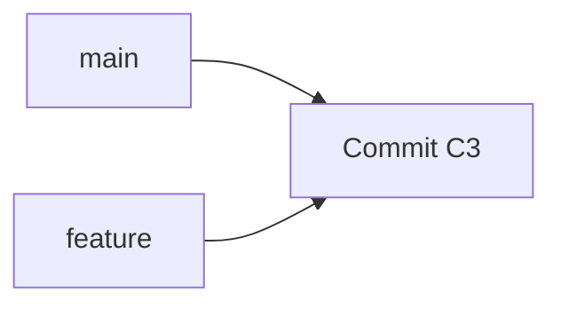

## Git Branch

Branch là một **reference trỏ tới commit**. Tạo branch không copy source code.



```bash
git branch feature
```

```quiz
git-branch-01 | single_choice | Khi chạy `git branch feature`, điều gì xảy ra? | Copy toàn bộ source code | Copy toàn bộ commit history | Tạo reference mới trỏ tới current commit | Tạo Tree mới | 3 | Branch chỉ là một reference trỏ tới commit.
git-branch-02 | single_choice | Vì sao tạo branch rất nhanh? | Vì Git chỉ chạy trong RAM | Vì branch chỉ là một pointer nhỏ | Vì Git bỏ qua commit history | Vì Git không dùng object store | 2 | Git không cần copy Blob, Tree hay Commit khi tạo branch.
git-branch-03 | single_choice | Nếu `main → C2`, sau khi tạo branch `feature` thì trạng thái nào đúng? | `main → C2`, `feature → C2` | `main → C2`, `feature → C3` | `main → feature → C2` | `feature` chưa trỏ tới commit nào | 1 | Branch mới mặc định trỏ tới commit hiện tại.
```

### Tiếp tục học
Bạn có thể quay lại câu trước; lựa chọn vẫn được giữ nguyên.
