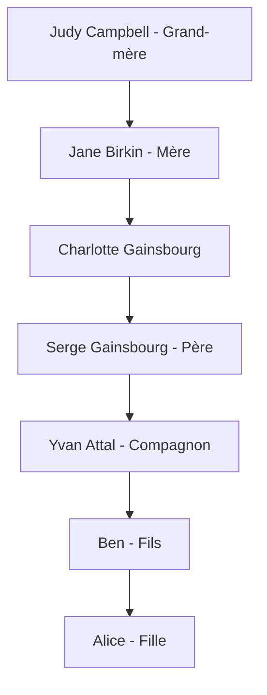

# Unité 1 — Leçon 2 : De mère en fille

**TL;DR:** Giới thiệu gia đình, nói về hành động vừa xảy ra với `venir de`, dự định với `aller` và diễn đạt toàn bộ bằng `tout`, `toute`, `tous`, `toutes`.

## Mục tiêu học tập

- Giới thiệu thành viên và mối quan hệ gia đình.
- Diễn đạt hành động vừa xảy ra và sắp xảy ra.
- Phân biệt présent, passé récent và futur proche.
- Sử dụng và phát âm đúng bốn dạng của tout.

## Bối cảnh — Une famille d'artistes

Charlotte Gainsbourg xuất thân từ một gia đình nghệ sĩ. Hãy tưởng tượng Charlotte đang trò chuyện với một người bạn về gia đình, những việc cô vừa làm và những dự định sắp tới.

## 2.1. La famille — Gia đình

Charlotte giới thiệu các thành viên trong gia đình.

**Charlotte est la fille de Jane Birkin.**

Charlotte là con gái của Jane Birkin.

**Elle a deux sœurs, Kate et Lou.**

Cô ấy có hai chị em gái.

**Elle a deux enfants : un fils et une fille.**

Cô ấy có hai người con: một con trai và một con gái.

### Từ vựng

| Tiếng Pháp | Nghĩa |
| --- | --- |
| les parents | Cha mẹ |
| le père / la mère | Cha / mẹ |
| le frère / la sœur | Anh em trai / chị em gái |
| le mari / la femme | Chồng / vợ |
| le fils / la fille | Con trai / con gái |
| les enfants | Các con |
| le grand-père / la grand-mère | Ông / bà |
| l'oncle / la tante | Chú, bác trai / cô, dì |
| les cousins | Anh chị em họ |
| les jumeaux | Cặp sinh đôi |



Sơ đồ dựa trên thông tin gia đình trong tài liệu ngày 15/12/2006, không phải thông tin cập nhật hiện tại.

### Quy tắc

Dùng `être` để giới thiệu mối quan hệ và `avoir` để nói mình có những thành viên nào.

**C'est ma sœur.**

Đây là chị/em gái của tôi.

**J'ai deux enfants.**

Tôi có hai người con.

**Phát âm:**

- sœur /sœʁ/: chị/em gái.
- fils /fis/: con trai, âm s cuối được phát âm.
- fille /fij/: con gái.
- jumeaux /ʒymo/: cặp sinh đôi, âm x cuối câm.

### Mini Quiz

```quiz-deck
L02-01 | single_choice | Jane Birkin est la ___ de Charlotte. | sœur | mère | fille | tante | 2 | Mère nghĩa là mẹ.
L02-02 | single_choice | La sœur de ma mère est ma ___. | fille | mère | grand-mère | tante | 4 | Chị hoặc em gái của mẹ là dì hoặc bác gái.
L02-03 | single_choice | Ben est le ___ de Charlotte. | fils | frère | père | mari | 1 | Fils nghĩa là con trai.
L02-04 | word_order | Cô ấy có hai người con. | enfants / deux / Elle / a | Elle a deux enfants. | Avoir dùng để nói mình có con.
L02-05 | word_order | Đây là chị gái của tôi. | sœur / ma / C'est | C'est ma sœur. | C'est dùng để giới thiệu.
```

## 2.2. Passé récent — Hành động vừa xảy ra

Người bạn hỏi Charlotte gần đây đã làm gì.

**Je viens de revoir ce film.**

Tôi vừa xem lại bộ phim này.

**Elle vient de sortir un album.**

Cô ấy vừa phát hành một album.

**Nous venons de faire les courses.**

Chúng tôi vừa đi mua sắm.

### Quy tắc

Passé récent diễn tả hành động vừa mới xảy ra.

**Chủ ngữ + venir (présent) + de/d' + infinitif**

| Chủ ngữ | Venir |
| --- | --- |
| Je | viens |
| Tu | viens |
| Il / Elle | vient |
| Nous | venons |
| Vous | venez |
| Ils / Elles | viennent |

```visual-timeline
title: Passé récent
Vừa xong | Je viens de manger. | Tôi vừa ăn xong.
Bây giờ | Maintenant | Thời điểm đang nói.
```

Chỉ chia venir. Động từ chính giữ nguyên mẫu.

Dùng d' trước nguyên âm hoặc h câm.

**Il vient d'acheter un cadeau.**

Anh ấy vừa mua một món quà.

**Phát âm:**

- viens /vjɛ̃/ và vient /vjɛ̃/: âm s, t cuối câm.
- viennent /vjɛn/: âm n được phát âm.

### Mini Quiz

```quiz-deck
L02-06 | single_choice | Charlotte vừa phát hành album. Elle ___ de sortir un album. | viens | venez | vient | venons | 3 | Elle đi với vient.
L02-07 | single_choice | Nous ___ de faire les courses. | venons | viennent | venez | vient | 1 | Nous đi với venons.
L02-08 | single_choice | Il vient ___ acheter un cadeau. | de | à | en | d' | 4 | De chuyển thành d' trước nguyên âm.
L02-09 | word_order | Tôi vừa xem một bộ phim. | un film / voir / viens / Je / de | Je viens de voir un film. | Venir de kết hợp động từ nguyên mẫu.
L02-10 | word_order | Họ vừa về nhà. | rentrer / viennent / Ils / de | Ils viennent de rentrer. | Ils đi với viennent.
```

## 2.3. Futur proche — Hành động sắp xảy ra

Sau khi kể về những việc vừa làm, Charlotte chia sẻ dự định sắp tới.

**Elle va jouer dans un film.**

Cô ấy sắp đóng phim.

**Je vais acheter un cadeau.**

Tôi sẽ mua một món quà.

**Nous allons préparer une surprise.**

Chúng tôi sẽ chuẩn bị một điều bất ngờ.

### Quy tắc

Futur proche diễn tả hành động sắp xảy ra hoặc đã có dự định.

**Chủ ngữ + aller (présent) + infinitif**

| Chủ ngữ | Aller |
| --- | --- |
| Je | vais |
| Tu | vas |
| Il / Elle | va |
| Nous | allons |
| Vous | allez |
| Ils / Elles | vont |

Chỉ chia aller, giữ nguyên động từ chính.

### Phân biệt ba thời điểm

```visual-timeline
title: Passé récent, Présent et Futur proche
Vừa xảy ra | Je viens de manger. | Tôi vừa ăn xong.
Hiện tại | Je mange. | Tôi đang ăn.
Sắp xảy ra | Je vais manger. | Tôi sắp ăn.
```

Không phải mọi câu chứa aller hoặc venir đều diễn tả tương lai gần hoặc quá khứ gần.

**Je vais à l'école.**

Tôi đi đến trường. (Présent)

**Je vais étudier.**

Tôi sắp học. (Futur proche)

**Je viens à Cannes.**

Tôi đến Cannes. (Présent)

**Je viens de terminer.**

Tôi vừa hoàn thành. (Passé récent)

**Phát âm:** Nous allons /nu.z‿alɔ̃/ và vous allez /vu.z‿ale/ có liaison, nối âm s thành /z/.

### Mini Quiz

```quiz-deck
L02-11 | single_choice | Charlotte sắp đóng phim. Elle ___ jouer dans un film. | vais | va | vas | vont | 2 | Elle đi với va.
L02-12 | single_choice | Nous ___ préparer une surprise. | allez | vont | allons | vais | 3 | Nous đi với allons.
L02-13 | single_choice | Je vais au cinéma. Đây là cấu trúc nào? | Présent | Futur proche | Passé récent | Passé composé | 1 | Aller kết hợp địa điểm, không phải động từ nguyên mẫu.
L02-14 | word_order | Tôi sẽ mua một món quà. | acheter / un cadeau / vais / Je | Je vais acheter un cadeau. | Aller kết hợp động từ nguyên mẫu.
L02-15 | word_order | Các cô ấy sắp hát. | chanter / vont / Elles | Elles vont chanter. | Elles đi với vont.
```

## 2.4. Tout — Toàn bộ, tất cả

Người bạn rất yêu thích những tác phẩm nghệ thuật của Charlotte.

**J'adore tous ses films.**

Tôi rất thích tất cả các bộ phim của cô ấy.

**J'aime toutes ses chansons.**

Tôi thích tất cả các bài hát của cô ấy.

**Je regarde tout le film.**

Tôi xem toàn bộ bộ phim.

**Je travaille toute la journée.**

Tôi làm việc cả ngày.

### Quy tắc

Khi đứng trước danh từ, tout thay đổi theo giống và số của danh từ đó.

| Giống | Số ít | Số nhiều |
| --- | --- | --- |
| Giống đực | tout | tous |
| Giống cái | toute | toutes |

```visual-grid
title: Bốn dạng của Tout
columns: 2
file-text | Tout le film | Toàn bộ bộ phim, giống đực số ít.
clock | Toute la journée | Cả ngày, giống cái số ít.
layers | Tous ses films | Tất cả phim, giống đực số nhiều.
star | Toutes ses chansons | Tất cả bài hát, giống cái số nhiều.
```

### Các cách dùng thường gặp

**Tout le monde.**

Mọi người.

**Je déteste tout ça.**

Tôi ghét tất cả những thứ đó.

**Pas du tout.**

Hoàn toàn không.

**À tout à l'heure !**

Hẹn gặp lại lát nữa!

### Phát âm

TừIPAVí dụtout/tu/tout le filmtous/tu/tous les filmstoute/tut/toute la vietoutes/tut/toutes les chansons

Khi tous là đại từ, phát âm /tus/.

**Ils sont tous venus.**

Tất cả họ đều đã đến.

Trong à tout à l'heure, âm t của tout được nối với à.

### Mini Quiz

```quiz-deck
L02-16 | single_choice | Charlotte travaille ___ la journée. | tout | tous | toutes | toute | 4 | Journée là giống cái số ít.
L02-17 | single_choice | J'adore ___ ses films. | tous | tout | toute | toutes | 1 | Films là giống đực số nhiều.
L02-18 | single_choice | Trong Ils sont tous venus, tous được phát âm thế nào? | /tu/ | /tus/ | /tut/ | /ta/ | 2 | Tous là đại từ nên đọc âm s cuối.
L02-19 | word_order | Tôi thích tất cả bài hát của cô ấy. | ses chansons / toutes / J'aime | J'aime toutes ses chansons. | Chansons là giống cái số nhiều.
L02-20 | word_order | Tôi xem toàn bộ bộ phim. | le film / tout / regarde / Je | Je regarde tout le film. | Film là giống đực số ít.
```

## Lỗi thường gặp

```visual-callout
tone: pitfall
title: Bốn lỗi cần tránh
Je vient de manger. — Sai: Je viens de manger.
Elle va chante. — Sai: Elle va chanter.
Je viens de acheter. — Sai: Je viens d'acheter.
Tous ses chansons. — Sai: Toutes ses chansons.
```

## Mental Model — Ghi nhớ toàn bài

```visual-grid
title: De mère en fille
columns: 2
users | La famille | Être để giới thiệu quan hệ, avoir để nói mình có ai.
refresh-cw | Passé récent | Venir de + infinitif, hành động vừa xảy ra.
clock | Futur proche | Aller + infinitif, hành động sắp xảy ra.
layers | Tout | Chọn dạng theo giống và số của danh từ.
```

## Ôn tập tổng hợp — 20 câu

```quiz-deck
L02-21 | single_choice | Charlotte muốn nói cô vừa mua quà. Chọn câu đúng. | Je viens d'acheter un cadeau. | Je vais acheter un cadeau. | J'achète un cadeau. | Je viens acheter un cadeau. | 1 | Venir de diễn tả hành động vừa xảy ra.
L02-22 | single_choice | Charlotte có dự định phát hành album. Chọn câu đúng. | Elle sort un album. | Elle va sortir un album. | Elle vient de sortir un album. | Elle va au cinéma. | 2 | Aller kết hợp infinitif diễn tả dự định.
L02-23 | single_choice | ___ mes amis. | Tout | Toute | Tous | Toutes | 3 | Amis là giống đực số nhiều.
L02-24 | single_choice | ___ les photos. | Tout | Tous | Toute | Toutes | 4 | Photos là giống cái số nhiều.
L02-25 | single_choice | Nous ___ de rentrer. | venons | allons | venez | viennent | 1 | Nous venons de diễn tả quá khứ gần.
L02-26 | single_choice | Elles ___ travailler demain. | va | vont | vient | venons | 2 | Elles vont kết hợp infinitif diễn tả tương lai gần.
L02-27 | single_choice | Vous venez à Cannes. Đây là cấu trúc nào? | Futur proche | Passé récent | Présent | Passé composé | 3 | Venir kết hợp địa điểm là cách dùng thông thường ở présent.
L02-28 | single_choice | ___ ma vie. | Tout | Tous | Toutes | Toute | 4 | Vie là giống cái số ít.
L02-29 | single_choice | Từ nào mang nghĩa ghét? | détester | aimer | adorer | apprécier | 1 | Détester nghĩa là ghét.
L02-30 | single_choice | Từ nào trái nghĩa với merveilleux? | génial | nul | super | excellent | 2 | Merveilleux nghĩa là tuyệt vời, nul nghĩa là rất tệ.
L02-31 | single_choice | Từ nào trái nghĩa với beau? | superbe | magnifique | laid | parfait | 3 | Beau nghĩa là đẹp, laid nghĩa là xấu.
L02-32 | single_choice | Từ nào trái nghĩa với récent? | nouveau | moderne | génial | ancien | 4 | Récent nghĩa là gần đây hoặc mới, ancien nghĩa là cũ.
L02-33 | single_choice | Charlotte est une actrice. Actrice nghĩa là gì? | Nữ diễn viên | Ca sĩ nữ | Giáo viên | Y tá | 1 | Actrice là nữ diễn viên.
L02-34 | single_choice | Une chanteuse là ai? | Nữ diễn viên | Ca sĩ nữ | Nhạc sĩ | Nhiếp ảnh gia | 2 | Chanteuse là nữ ca sĩ.
L02-35 | single_choice | Tous les chats. Tous được phát âm thế nào? | /tus/ | /tut/ | /tu/ | /ta/ | 3 | Tous đứng trước danh từ, âm s cuối câm trong cụm này.
L02-36 | single_choice | Trong À tout à l'heure, tout được phát âm thế nào? | /tu/ | /tus/ | /ta/ | /tut/ | 4 | Âm t cuối được nối với nguyên âm tiếp theo.
L02-37 | word_order | Tôi vừa hoàn thành. | terminer / de / viens / Je | Je viens de terminer. | Venir de kết hợp động từ nguyên mẫu.
L02-38 | word_order | Chúng tôi sẽ chuẩn bị một điều bất ngờ. | une surprise / allons / Nous / préparer | Nous allons préparer une surprise. | Aller kết hợp động từ nguyên mẫu.
L02-39 | word_order | Tôi rất thích tất cả phim của cô ấy. | ses films / tous / J'adore | J'adore tous ses films. | Films là giống đực số nhiều.
L02-40 | word_order | Cô ấy có hai chị em gái. | sœurs / deux / Elle / a | Elle a deux sœurs. | Avoir dùng để giới thiệu thành viên gia đình.
```

## Flashcards — Từ vựng và cấu trúc

```flipcard
les parents | Cha mẹ | Ce sont mes parents.
le père | Cha | C'est mon père.
la mère | Mẹ | C'est ma mère.
le frère | Anh em trai | J'ai un frère.
la sœur | Chị em gái | Elle a deux sœurs.
le mari | Chồng | C'est son mari.
la femme | Vợ, người phụ nữ | C'est sa femme.
le fils | Con trai | Ben est son fils.
la fille | Con gái | Alice est sa fille.
les enfants | Các con | Elle a deux enfants.
le grand-père | Ông | C'est mon grand-père.
la grand-mère | Bà | C'est ma grand-mère.
l'oncle | Chú, bác trai, cậu | C'est mon oncle.
la tante | Cô, dì, bác gái | C'est ma tante.
les cousins | Anh chị em họ | Ce sont mes cousins.
les jumeaux | Cặp sinh đôi | Ce sont des jumeaux.
revoir | Xem lại, gặp lại | Je viens de revoir ce film.
faire les courses | Đi mua sắm | Nous venons de faire les courses.
un cadeau | Món quà | Je vais acheter un cadeau.
une surprise | Điều bất ngờ | Nous allons préparer une surprise.
une chanteuse | Nữ ca sĩ | C'est une chanteuse.
une actrice | Nữ diễn viên | Charlotte est une actrice.
détester | Ghét | Je déteste tout ça.
merveilleux | Tuyệt vời | C'est merveilleux !
nul | Rất tệ | Ce film est nul.
beau | Đẹp | C'est beau.
laid | Xấu | C'est laid.
récent | Gần đây, mới | C'est un film récent.
ancien | Cũ, lâu đời | C'est un film ancien.
tout le monde | Mọi người | Bonjour tout le monde !
pas du tout | Hoàn toàn không | Non, pas du tout.
à tout à l'heure | Hẹn gặp lại lát nữa | À tout à l'heure !
```

## Tóm tắt — TL;DR

| Kiến thức | Cấu trúc | Ví dụ |
| --- | --- | --- |
| Présent | Động từ hiện tại | Je travaille. |
| Passé récent | Venir de + infinitif | Je viens de travailler. |
| Futur proche | Aller + infinitif | Je vais travailler. |
| Tout | Đực, số ít | tout le film |
| Toute | Cái, số ít | toute la journée |
| Tous | Đực, số nhiều | tous les films |
| Toutes | Cái, số nhiều | toutes les chansons |

**Ghi nhớ:** Chỉ chia venir hoặc aller, giữ nguyên động từ chính. Với tout đứng trước danh từ, luôn xác định giống và số.

**Tự kiểm tra:** Bạn có thể giới thiệu gia đình, kể một việc vừa làm và một việc sắp làm bằng tiếng Pháp.

*Phạm vi: Giữ thông tin gia đình theo tài liệu năm 2006; dùng compagnon (bạn đời) thay cho mari trong sơ đồ để tránh khẳng định tình trạng hôn nhân. Không bổ sung bài nghe Piste 4 vì chưa có audio hoặc transcript.*
