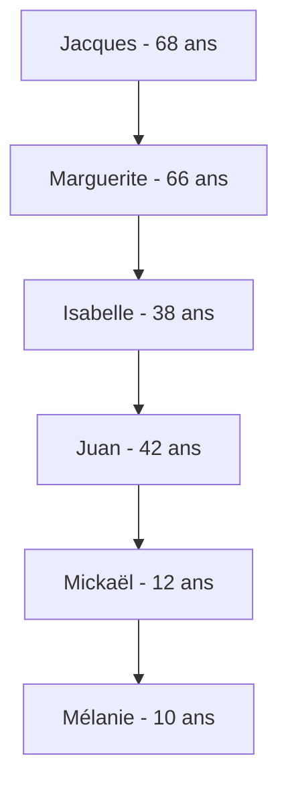

# Unité 1 — Leçon 4 : Une famille en or

**TL;DR:** Vận dụng kiến thức ba bài trước để giới thiệu gia đình, hỏi thông tin, diễn đạt sở thích, đọc hiểu và viết e-mail đăng ký chương trình truyền hình.

## Mục tiêu học tập

- Đọc hiểu thông báo tuyển ứng viên.
- Giới thiệu gia đình, sở thích và hoạt động.
- Hỏi và trả lời thông tin cá nhân.
- Viết e-mail đăng ký và hỏi thông tin.

## Bối cảnh — Une famille en or

Isabelle nhìn thấy thông báo tuyển ứng viên cho chương trình truyền hình *Une famille en or*. Cô muốn đăng ký cùng chồng, bố mẹ và hai người con.

Để tham gia, Isabelle cần đọc thông báo, giới thiệu gia đình và gửi e-mail đăng ký.

## 4.1. Devenez candidats ! — Đọc thông báo tuyển ứng viên

### Document 1 — Une famille en or

**Devenez candidats !**

Hãy trở thành ứng viên!

**Venez jouer avec nous !**

Hãy đến chơi cùng chúng tôi!

**Envoyez-nous votre candidature.**

Hãy gửi đơn đăng ký cho chúng tôi.

Chương trình tuyển các đội gồm sáu thành viên cùng gia đình. Ứng viên cần chuẩn bị:

- Une photo de votre équipe — Ảnh của đội.
- Une présentation des membres — Phần giới thiệu các thành viên.
- Votre numéro de téléphone — Số điện thoại.

```visual-flow
title: Comment participer ?
direction: horizontal
users | Former une équipe | Thành lập đội sáu người.
file-text | Préparer les documents | Chuẩn bị ảnh và thông tin.
mail | Envoyer la candidature | Gửi đăng ký qua e-mail hoặc điện thoại.
```

### Từ vựng

| Tiếng Pháp | Nghĩa |
| --- | --- |
| une émission | Chương trình truyền hình |
| une équipe | Một đội |
| un candidat | Ứng viên |
| une candidature | Đơn đăng ký |
| participer | Tham gia |
| envoyer | Gửi |
| jouer | Chơi |
| s'inscrire | Đăng ký |

**Phát âm:**

- émission /emisjɔ̃/: chương trình.
- équipe /ekip/: đội.
- candidat /kɑ̃dida/: âm t cuối câm.
- s'inscrire /sɛ̃skʁiʁ/: đăng ký.

### Mini Quiz

```quiz-deck
L04-01 | single_choice | Combien de personnes par équipe ? | Quatre | Six | Cinq | Sept | 2 | Mỗi đội cần sáu thành viên.
L04-02 | single_choice | Isabelle cần chuẩn bị tài liệu nào? | Un passeport | Un diplôme | Une carte bancaire | Une photo de son équipe | 4 | Chương trình yêu cầu ảnh của đội.
L04-03 | single_choice | Envoyer une candidature nghĩa là gì? | Gửi đơn đăng ký | Nhận giải thưởng | Xem truyền hình | Thành lập gia đình | 1 | Envoyer nghĩa là gửi.
L04-04 | word_order | Hãy đến chơi cùng chúng tôi! | avec nous / jouer / Venez | Venez jouer avec nous ! | Venez dùng để đưa ra lời mời.
L04-05 | word_order | Hãy gửi đơn đăng ký cho chúng tôi. | votre candidature / Envoyez-nous | Envoyez-nous votre candidature. | Candidature là đơn đăng ký.
```

## 4.2. Présenter sa famille — Giới thiệu gia đình

Isabelle chuẩn bị thông tin về sáu thành viên trong đội.

### Document 2 — La famille d'Isabelle

| Personne | Âge | Profession / Activités |
| --- | --- | --- |
| Isabelle | 38 | Giáo viên, salsa, điện ảnh |
| Juan | 42 | Giáo viên, nấu ăn, thể thao |
| Marguerite (Maguy) | 66 | Nghỉ hưu, du lịch, đọc sách |
| Jacques | 68 | Nghỉ hưu, du lịch, đọc sách |
| Mickaël | 12 | Bóng đá, Internet |
| Mélanie | 10 | Âm nhạc, khiêu vũ |



**Mon mari s'appelle Juan. Il est né au Mexique.**

Chồng tôi tên Juan. Anh ấy sinh ra tại Mexico.

**Mes parents sont à la retraite.**

Bố mẹ tôi đã nghỉ hưu.

**J'ai deux enfants : Mickaël et Mélanie.**

Tôi có hai người con: Mickaël và Mélanie.

### Diễn đạt sở thích và hoạt động

**Ils aiment lire.**

Họ thích đọc sách.

**Il adore cuisiner.**

Anh ấy rất thích nấu ăn.

**Elle préfère danser.**

Cô ấy thích khiêu vũ hơn.

**Il fait du vélo.**

Anh ấy đi xe đạp.

**Il joue au foot.**

Anh ấy chơi bóng đá.

| Cấu trúc | Cách dùng |
| --- | --- |
| aimer + infinitif | Thích làm gì |
| adorer + infinitif | Rất thích làm gì |
| préférer + infinitif | Thích làm gì hơn |
| faire du / de la | Thực hiện hoạt động |
| jouer au | Chơi môn thể thao hoặc trò chơi giống đực |

### Diễn đạt tần suất

| Tiếng Pháp | Nghĩa |
| --- | --- |
| tous les week-ends | Mỗi cuối tuần |
| tous les mardis | Mỗi thứ Ba |
| toutes les semaines | Mỗi tuần |
| deux fois par semaine | Hai lần mỗi tuần |

**Elle danse toutes les semaines.**

Cô ấy khiêu vũ mỗi tuần.

**Il fait du sport deux fois par semaine.**

Anh ấy chơi thể thao hai lần mỗi tuần.

**Phát âm:** retraité /ʁətʁete/ — người đã nghỉ hưu; deux enfants /dø.zɑ̃.fɑ̃/ có liaison /z/.

### Mini Quiz

```quiz-deck
L04-06 | single_choice | Qui est la mère d'Isabelle ? | Mélanie | Juan | Marguerite | Jacques | 3 | Marguerite là mẹ của Isabelle.
L04-07 | single_choice | Juan est né où ? | Au Mexique | En France | En Espagne | Au Pérou | 1 | Juan sinh ra tại Mexico.
L04-08 | single_choice | Mickaël joue ___ foot. | du | de la | aux | au | 4 | Jouer au foot nghĩa là chơi bóng đá.
L04-09 | word_order | Cô ấy khiêu vũ mỗi tuần. | les semaines / danse / Elle / toutes | Elle danse toutes les semaines. | Semaines là giống cái số nhiều.
L04-10 | word_order | Anh ấy rất thích nấu ăn. | cuisiner / adore / Il | Il adore cuisiner. | Adorer kết hợp động từ nguyên mẫu.
```

## 4.3. Parler et écrire — Giao tiếp và viết e-mail

Nhân viên chương trình muốn biết thêm thông tin về Isabelle.

### Hội thoại — Entretien avec Isabelle

**A : Quel âge avez-vous ?**

Bạn bao nhiêu tuổi?

**B : J'ai 38 ans.**

Tôi 38 tuổi.

**A : Où habitez-vous ?**

Bạn sống ở đâu?

**B : J'habite à Nîmes.**

Tôi sống tại Nîmes.

**A : Quelle est votre profession ?**

Nghề nghiệp của bạn là gì?

**B : Je suis professeur.**

Tôi là giáo viên.

**A : Quels sont vos loisirs ?**

Sở thích của bạn là gì?

**B : J'aime danser et aller au cinéma.**

Tôi thích khiêu vũ và đi xem phim.

### Écrire un e-mail — Viết e-mail đăng ký

Isabelle sử dụng những thông tin trên để viết e-mail.

```visual-flow
title: Structure d'un e-mail
direction: vertical
file-text | Objet | Tiêu đề e-mail.
users | Salutation | Lời chào.
mail | Introduction | Lý do viết e-mail.
users | Présentation | Giới thiệu gia đình.
file-text | Coordonnées | Thông tin liên hệ.
check-circle | Conclusion | Lời kết và chữ ký.
```

### E-mail mẫu

**Objet : Candidature – Une famille en or**

Tiêu đề: Đăng ký tham gia Une famille en or.

**Bonjour,**

Xin chào,

**Je voudrais participer à votre émission avec ma famille.**

Tôi muốn tham gia chương trình cùng gia đình mình.

**Je m'appelle Isabelle. J'ai 38 ans.**

Tôi tên Isabelle. Tôi 38 tuổi.

**Mon mari est professeur. Mes parents sont à la retraite. J'ai deux enfants.**

Chồng tôi là giáo viên. Bố mẹ tôi đã nghỉ hưu. Tôi có hai người con.

**À quelle heure commence l'émission ?**

Chương trình bắt đầu lúc mấy giờ?

**Mon numéro de téléphone est le [numéro].**

Số điện thoại của tôi là [số điện thoại].

**À bientôt,**

Hẹn gặp lại,

**Isabelle**

### Cấu trúc cần nhớ

- Je voudrais + infinitif: Tôi muốn làm gì.
- Quel / Quelle / Quels / Quelles: Hỏi thông tin cụ thể.
- À quelle heure: Hỏi giờ.

**Phát âm:** voudrais /vudʁɛ/, âm s cuối câm; coordonnées /kɔɔʁdɔne/ — thông tin liên hệ.

### Mini Quiz

```quiz-deck
L04-11 | single_choice | Isabelle muốn hỏi nghề nghiệp của ứng viên. | Quel âge avez-vous ? | Quelle est votre profession ? | Où habitez-vous ? | Quels sont vos loisirs ? | 2 | Profession nghĩa là nghề nghiệp.
L04-12 | single_choice | Je voudrais participer à votre émission. Isabelle muốn nói gì? | Tôi vừa tham gia | Tôi không thích chương trình | Tôi muốn tham gia chương trình | Tôi đang xem chương trình | 3 | Je voudrais diễn đạt mong muốn lịch sự.
L04-13 | single_choice | Phần nào trong e-mail chứa số điện thoại? | Objet | Salutation | Conclusion | Coordonnées | 4 | Coordonnées là thông tin liên hệ.
L04-14 | word_order | Tôi muốn tham gia chương trình của bạn. | à votre émission / participer / voudrais / Je | Je voudrais participer à votre émission. | Je voudrais kết hợp động từ nguyên mẫu.
L04-15 | word_order | Số điện thoại của bạn là gì? | votre numéro de téléphone / Quel / est | Quel est votre numéro de téléphone ? | Numéro là giống đực số ít.
```

## 4.4. Le Crocodile rouillé — Đọc hiểu

Sau khi gửi e-mail, Isabelle đọc một cuốn tiểu thuyết hài hước về gia đình.

### Document 3 — Résumé du roman

**Le Crocodile rouillé est un roman plein d'humour.**

Le Crocodile rouillé là một tiểu thuyết đầy hài hước.

**Il raconte les aventures d'une famille nombreuse dans un pays étranger.**

Cuốn sách kể về những cuộc phiêu lưu của một gia đình đông con tại nước ngoài.

**Les grands cherchent des copains.**

Những đứa trẻ lớn tìm kiếm bạn bè.

**Les jumeaux font des bêtises.**

Cặp sinh đôi nghịch ngợm.

**Les petits inventent des amis imaginaires.**

Những đứa trẻ nhỏ tưởng tượng ra các người bạn.

**Les parents voudraient une famille calme.**

Cha mẹ mong muốn một gia đình yên bình.

```visual-grid
title: Les personnages du roman
columns: 2
users | Les parents | Mong muốn gia đình yên bình.
search | Les grands | Tìm kiếm bạn bè.
activity | Les jumeaux | Làm những trò nghịch ngợm.
star | Les petits | Tưởng tượng ra những người bạn.
```

### Từ vựng

| Tiếng Pháp | Nghĩa |
| --- | --- |
| un roman | Tiểu thuyết |
| une famille nombreuse | Gia đình đông con |
| un pays étranger | Nước ngoài |
| les jumeaux | Cặp sinh đôi |
| faire des bêtises | Nghịch ngợm |
| sage | Ngoan ngoãn |
| calme | Bình tĩnh, yên bình |
| inquiet | Lo lắng |
| un secret | Bí mật |

**Phát âm:**

- rouillé /ʁuje/: bị gỉ.
- étranger /etʁɑ̃ʒe/: nước ngoài, xa lạ.
- bêtise /bɛtiz/: trò nghịch ngợm.
- inquiet /ɛ̃kjɛ/: lo lắng, âm t cuối câm.

### Mini Quiz

```quiz-deck
L04-16 | single_choice | Quel type de livre est Le Crocodile rouillé ? | Un roman | Un dictionnaire | Un magazine | Un journal | 1 | Đây là một cuốn tiểu thuyết.
L04-17 | single_choice | Que font les jumeaux ? | Ils travaillent. | Ils font des bêtises. | Ils lisent. | Ils voyagent. | 2 | Cặp sinh đôi nghịch ngợm.
L04-18 | single_choice | Que veulent les parents ? | Une nouvelle maison | Un voyage | Une famille calme | Un chien | 3 | Cha mẹ mong muốn gia đình yên bình.
L04-19 | word_order | Những đứa trẻ lớn tìm bạn bè. | des copains / cherchent / Les grands | Les grands cherchent des copains. | Chercher nghĩa là tìm kiếm.
L04-20 | word_order | Đây là một gia đình đông con. | nombreuse / une famille / C'est | C'est une famille nombreuse. | Nombreuse hòa hợp với famille.
```

## Lỗi thường gặp

```visual-callout
tone: pitfall
title: Năm lỗi cần tránh
Il joue du foot. — Sai: Il joue au foot.
Elle fait au vélo. — Sai: Elle fait du vélo.
Tous les semaines. — Sai: Toutes les semaines.
Juan est né en Mexique. — Sai: Juan est né au Mexique.
Je voudrais participe. — Sai: Je voudrais participer.
```

## Mental Model — Vận dụng kiến thức Unité 1

```visual-grid
title: Une famille en or
columns: 2
users | Se présenter | Je m'appelle, J'ai, Je suis.
search | Poser des questions | Quel, Quelle, Est-ce que, Inversion.
layers | Présenter sa famille | Mon mari, mes parents, mes enfants.
activity | Les activités | Faire du sport, jouer au foot.
clock | La fréquence | Souvent, tous les mardis, deux fois par semaine.
refresh-cw | Les actions | Venir de, aller + infinitif.
star | Les goûts | Aimer, adorer, préférer.
mail | Écrire un e-mail | Bonjour, Je voudrais participer, À bientôt.
```

## Ôn tập tổng hợp — 20 câu

```quiz-deck
L04-21 | single_choice | Juan travaille comme... | professeur | journaliste | acteur | chanteur | 1 | Juan là giáo viên.
L04-22 | single_choice | Maguy est la ___ d'Isabelle. | sœur | mère | fille | tante | 2 | Maguy là mẹ của Isabelle.
L04-23 | single_choice | Mélanie est la ___ de Juan. | mère | sœur | fille | femme | 3 | Mélanie là con gái của Juan.
L04-24 | single_choice | Isabelle habite ___ Nîmes. | au | en | aux | à | 4 | Dùng à trước tên thành phố.
L04-25 | single_choice | Juan est né ___ Mexique. | au | en | à | aux | 1 | Mexique là quốc gia giống đực.
L04-26 | single_choice | Isabelle danse ___ les mardis. | tout | tous | toute | toutes | 2 | Mardis là giống đực số nhiều.
L04-27 | single_choice | Mélanie écoute de la musique ___ les semaines. | tout | tous | toutes | toute | 3 | Semaines là giống cái số nhiều.
L04-28 | single_choice | Jacques et Maguy, ___, aiment voyager. | lui | elle | moi | eux | 4 | Eux là đại từ nhấn mạnh của ils.
L04-29 | single_choice | Isabelle vient d'envoyer sa candidature. Đây là cấu trúc nào? | Passé récent | Présent | Futur proche | Impératif | 1 | Venir de diễn tả hành động vừa xảy ra.
L04-30 | single_choice | La famille va participer à l'émission. Đây là cấu trúc nào? | Présent | Futur proche | Passé récent | Impératif | 2 | Aller kết hợp infinitif diễn tả dự định.
L04-31 | single_choice | Mickaël muốn nói mình chơi bóng đá. | Je fais au foot. | Je joue du foot. | Je joue au foot. | Je joue de la foot. | 3 | Jouer au foot là chơi bóng đá.
L04-32 | single_choice | Mélanie fait ___ danse. | du | au | aux | de la | 4 | Danse là danh từ giống cái.
L04-33 | single_choice | Les grands ont ___ amis. | beaucoup d' | beaucoup | souvent | vraiment | 1 | Beaucoup de chuyển thành beaucoup d' trước nguyên âm.
L04-34 | single_choice | Jacques lit souvent. Jacques đọc sách với tần suất nào? | Không bao giờ | Thường xuyên | Vừa mới đọc | Sắp đọc | 2 | Souvent diễn tả tần suất thường xuyên.
L04-35 | single_choice | ___ est ton activité préférée ? | Quel | Quels | Quelle | Quelles | 3 | Activité là giống cái số ít.
L04-36 | single_choice | Isabelle muốn hỏi ý kiến về cuốn sách. | Quel âge as-tu ? | Où habites-tu ? | Quel est ton numéro ? | Tu aimes ce livre ? | 4 | Aimer dùng để hỏi sự yêu thích.
L04-37 | word_order | Họ thích đọc sách và đi du lịch. | voyager / lire / aiment / et / Ils | Ils aiment lire et voyager. | Aimer kết hợp động từ nguyên mẫu.
L04-38 | word_order | Anh ấy rất thích chơi thể thao. | du sport / adore / faire / Il | Il adore faire du sport. | Adorer diễn tả sự yêu thích mạnh.
L04-39 | word_order | Chúng tôi thường đi du lịch. | souvent / Nous / voyageons | Nous voyageons souvent. | Souvent thường đứng sau động từ.
L04-40 | word_order | Cô ấy sắp nghe một bài hát. | une chanson / va / Elle / écouter | Elle va écouter une chanson. | Aller kết hợp infinitif tạo futur proche.
```

## Flashcards — Từ vựng và cấu trúc

```flipcard
une émission /emisjɔ̃/ | Chương trình truyền hình | Je regarde une émission.
une équipe /ekip/ | Một đội | Voici notre équipe.
un candidat /kɑ̃dida/ | Ứng viên | Il est candidat.
une candidature /kɑ̃didatyʁ/ | Đơn đăng ký | J'envoie ma candidature.
participer /paʁtisipe/ | Tham gia | Je voudrais participer.
envoyer /ɑ̃vwaje/ | Gửi | J'envoie une photo.
s'inscrire /sɛ̃skʁiʁ/ | Đăng ký | Je voudrais m'inscrire.
jouer /ʒwe/ | Chơi | Il joue au foot.
être à la retraite | Đã nghỉ hưu | Mes parents sont à la retraite.
retraité /ʁətʁete/ | Người đã nghỉ hưu | Jacques est retraité.
cuisiner /kɥizine/ | Nấu ăn | Il adore cuisiner.
danser /dɑ̃se/ | Khiêu vũ | Elle aime danser.
faire du vélo | Đi xe đạp | Il fait du vélo.
deux fois par semaine | Hai lần mỗi tuần | Je danse deux fois par semaine.
un objet /ɔbʒɛ/ | Tiêu đề trong e-mail | Objet : Candidature.
les coordonnées /kɔɔʁdɔne/ | Thông tin liên hệ | Voici mes coordonnées.
un roman /ʁɔmɑ̃/ | Tiểu thuyết | Je lis un roman.
une famille nombreuse | Gia đình đông con | C'est une famille nombreuse.
un pays étranger | Nước ngoài | Ils vivent dans un pays étranger.
un copain /kɔpɛ̃/ | Bạn bè, bạn nam | Il cherche des copains.
les jumeaux /ʒymo/ | Cặp sinh đôi | Ce sont des jumeaux.
faire des bêtises | Nghịch ngợm | Les enfants font des bêtises.
sage /saʒ/ | Ngoan ngoãn | Il est sage.
calme /kalm/ | Bình tĩnh, yên bình | La famille est calme.
inquiet /ɛ̃kjɛ/ | Lo lắng | Il est inquiet.
un secret /səkʁɛ/ | Bí mật | C'est un secret.
imaginaire /imaʒinɛʁ/ | Tưởng tượng | Un ami imaginaire.
```

## Tóm tắt — TL;DR

| Mục đích | Cấu trúc |
| --- | --- |
| Giới thiệu gia đình | J'ai deux enfants. |
| Hỏi thông tin | Quel âge avez-vous ? |
| Nói sở thích | J'adore cuisiner. |
| Nói hoạt động | Je fais du sport. |
| Nói tần suất | Deux fois par semaine. |
| Nói việc vừa làm | Je viens de lire. |
| Nói dự định | Je vais participer. |
| Diễn đạt mong muốn | Je voudrais participer. |
| Hỏi ý kiến | Tu aimes ce livre ? |

**Tự kiểm tra:** Bạn có thể giới thiệu gia đình trong một phút và viết e-mail đăng ký chương trình bằng 5–8 câu tiếng Pháp.

*Phạm vi: Bài học tập trung vận dụng kiến thức Leçon 1–3, không mở rộng ngữ pháp mới. Các câu đọc hiểu chỉ dựa trên thông tin được cung cấp, không suy diễn những chi tiết chưa được xác nhận trong tiểu thuyết.*
