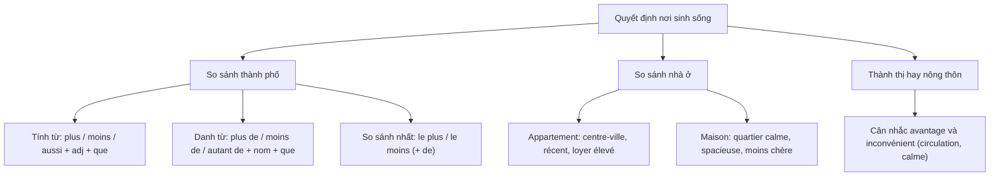

# Unité 3 — Leçon 12 : Toulouse, la ville rose

**TL;DR:** Vận dụng comparatif, superlatif và các đại từ đã học để so sánh thành phố, lựa chọn nhà ở, phương tiện giao thông và trình bày quan điểm về nơi sinh sống.

## Mục tiêu học tập

- So sánh dân số, khí hậu và giao thông giữa các thành phố.
- Đánh giá ưu điểm, nhược điểm của nhà ở.
- Trình bày lựa chọn giữa thành thị và nông thôn.
- Tư vấn phương tiện di chuyển và viết thư bằng tiếng Pháp.

## Bối cảnh

Khi chuẩn bị chuyển đến một thành phố mới ở Pháp để học tập hoặc làm việc — như Toulouse, Lyon hay Lille — bạn cần cân nhắc nhiều yếu tố thực tế từ dân số, khí hậu, giao thông cho đến việc chọn thuê căn hộ ở trung tâm hay nhà riêng yên tĩnh. Bài học này đặt bạn vào tình huống so sánh dữ liệu đô thị và đọc quảng cáo bất động sản để đưa ra quyết định phù hợp. Qua đó, bạn rèn luyện cách dùng câu so sánh, đánh giá ưu nhược điểm giữa thành thị và nông thôn, đồng thời tư vấn phương tiện di chuyển và viết thư bằng tiếng Pháp.

## 12.1. Trois grandes villes — Ba thành phố lớn

### Từ vựng

| Tiếng Pháp               | Nghĩa               |
| ------------------------ | ------------------- |
| l'économie               | Kinh tế             |
| l'enseignement           | Giáo dục            |
| la gastronomie           | Ẩm thực             |
| une entreprise           | Doanh nghiệp        |
| un aéroport              | Sân bay             |
| un institut de recherche | Viện nghiên cứu     |
| une salle de spectacles  | Phòng biểu diễn     |
| une ligne de bus         | Tuyến xe buýt       |
| une ligne de métro       | Tuyến tàu điện ngầm |
| un habitant              | Cư dân              |

### Đọc hiểu và so sánh

| Critère                | Lille   | Toulouse | Lyon    |
| ---------------------- | ------- | -------- | ------- |
| Habitants              | 226 000 | 437 000  | 467 400 |
| Lignes de bus          | 68      | 110      | 120     |
| Lignes de métro        | 2       | 4        | 4       |
| Soleil (h/an)          | 1 600   | 2 050    | 2 000   |
| Pluie (mm/an)          | 687     | 655      | 825     |
| Température en juillet | 22°C    | 28°C     | 26°C    |
| Étudiants              | 97 000  | 97 000   | 124 000 |

Ví dụ:

- Toulouse est plus ensoleillée que Lille. — Toulouse nhiều nắng hơn Lille.
- Lyon a le plus d'habitants. — Lyon có nhiều cư dân nhất.
- Lille et Toulouse ont autant d'étudiants. — Lille và Toulouse có số sinh viên bằng nhau.

### Luyện tập

```quiz-deck
L12-01 | single_choice | Quelle ville a le plus d'habitants ? | Lille | Lyon | Toulouse | Paris | 2 | Lyon có 467 400 cư dân.
L12-02 | single_choice | Quelle ville a le moins de pluie ? | Lille | Lyon | Paris | Toulouse | 4 | Toulouse có 655 mm mưa.
L12-03 | single_choice | Quelles villes ont autant d'étudiants ? | Lille et Toulouse | Lyon et Lille | Lyon et Toulouse | Les trois | 1 | Lille và Toulouse đều có 97 000 sinh viên.
L12-04 | single_choice | Quelle ville est la moins chaude en juillet ? | Toulouse | Lyon | Lille | Marseille | 3 | Lille có nhiệt độ 22°C.
L12-05 | single_choice | La gastronomie ? | Giáo dục | Ẩm thực | Giao thông | Kinh tế | 2 | Gastronomie là ẩm thực.
L12-06 | single_choice | Quelle ville a le plus de lignes de bus ? | Lille | Toulouse | Paris | Lyon | 4 | Lyon có 120 tuyến.
L12-07 | single_choice | Toulouse a ___ soleil que Lille. | plus de | moins de | autant de | aussi | 1 | 2 050 giờ so với 1 600 giờ.
L12-08 | single_choice | Lyon et Toulouse ont ___ lignes de métro. | aussi | plus de | autant de | moins de | 3 | Cả hai có 4 tuyến.
L12-09 | word_order | Lyon có nhiều cư dân hơn Lille. | que Lille / Lyon / d'habitants / a plus | Lyon a plus d'habitants que Lille. | Plus de + danh từ.
L12-10 | word_order | Toulouse có ít mưa nhất. | le moins de pluie / C'est / à Toulouse / qu'il y a | C'est à Toulouse qu'il y a le moins de pluie. | Le moins de.
```

## 12.2. Choisir un logement — Lựa chọn nhà ở

### Từ vựng

| Tiếng Pháp         | Nghĩa               |
| ------------------ | ------------------- |
| une surface        | Diện tích           |
| un centre-ville    | Trung tâm thành phố |
| une discothèque    | Hộp đêm             |
| un quartier calme  | Khu phố yên tĩnh    |
| un immeuble        | Tòa nhà             |
| une chambre        | Phòng ngủ           |
| une cuisine        | Nhà bếp             |
| une salle de bains | Phòng tắm           |
| un loyer           | Tiền thuê nhà       |

### Đọc hiểu quảng cáo

| Critère       | Appartement                 | Maison           |
| ------------- | --------------------------- | ---------------- |
| Localisation  | Centre-ville                | À 5 km du centre |
| Surface       | 45 m²                       | 80 m²            |
| État          | Récent                      | Ancien           |
| Chambres      | 1                           | 3                |
| Environnement | Au-dessus d'une discothèque | Quartier calme   |
| Loyer         | 460 €/mois                  | 345 €/mois       |

### Từ viết tắt

| Viết tắt | Đầy đủ         | Nghĩa     |
| -------- | -------------- | --------- |
| appt     | appartement    | Căn hộ    |
| imm.     | immeuble       | Tòa nhà   |
| chbre    | chambre        | Phòng ngủ |
| cuis.    | cuisine        | Nhà bếp   |
| SdB      | salle de bains | Phòng tắm |

### So sánh

- La maison est plus spacieuse que l'appartement. — Nhà rộng hơn căn hộ.
- L'appartement est plus proche du centre-ville. — Căn hộ gần trung tâm hơn.
- La maison est moins chère. — Nhà có tiền thuê thấp hơn.

### Luyện tập

```quiz-deck
L12-11 | single_choice | Quel logement est le moins cher ? | L'appartement | Les deux | La maison | Aucun | 3 | Maison: 345 euros.
L12-12 | single_choice | Quel logement est le plus spacieux ? | La maison | L'appartement | Les deux | Aucun | 1 | Maison: 80 m².
L12-13 | single_choice | Où se trouve l'appartement ? | À Langlade | À la campagne | À 5 km du centre | Au centre-ville | 4 | Appartement nằm ở trung tâm.
L12-14 | single_choice | SdB signifie... | salon | salle de bains | séjour | salle de cinéma | 2 | SdB là salle de bains.
L12-15 | single_choice | La maison a ___ chambres que l'appartement. | autant de | moins de | plus de | aussi | 3 | Ba phòng so với một phòng.
L12-16 | single_choice | L'appartement est ___ cher que la maison. | plus | moins | autant | aussi | 1 | 460 euros so với 345 euros.
L12-17 | single_choice | Quel logement est ancien ? | L'appartement | Les deux | Aucun | La maison | 4 | Maison được mô tả là ancienne.
L12-18 | single_choice | Quelle est la différence de loyer mensuel ? | 105 € | 115 € | 125 € | 135 € | 2 | 460 - 345 = 115.
L12-19 | word_order | Nhà có nhiều phòng hơn căn hộ. | plus de pièces / La maison / que l'appartement / a | La maison a plus de pièces que l'appartement. | Plus de + danh từ.
L12-20 | word_order | Ngôi nhà nằm trong khu phố yên tĩnh. | dans un quartier calme / se trouve / La maison | La maison se trouve dans un quartier calme. | Se trouver chỉ vị trí.
```

## 12.3. Ville ou campagne ? — Thành thị hay nông thôn?

### Từ vựng

| Tiếng Pháp               | Nghĩa          |
| ------------------------ | -------------- |
| la campagne              | Nông thôn      |
| la capitale              | Thủ đô         |
| la banlieue              | Vùng ngoại ô   |
| quotidiennement          | Hằng ngày      |
| la circulation           | Giao thông     |
| tomber amoureux          | Phải lòng      |
| un avantage              | Ưu điểm        |
| un inconvénient          | Nhược điểm     |
| un professeur de collège | Giáo viên THCS |
| un déplacement           | Sự di chuyển   |

### Đọc hiểu — Choix de vie

| Personne | Lý do lựa chọn                            | Khó khăn              |
| -------- | ----------------------------------------- | --------------------- |
| Élisa    | Muốn nhà rộng, có vườn                    | Mệt vì di chuyển      |
| Malika   | Chồng tìm được việc; cô là giáo viên THCS | Cần tổ chức thời gian |
| Stéphane | Sống cùng người yêu                       | Di chuyển đến Paris   |
| Joël     | Môi trường tốt cho con                    | Lái xe 4 giờ/ngày     |

### Trình bày quan điểm

- Selon moi, la qualité de vie est meilleure à la campagne. — Theo tôi, chất lượng sống ở nông thôn tốt hơn.
- Je préfère vivre près de mon lieu de travail. — Tôi thích sống gần nơi làm việc hơn.
- Le principal inconvénient, c'est le temps de transport. — Nhược điểm chính là thời gian di chuyển.

### Luyện tập

```quiz-deck
L12-21 | single_choice | Qui voulait un logement plus spacieux ? | Malika | Joël | Élisa | Stéphane | 3 | Élisa muốn có nhà rộng hơn.
L12-22 | single_choice | Qui a quitté Paris par amour ? | Stéphane | Élisa | Malika | Joël | 1 | Stéphane chuyển đi vì tình yêu.
L12-23 | single_choice | Qui a choisi la campagne pour ses enfants ? | Stéphane | Élisa | Malika | Joël | 4 | Joël muốn môi trường tốt cho con.
L12-24 | single_choice | Qui doit organiser son temps ? | Élisa | Malika | Stéphane | Joël | 2 | Malika cần tổ chức thời gian.
L12-25 | single_choice | Quotidiennement ? | Hằng tháng | Cuối tuần | Hằng ngày | Hằng năm | 3 | Quotidiennement là mỗi ngày.
L12-26 | single_choice | Un inconvénient ? | Nhược điểm | Ưu điểm | Mong muốn | Nhu cầu | 1 | Inconvénient là nhược điểm.
L12-27 | single_choice | Combien de temps Joël passe-t-il en voiture par jour ? | Une heure | Deux heures | Trois heures | Quatre heures | 4 | Bốn giờ mỗi ngày.
L12-28 | single_choice | Qui est professeur dans un collège ? | Élisa | Malika | Stéphane | Joël | 2 | Malika là giáo viên THCS.
L12-29 | word_order | Tôi thích sống ở nông thôn hơn. | à la campagne / vivre / Je préfère | Je préfère vivre à la campagne. | Préférer + infinitif.
L12-30 | word_order | Đó là một ưu điểm khi học đại học. | un avantage / C'est / d'être à la fac | C'est un avantage d'être à la fac. | Avantage.
```

## 12.4. Choisir un transport — Lựa chọn phương tiện

### Từ vựng

| Tiếng Pháp            | Nghĩa                  |
| --------------------- | ---------------------- |
| un moyen de transport | Phương tiện giao thông |
| un TGV                | Tàu cao tốc            |
| un avion              | Máy bay                |
| un autocar            | Xe khách               |
| le prix               | Giá tiền               |
| la durée              | Thời lượng             |
| rapide                | Nhanh                  |
| cher                  | Đắt                    |
| un voyage             | Chuyến đi              |
| une solution          | Giải pháp              |

### Đọc hiểu — Paris – Toulouse

| Critère | TGV    | Avion  | Autocar |
| ------- | ------ | ------ | ------- |
| Prix    | 73 €   | 210 €  | 52 €    |
| Durée   | 5 h 13 | 1 h 15 | 9 h 30  |

### So sánh

- L'avion est le moyen de transport le plus rapide. — Máy bay là phương tiện nhanh nhất.
- L'autocar est le moins cher. — Xe khách rẻ nhất.
- Le TGV est moins cher que l'avion. — TGV rẻ hơn máy bay.

### Viết thư tư vấn

> Salut Bruno,
>
> Pour venir à Toulouse, tu peux prendre le TGV, l'avion ou l'autocar.
>
> L'avion est le plus rapide, mais c'est aussi le plus cher. L'autocar est moins cher que le TGV, mais le voyage dure plus longtemps.
>
> Selon moi, le TGV est la meilleure solution.
>
> À bientôt !

### Luyện tập

```quiz-deck
L12-31 | single_choice | Quel transport est le plus rapide ? | L'avion | Le TGV | L'autocar | Les trois | 1 | Avion: 1 h 15.
L12-32 | single_choice | Quel transport est le moins cher ? | L'avion | L'autocar | Le TGV | Les trois | 2 | Autocar: 52 euros.
L12-33 | single_choice | Combien coûte le TGV ? | 52 € | 210 € | 73 € | 100 € | 3 | Giá TGV là 73 euros.
L12-34 | single_choice | Quel voyage dure le plus longtemps ? | L'avion | Le TGV | Les trois | L'autocar | 4 | Autocar: 9 h 30.
L12-35 | single_choice | Le TGV est ___ cher que l'avion. | moins | plus | aussi | autant | 1 | 73 euros thấp hơn 210 euros.
L12-36 | single_choice | L'avion est ___ rapide que le TGV. | moins | plus | aussi | autant | 2 | 1 h 15 nhanh hơn 5 h 13.
L12-37 | single_choice | C'est la ___ solution. | mieux | meilleur | meilleure | meilleurs | 3 | Solution giống cái số ít.
L12-38 | single_choice | Quelle est la différence de prix entre le TGV et l'autocar ? | 15 € | 17 € | 19 € | 21 € | 4 | 73 - 52 = 21.
L12-39 | word_order | Máy bay nhanh nhất. | le plus rapide / L'avion / est | L'avion est le plus rapide. | Superlatif.
L12-40 | word_order | TGV rẻ hơn máy bay. | que l'avion / moins cher / Le TGV / est | Le TGV est moins cher que l'avion. | Comparatif.
```

## Lỗi thường gặp

- **Nhầm `plus` / `aussi` (đi với tính từ) với `plus de` / `autant de` (đi với danh từ):**
  - Sai: *Lyon a plus habitants que Lille.* / *Toulouse a aussi soleil que Lille.*
  - Đúng: *Lyon a **plus d'habitants** que Lille.* (Lyon có nhiều cư dân hơn Lille.) / *Toulouse est **plus ensoleillée** que Lille.* (Toulouse nhiều nắng hơn Lille.)
- **Quên hợp giống tính từ khi so sánh danh từ giống cái (`la ville`, `la maison`):**
  - Sai: *Toulouse est plus ensoleillé que Lille.*
  - Đúng: *Toulouse est plus **ensoleillée** que Lille.* (Toulouse nhiều nắng hơn Lille.)
- **Dùng sai `le moins` thay cho `le moins de` trước danh từ:**
  - Sai: *C'est à Toulouse qu'il y a le moins pluie.*
  - Đúng: *C'est à Toulouse qu'il y a **le moins de** pluie.* (Toulouse là nơi có ít mưa nhất.)
- **Dùng sai giới từ chỉ vị trí (`au centre-ville` vs `à la campagne`):**
  - Sai: *L'appartement est à le centre-ville.* / *J'habite dans la campagne.*
  - Đúng: *L'appartement est **au centre-ville**.* (Căn hộ ở trung tâm thành phố.) / *J'habite **à la campagne**.* (Tôi sống ở nông thôn.)

## Mental Model



## Ôn tập tổng hợp — 20 câu

```quiz-deck
L12-41 | single_choice | Une ville ___ il fait beau. | où | qui | que | dont | 1 | Où chỉ nơi chốn.
L12-42 | single_choice | Le logement ___ nous avons besoin. | où | dont | qui | que | 2 | Avoir besoin de → dont.
L12-43 | single_choice | Une maison ___ possède un jardin. | que | où | qui | dont | 3 | Qui thay chủ ngữ.
L12-44 | single_choice | Le quartier ___ je préfère. | qui | dont | où | que | 4 | Que thay COD.
L12-45 | single_choice | Notre appartement est plus grand que votre appartement. | le vôtre | la vôtre | le leur | les vôtres | 1 | Appartement giống đực số ít.
L12-46 | single_choice | Ta maison ? | le tien | la tienne | la mienne | le sien | 2 | Maison giống cái số ít.
L12-47 | single_choice | Ces villes ont ___ étudiants. | aussi | autant | autant d' | mieux | 3 | Autant de + danh từ.
L12-48 | single_choice | C'est la ville ___ peuplée. | le plus | plus de | les plus | la plus | 4 | Ville giống cái số ít.
L12-49 | single_choice | Ce logement est ___ situé que l'autre. | mieux | meilleur | meilleure | meilleurs | 1 | Mieux là dạng so sánh của bien.
L12-50 | single_choice | J'aimerais vivre à la campagne. | Fait | Souhait | Habitude | Ordre | 2 | J'aimerais diễn đạt mong muốn.
L12-51 | single_choice | ___-vous me donner des renseignements ? | Pourrais | Pourrait | Pourriez | Pourrions | 3 | Vous + pourriez.
L12-52 | single_choice | Ces deux appartements ? ___ préférez-vous ? | Laquelle | Lequel | Lesquelles | Lesquels | 2 | Appartement giống đực số ít.
L12-53 | single_choice | Lyon a ___ habitants que Toulouse. | plus d' | moins d' | autant d' | aussi | 1 | 467 400 lớn hơn 437 000.
L12-54 | single_choice | Quelle ville a le plus de lignes de bus ? | Lille | Lyon | Toulouse | Aucune | 2 | Lyon có 120 tuyến.
L12-55 | single_choice | Selon moi, la campagne est agréable. | Fait | Question | Opinion | Demande | 3 | Selon moi giới thiệu ý kiến.
L12-56 | single_choice | Un propriétaire reçoit un ___. | locataire | logement | climat | loyer | 4 | Loyer là tiền thuê nhà.
L12-57 | word_order | Đây là thành phố nơi tôi muốn sống. | où / une ville / je voudrais vivre / C'est | C'est une ville où je voudrais vivre. | Où chỉ địa điểm.
L12-58 | word_order | Đây là nhà ở mà tôi cần. | dont / j'ai besoin / Voici / le logement | Voici le logement dont j'ai besoin. | Avoir besoin de.
L12-59 | word_order | Nông thôn ít ồn hơn thành phố. | que la ville / La campagne / moins bruyante / est | La campagne est moins bruyante que la ville. | Comparatif.
L12-60 | word_order | Theo tôi, tàu là giải pháp tốt nhất. | la meilleure solution / Selon moi / est / le train | Selon moi, le train est la meilleure solution. | Meilleur hòa hợp với solution.
```

## Flashcards — Từ vựng và cấu trúc

```flipcard
un habitant | Cư dân, người dân sinh sống tại một nơi | Lyon a plus d'habitants que Lille. (Lyon có nhiều cư dân hơn Lille.)
la gastronomie | Ẩm thực, văn hóa ăn uống đặc trưng | Toulouse est célèbre pour sa gastronomie. (Toulouse nổi tiếng về ẩm thực.)
un loyer | Tiền thuê nhà hằng tháng | Le loyer de la maison est de 345 € par mois. (Tiền thuê ngôi nhà là 345 euro mỗi tháng.)
un quartier calme | Khu phố yên tĩnh, ít tiếng ồn | La maison se trouve dans un quartier calme. (Ngôi nhà nằm trong một khu phố yên tĩnh.)
la banlieue | Vùng ngoại ô quanh thành phố | Il habite en banlieue pour éviter la circulation. (Anh ấy sống ở ngoại ô để tránh kẹt xe.)
la campagne | Nông thôn, vùng quê | Elle préfère vivre à la campagne. (Cô ấy thích sống ở nông thôn hơn.)
plus de + danh từ + que | Nhiều ... hơn (so sánh số lượng danh từ) | La maison a plus de chambres que l'appartement. (Ngôi nhà có nhiều phòng ngủ hơn căn hộ.)
autant de + danh từ + que | Nhiều bằng, số lượng ngang nhau | Lille et Toulouse ont autant d'étudiants. (Lille và Toulouse có số sinh viên bằng nhau.)
```

## Tóm tắt — TL;DR

| Kiến thức        | Cấu trúc                           | Ví dụ                                                                                      |
| ---------------- | ---------------------------------- | ------------------------------------------------------------------------------------------ |
| So sánh tính từ  | plus/moins/aussi + adjectif + que  | Toulouse est plus ensoleillée que Lille. (Toulouse nhiều nắng hơn Lille.)                  |
| So sánh số lượng | plus de/moins de/autant de + nom   | Lyon a plus d'habitants que Lille. (Lyon có nhiều cư dân hơn Lille.)                       |
| So sánh nhất     | le/la/les plus ou moins + adjectif | L'avion est le plus rapide. (Máy bay là nhanh nhất.)                                       |
| Bất quy tắc      | meilleur, mieux                    | Le TGV est la meilleure solution. (TGV là giải pháp tốt nhất.)                             |
| Đại từ quan hệ   | qui, que, où, dont                 | C'est une ville où je voudrais vivre. (Đây là thành phố nơi tôi muốn sống.)                |
| Đại từ sở hữu    | le mien, la tienne, le vôtre       | Notre appartement est plus grand que le vôtre. (Căn hộ của chúng tôi lớn hơn của bạn.)     |
| Ý kiến           | Selon moi...                       | Selon moi, la campagne est agréable. (Theo tôi, nông thôn rất dễ chịu.)                    |
| Mong muốn        | J'aimerais...                      | J'aimerais vivre à la campagne. (Tôi muốn sống ở nông thôn.)                               |
| Yêu cầu lịch sự  | Pourriez-vous...?                  | Pourriez-vous me donner des renseignements ? (Bạn có thể cho tôi thông tin được không?)    |

**Sau bài này, tôi có thể:**

- So sánh ba thành phố dựa trên số liệu.
- Phân tích ưu và nhược điểm của nhà ở.
- Giải thích lựa chọn giữa thành thị và nông thôn.
- Viết thư tư vấn phương tiện giao thông bằng tiếng Pháp.

*Lưu ý: Các số liệu dân số, giao thông, giá thuê và giá vé được giữ theo giáo trình, không đại diện cho dữ liệu hiện hành.*
