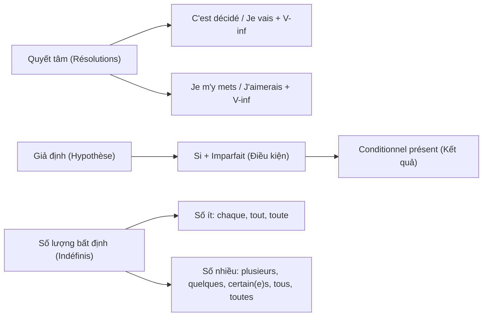

# Unité 4 — Leçon 13 : De bonnes résolutions

## Mục tiêu học tập

- Diễn đạt các quyết tâm và kế hoạch thay đổi thói quen (ví dụ: *C'est décidé, je vais faire du sport.* — Tôi quyết định sẽ tập thể thao.).
- Đặt câu giả định ở hiện tại hoặc tương lai bằng cấu trúc `si + imparfait → conditionnel présent` (ví dụ: *Si j'avais le temps, je voyagerais.* — Nếu có thời gian, tôi sẽ đi du lịch.).
- Chia đúng động từ ở thì *imparfait* (lưu ý ngoại lệ `être` dùng gốc `ét-`) và *conditionnel présent*.
- Sử dụng đúng các tính từ bất định (`chaque`, `plusieurs`, `quelques`, `certain(e)s`, `tout/toute/tous/toutes`) theo giống và số của danh từ.

**TL;DR:** Học cách diễn đạt quyết tâm, giả định và số lượng không xác định. Trọng tâm là `si + imparfait → conditionnel présent` và các adjectifs indéfinis.

## Bối cảnh — Những quyết tâm thay đổi cuộc sống

Hãy tưởng tượng bạn muốn thay đổi thói quen trong năm mới: tập thể thao, ăn uống tốt hơn, tiết kiệm tiền và đi du lịch.

Bạn cần biết cách:

- Nói về những điều muốn thay đổi.
- Đặt giả định về những tình huống chưa có thật.
- Diễn đạt tần suất và số lượng không chính xác.

## 13.1. Les bonnes résolutions — Những quyết tâm tốt

### Từ vựng

| Tiếng Pháp           | Nghĩa                |
| -------------------- | -------------------- |
| une résolution       | Quyết tâm            |
| une habitude         | Thói quen            |
| se cultiver          | Trau dồi kiến thức   |
| une alimentation     | Chế độ ăn uống       |
| contrôler le stress  | Kiểm soát căng thẳng |
| arrêter de fumer     | Bỏ thuốc lá          |
| prendre des vacances | Đi nghỉ              |
| perdre du poids      | Giảm cân             |
| dépenser             | Tiêu tiền            |
| régulièrement        | Thường xuyên         |
| quotidiennement      | Hằng ngày            |
| respecter            | Tuân thủ, thực hiện  |

### Diễn đạt quyết tâm

| Cấu trúc               | Nghĩa                      | Ví dụ                                                                          |
| ---------------------- | -------------------------- | ------------------------------------------------------------------------------ |
| C'est décidé !         | Tôi quyết định rồi!        | C'est décidé, je vais faire du sport. (Tôi quyết định sẽ tập thể thao.)        |
| Je vais + infinitif    | Tôi sẽ...                  | Je vais manger mieux. (Tôi sẽ ăn uống tốt hơn.)                                |
| Je m'y mets.           | Tôi bắt tay vào thực hiện. | Cette année, je m'y mets. (Năm nay, tôi sẽ bắt tay thực hiện.)                 |
| Je veux + infinitif    | Tôi muốn...                | Je veux arrêter de fumer. (Tôi muốn bỏ thuốc lá.)                              |
| J'aimerais + infinitif | Tôi mong muốn...           | J'aimerais prendre des vacances. (Tôi mong muốn đi nghỉ.)                      |

### Quiz

```quiz-deck
L13-01 | single_choice | Une résolution ? | Thói quen | Quyết tâm | Lời khuyên | Kết quả | 2 | Résolution là quyết tâm.
L13-02 | single_choice | Arrêter de fumer ? | Tập thể thao | Giảm cân | Đi nghỉ | Bỏ thuốc lá | 4 | Arrêter de fumer.
L13-03 | single_choice | Se cultiver ? | Trau dồi kiến thức | Nghỉ ngơi | Làm việc | Tiết kiệm | 1 | Se cultiver.
L13-04 | single_choice | Une alimentation ? | Hoạt động | Công việc | Chế độ ăn uống | Sở thích | 3 | Alimentation.
L13-05 | single_choice | Quotidiennement ? | Hằng tuần | Hằng ngày | Hằng tháng | Hằng năm | 2 | Quotidiennement.
L13-06 | word_order | Tôi sẽ bỏ thuốc lá. | de fumer / vais / arrêter / Je | Je vais arrêter de fumer. | Futur proche.
```

## 13.2. L'hypothèse — Câu giả định

### Vấn đề

Bạn muốn nói:

- Nếu tôi có nhiều thời gian, tôi sẽ tập thể thao.
- Nếu tôi giàu, tôi sẽ đi du lịch.
- Nếu tôi làm việc ít hơn, tôi sẽ nghỉ ngơi nhiều hơn.

Đây là những tình huống giả định ở hiện tại hoặc tương lai.

### Công thức cốt lõi

**SI + IMPARFAIT**

**Si j'avais le temps**

Nếu tôi có thời gian

Kết quả giả định

**CONDITIONNEL PRÉSENT**

**je ferais du sport.**

Tôi sẽ tập thể thao.

**Cấu trúc:**

`Si + sujet + imparfait, sujet + conditionnel présent.`

### Cách chia Imparfait

Lấy gốc động từ `nous` ở présent, bỏ `-ons`, thêm đuôi:

| Chủ ngữ     | Đuôi   |
| ----------- | ------ |
| Je          | -ais   |
| Tu          | -ais   |
| Il / Elle   | -ait   |
| Nous        | -ions  |
| Vous        | -iez   |
| Ils / Elles | -aient |

Ví dụ:

| Động từ | Nous (présent) | Gốc imparfait |
| ------- | -------------- | ------------- |
| parler  | parlons        | parl-         |
| finir   | finissons      | finiss-       |
| prendre | prenons        | pren-         |
| faire   | faisons        | fais-         |
| avoir   | avons          | av-           |

Ngoại lệ: `être` sử dụng gốc `ét-`.

### Cách chia Conditionnel présent

`Gốc futur simple + đuôi imparfait`

| Động từ    | Imparfait (je) | Conditionnel (je) |
| ---------- | -------------- | ----------------- |
| avoir      | avais          | aurais            |
| être       | étais          | serais            |
| faire      | faisais        | ferais            |
| pouvoir    | pouvais        | pourrais          |
| prendre    | prenais        | prendrais         |
| travailler | travaillais    | travaillerais     |
| manger     | mangeais       | mangerais         |

### Ví dụ thực tế

| Tiếng Pháp                                              | Nghĩa                                                   |
| ------------------------------------------------------- | ------------------------------------------------------- |
| Si j'étais riche, j'arrêterais de travailler.           | Nếu giàu, tôi sẽ nghỉ làm.                              |
| Si elle pouvait, elle prendrait des vacances.           | Nếu có thể, cô ấy sẽ đi nghỉ.                           |
| Si vous mangiez mieux, vous seriez en meilleure santé.  | Nếu ăn uống tốt hơn, bạn sẽ khỏe mạnh hơn.              |

Có thể đảo vị trí hai mệnh đề:

`Je voyagerais si j'avais plus de temps.`

**Lỗi cần tránh:**

- Sai: `Si j'aurais le temps, je ferais du sport.`
- Đúng: `Si j'avais le temps, je ferais du sport.`

Không dùng conditionnel ngay sau `si` trong cấu trúc này.

### Quiz

```quiz-deck
L13-07 | single_choice | Si j'___ riche, je voyagerais. | serais | suis | étais | serai | 3 | Si + imparfait.
L13-08 | single_choice | Si j'avais le temps, je ___ du sport. | ferais | faisais | fais | ferait | 1 | Conditionnel présent.
L13-09 | single_choice | Si elle ___, elle partirait. | pourrait | pourra | peut | pouvait | 4 | Si + imparfait.
L13-10 | single_choice | Si tu travaillais moins, tu ___ plus de temps. | avais | aurais | auras | aurait | 2 | Conditionnel.
L13-11 | single_choice | Si vous ___ mieux, vous seriez en meilleure santé. | mangeriez | mangez | mangiez | mangeraient | 3 | Imparfait.
L13-12 | word_order | Nếu tôi giàu, tôi sẽ đi du lịch. | je voyagerais / Si j'étais riche | Si j'étais riche, je voyagerais. | Si + imparfait.
L13-13 | word_order | Nếu tôi làm việc ít hơn, tôi sẽ ngủ nhiều hơn. | je dormirais plus / Si je travaillais moins | Si je travaillais moins, je dormirais plus. | Conditionnel.
```

## 13.3. Les adjectifs indéfinis — Tính từ bất định

### Chức năng

Tính từ bất định đứng trước danh từ, diễn đạt số lượng hoặc phạm vi không xác định chính xác.

| Từ          | Nghĩa            | Ví dụ               |
| ----------- | ---------------- | ------------------- |
| chaque      | Mỗi              | chaque jour         |
| plusieurs   | Nhiều, một số    | plusieurs fois      |
| quelques    | Một vài          | quelques kilos      |
| certain(e)s | Một số nhất định | certaines choses    |
| tout        | Toàn bộ          | tout le jour        |
| toute       | Toàn bộ          | toute la journée    |
| tous        | Tất cả           | tous les matins     |
| toutes      | Tất cả           | toutes les semaines |

### Phân biệt cách sử dụng

| Cấu trúc         | Nghĩa                      | Ví dụ                                                                                         |
| ---------------- | -------------------------- | --------------------------------------------------------------------------------------------- |
| chaque matin     | Mỗi buổi sáng              | Elle fait du sport chaque matin. (Cô ấy tập thể thao mỗi sáng.)                               |
| tous les matins  | Mọi buổi sáng              | Il court tous les matins. (Anh ấy chạy bộ mọi buổi sáng.)                                     |
| plusieurs matins | Nhiều buổi sáng            | Elle va à la piscine plusieurs matins par semaine. (Cô ấy đi bơi nhiều buổi sáng mỗi tuần.)   |
| quelques matins  | Một vài buổi sáng          | Je travaille tôt quelques matins. (Tôi làm việc sớm một vài buổi sáng.)                       |
| certains matins  | Một số buổi sáng nhất định | Elle prend des cours certains matins. (Cô ấy tham gia lớp học vào một số buổi sáng.)          |

**Quy tắc hòa hợp:**

- `chaque` + danh từ số ít.
- `plusieurs`, `quelques` + danh từ số nhiều.
- `certain / certaine / certains / certaines` hòa hợp giống và số.
- `tout / toute / tous / toutes` hòa hợp giống và số.

### Quiz

```quiz-deck
L13-14 | single_choice | Mỗi ngày? | plusieurs jours | quelques jours | chaque jour | certains jours | 3 | Chaque + danh từ số ít.
L13-15 | single_choice | Mọi buổi sáng? | tous les matins | toutes les matins | chaque matins | tout les matins | 1 | Matins giống đực số nhiều.
L13-16 | single_choice | Một vài kilogram? | chaque kilo | tout kilo | quelques kilo | quelques kilos | 4 | Quelques + danh từ số nhiều.
L13-17 | single_choice | Một số điều nhất định? | certains choses | certaines choses | certaine choses | certains chose | 2 | Choses giống cái số nhiều.
L13-18 | single_choice | Nhiều lần? | chaque fois | toute fois | plusieurs fois | plusieurs fois-là | 3 | Plusieurs fois.
L13-19 | single_choice | Cả ngày? | tout la journée | toute la journée | tous la journée | toutes la journée | 2 | Journée giống cái số ít.
L13-20 | word_order | Cô ấy tập thể thao mỗi sáng. | chaque matin / du sport / Elle fait | Elle fait du sport chaque matin. | Chaque.
L13-21 | word_order | Tôi muốn giảm vài kilogram. | quelques kilos / perdre / Je voudrais | Je voudrais perdre quelques kilos. | Quelques.
```

## 13.4. Que feriez-vous si...? — Bạn sẽ làm gì nếu...?

### Hỏi và trả lời giả định

| Question                            | Réponse                                     |
| ----------------------------------- | ------------------------------------------- |
| Si vous aviez plus de temps libre ? | Je lirais davantage.                        |
| Si vous aviez un an de vacances ?   | Je ferais le tour du monde.                 |
| Si vous étiez riche ?               | J'achèterais une grande maison.             |
| Si vous travailliez moins ?         | Je passerais plus de temps avec ma famille. |

### Câu hỏi về quyết tâm

| Tiếng Pháp                            | Nghĩa                                          |
| ------------------------------------- | ---------------------------------------------- |
| Quelles sont tes bonnes résolutions ? | Bạn có những quyết tâm gì?                     |
| Prends-tu souvent des résolutions ?   | Bạn có thường đặt quyết tâm không?             |
| Respectes-tu tes résolutions ?        | Bạn có thực hiện những quyết tâm đó không?     |

### Hội thoại

— Tu fais régulièrement du sport ?

— Non, mais si j'avais plus de temps, j'en ferais tous les jours.

<details>
<summary>Dịch</summary>

— Bạn có thường tập thể thao không?

— Không, nhưng nếu có nhiều thời gian hơn, tôi sẽ tập mỗi ngày.

</details>

### Ngữ điệu: Conseil ou irritation ?

Cùng một câu có thể thể hiện lời khuyên hoặc sự khó chịu tùy ngữ điệu.

`Tu devrais faire plus de sport !`

- Conseil: lời khuyên, giọng nhẹ nhàng.
- Irritation: khó chịu, giọng nhấn mạnh.

### Quiz

```quiz-deck
L13-22 | single_choice | Que feriez-vous si vous étiez riche ? | J'achèterais une maison. | J'achète hier. | J'étais étudiant. | J'ai vingt ans. | 1 | Kết quả giả định.
L13-23 | single_choice | Si tu avais plus de temps ? | Je lisais. | Je lirais davantage. | Je viens de lire. | Je lis hier. | 2 | Conditionnel.
L13-24 | single_choice | Quelles sont tes bonnes résolutions ? | À Paris. | Depuis lundi. | Je vais manger mieux. | À vingt heures. | 3 | Trình bày quyết tâm.
L13-25 | single_choice | Si vous aviez un an de vacances ? | Je travaille. | J'ai travaillé. | Je suis au bureau. | Je ferais le tour du monde. | 4 | Giả định.
L13-26 | single_choice | Si je fumais moins, je ___ moins d'argent. | dépenserais | dépensais | dépenserait | dépense | 1 | Conditionnel.
L13-27 | single_choice | Si nous ___ un taxi, nous arriverions plus tôt. | prendrions | prenions | prendrons | prenez | 2 | Imparfait.
L13-28 | single_choice | Que ___-vous si vous trouviez 1 000 euros ? | faites | faisiez | feriez | feraient | 3 | Vous feriez.
L13-29 | word_order | Nếu tôi ngủ tốt hơn, tôi sẽ ít mệt hơn. | je serais moins fatigué / Si je dormais mieux | Si je dormais mieux, je serais moins fatigué. | Hypothèse.
L13-30 | word_order | Nếu tôi có thể, tôi sẽ đi nghỉ. | je prendrais des vacances / Si je pouvais | Si je pouvais, je prendrais des vacances. | Conditionnel.
```

## Lỗi thường gặp

- **Dùng *conditionnel présent* ngay sau `si`:** Không dùng thì điều kiện trong mệnh đề giả định.
  - Sai: *Si j'aurais le temps, je ferais du sport.*
  - Đúng: *Si j'avais le temps, je ferais du sport.* (Nếu tôi có thời gian, tôi sẽ tập thể thao.)
- **Quên gốc bất quy tắc `ét-` của `être` ở *imparfait*:** Không suy ra từ `nous sommes`.
  - Sai: *Si je sommes riche...*
  - Đúng: *Si j'étais riche, j'arrêterais de travailler.* (Nếu tôi giàu, tôi sẽ nghỉ làm.)
- **Chia sai số ít / số nhiều với `chaque` và `tous/toutes`:** `chaque` luôn đi với danh từ số ít không có mạo từ; `tous/toutes` đi với mạo từ + danh từ số nhiều.
  - Sai: *chaque matins* / *tous matins*
  - Đúng: *chaque matin* (mỗi buổi sáng) / *tous les matins* (mọi buổi sáng).
- **Nhầm nghĩa giữa `tout/toute` (toàn bộ) và `tous/toutes` (tất cả):**
  - *toute la journée* (cả ngày hôm đó) ≠ *toutes les semaines* (tất cả các tuần).

## Mental Model



## Ôn tập tổng hợp — 20 câu

```quiz-deck
L13-31 | single_choice | Si tu ___ moins, tu serais moins fatigué. | travaillais | travaillerais | travailleras | travaillerait | 1 | Imparfait.
L13-32 | single_choice | Si j'avais un jardin, j'___ des amis. | invitais | inviterais | inviterait | invite | 2 | Conditionnel.
L13-33 | single_choice | Si nous ___ plus de temps, nous voyagerions. | aurions | avons | avions | aurez | 3 | Imparfait.
L13-34 | single_choice | Si elles faisaient du sport, elles ___ en meilleure santé. | étaient | sont | seraient-vous | seraient | 4 | Conditionnel.
L13-35 | single_choice | ___ année, je prends de bonnes résolutions. | Chaque | Plusieurs | Quelques | Certains | 1 | Chaque année.
L13-36 | single_choice | Il fait du sport ___ les jours. | tout | tous | toute | toutes | 2 | Tous les jours.
L13-37 | single_choice | Elle a pris cinq kilos, donc elle a pris ___ kilos. | chaque | tout | quelques | certaine | 3 | Quelques kilos.
L13-38 | single_choice | ___ personnes préfèrent travailler à la campagne. | Certain | Certains | Certaine | Certaines | 4 | Féminin pluriel.
L13-39 | single_choice | C'est une habitude ___ je voudrais perdre. | que | qui | où | dont | 1 | Que thay COD.
L13-40 | single_choice | Le temps ___ j'ai besoin. | où | dont | qui | que | 2 | Avoir besoin de.
L13-41 | single_choice | Je voudrais manger ___ qu'avant. | meilleur | meilleure | mieux | meilleures | 3 | Mieux là trạng từ.
L13-42 | single_choice | Elle veut avoir une ___ alimentation. | mieux | meilleur | meilleurs | meilleure | 4 | Alimentation giống cái.
L13-43 | single_choice | Je passe moins ___ temps au bureau. | de | que | à | en | 1 | Moins de + nom.
L13-44 | single_choice | Si elle était libre, elle ___ venir. | pouvait | pourrait | pourra | peut | 2 | Conditionnel.
L13-45 | single_choice | Je viens de prendre une résolution. | Futur proche | Imparfait | Passé récent | Conditionnel | 3 | Venir de + infinitif.
L13-46 | single_choice | Il va arrêter de fumer. | Passé récent | Imparfait | Conditionnel | Futur proche | 4 | Aller + infinitif.
L13-47 | word_order | Nếu tôi có thời gian, tôi sẽ dọn dẹp. | je ferais le ménage / Si j'avais du temps | Si j'avais du temps, je ferais le ménage. | Hypothèse.
L13-48 | word_order | Tôi muốn nói nhiều ngôn ngữ. | plusieurs langues / voudrais / parler / Je | Je voudrais parler plusieurs langues. | Plusieurs.
L13-49 | word_order | Nếu giàu, tôi sẽ làm việc ít hơn. | je travaillerais moins / Si j'étais riche | Si j'étais riche, je travaillerais moins. | Conditionnel.
L13-50 | word_order | Nếu bạn hút thuốc ít hơn, bạn sẽ khỏe hơn. | vous seriez en meilleure santé / Si vous fumiez moins | Si vous fumiez moins, vous seriez en meilleure santé. | Hypothèse.
```

## Flashcards — Từ vựng và cấu trúc

```flipcard
Si + imparfait → conditionnel présent | Diễn đạt giả định hiện tại hoặc tương lai | Si j'avais le temps, je voyagerais. | Hypothèse
Chaque | Mỗi, đi với danh từ số ít | Chaque jour | Tous
Plusieurs | Nhiều, một số, đi với danh từ số nhiều | Plusieurs fois | Quelques
Quelques | Một vài, số lượng nhỏ không xác định | Quelques kilos | Plusieurs
Certain(e)s | Một số nhất định, hòa hợp giống và số | Certaines personnes | Quelques
Tout / Toute / Tous / Toutes | Toàn bộ, tất cả; hòa hợp giống và số | Tous les matins | Chaque
```

## Tóm tắt — TL;DR

- **Hiểu:** Cách kết hợp imparfait và conditionnel présent.
- **Làm được:** Đặt giả định, trình bày quyết tâm và nói về tần suất.
- **Áp dụng:** Giao tiếp về sức khỏe, thói quen, công việc và kế hoạch cá nhân.

*Không đưa bài nghe Piste 17 và bài nhận diện ngữ điệu vào quiz vì chưa có audio hoặc transcript.*
