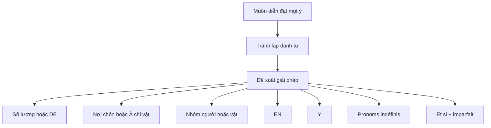

# Unité 4 — Leçon 14 : Manger mieux, bouger plus

**TL;DR:** Dùng `en` để thay thế số lượng hoặc bổ ngữ có `de`, `y` để thay thế nơi chốn hoặc bổ ngữ có `à`. Dùng đại từ bất định để tránh lặp danh từ và `Et si + imparfait` để đề xuất giải pháp.

## Mục tiêu học tập

- Trình bày thói quen ăn uống và vận động.
- Phân biệt và sử dụng đúng `en`, `y`.
- Sử dụng các đại từ bất định.
- Đề xuất giải pháp bằng `Et si + imparfait`.

## Bối cảnh

Camille muốn cải thiện sức khỏe. Cô quyết định ăn nhiều rau củ, giảm lượng đường và tập thể thao thường xuyên. Eva giúp cô xây dựng những thói quen tốt.

## 14.1. L'alimentation et la santé — Ăn uống và sức khỏe

### Từ vựng

| Tiếng Pháp | Nghĩa |
| --- | --- |
| les fruits | Trái cây |
| les légumes | Rau củ |
| la viande | Thịt |
| les féculents | Thực phẩm giàu tinh bột |
| les produits laitiers | Sản phẩm từ sữa |
| les matières grasses | Chất béo |
| le sucre | Đường |
| le sel | Muối |
| un footing | Buổi chạy bộ |
| la marche rapide | Đi bộ nhanh |
| être au régime | Đang ăn kiêng |
| maigrir | Giảm cân |
| à volonté | Tùy ý |
| au moins | Ít nhất |

### Diễn đạt thói quen và lời khuyên

| Tiếng Pháp | Nghĩa |
| --- | --- |
| Je fais attention à mon alimentation. | Tôi chú ý đến chế độ ăn uống. |
| Il faut limiter sa consommation de sucre. | Cần hạn chế lượng đường tiêu thụ. |
| Je fais du sport régulièrement. | Tôi tập thể thao thường xuyên. |
| Je voudrais perdre quelques kilos. | Tôi muốn giảm vài kilogram. |

```visual-grid
title: Les bonnes habitudes
columns: 3
check-circle | Manger mieux | Ăn uống tốt hơn
activity | Bouger plus | Vận động nhiều hơn
clock | Régulièrement | Duy trì thường xuyên
```

### Luyện tập

```quiz-deck
L14-01 | single_choice | Les féculents désignent... | Chất béo | Thực phẩm giàu tinh bột | Rau củ | Trái cây | 2 | Féculents là thực phẩm giàu tinh bột.
L14-02 | single_choice | Le lait et les yaourts sont... | des légumes | des féculents | des matières grasses | des produits laitiers | 4 | Đây là các sản phẩm từ sữa.
L14-03 | single_choice | Camille voudrait perdre du poids. Elle voudrait... | maigrir | grossir | dormir | dépenser | 1 | Maigrir nghĩa là giảm cân.
L14-04 | word_order | Tôi tập thể thao thường xuyên. | régulièrement / du sport / Je fais | Je fais du sport régulièrement. | Régulièrement chỉ tần suất.
```

## 14.2. Le pronom en — Đại từ en

Eva hỏi Camille:

| Tiếng Pháp | Nghĩa |
| --- | --- |
| Tu manges des fruits ? | Bạn có ăn trái cây không? |
| Oui, j'en mange. | Có, tôi có ăn. |

Thay vì lặp lại `des fruits`, Camille sử dụng `en`.

### Khi nào dùng en?

| Câu gốc | Thay thế bằng en |
| --- | --- |
| Je mange des fruits. | J'en mange. |
| Je bois du lait. | J'en bois. |
| Je mange de la viande. | J'en mange. |
| Je fais un footing. | J'en fais un. |
| J'ai besoin de courage. | J'en ai besoin. |

`En` thay thế danh từ chỉ số lượng không xác định hoặc bổ ngữ có giới từ `de`, thường chỉ vật hoặc sự việc.

### Khi có số lượng cụ thể

| Tiếng Pháp | Nghĩa |
| --- | --- |
| Tu manges trois pommes ? | Bạn ăn ba quả táo à? |
| Oui, j'en mange trois. | Vâng, tôi ăn ba quả. |

```visual-flow
title: Cách sử dụng en
direction: horizontal
search | Je mange trois pommes. | Xác định danh từ cần thay thế
refresh-cw | pommes | Thay bằng en
check-circle | J'en mange trois. | Giữ lại số lượng trois
```

### Vị trí của en

| Trường hợp | Ví dụ |
| --- | --- |
| Présent | J'en mange. |
| Phủ định | Je n'en mange pas. |
| Passé composé | J'en ai mangé. |
| Infinitif | Je voudrais en manger. |

### Luyện tập

```quiz-deck
L14-05 | single_choice | Tu bois du lait ? Oui, j'___ bois. | y | le | en | lui | 3 | En thay thế du lait.
L14-06 | single_choice | Tu manges trois pommes ? Oui, j'en mange ___. | trois | des | du | de | 1 | Giữ lại số lượng trois.
L14-07 | single_choice | Elle a acheté des légumes. Thay des légumes bằng en. | Elle a en acheté. | Elle a acheté en. | Elle y a acheté. | Elle en a acheté. | 4 | En đứng trước trợ động từ.
L14-08 | single_choice | Tu as besoin de courage ? Oui, j'___ ai besoin. | y | en | le | lui | 2 | En thay bổ ngữ của avoir besoin de.
L14-09 | word_order | Tôi không uống thứ đó. | pas / bois / Je n'en | Je n'en bois pas. | En đứng trước động từ trong câu phủ định.
```

## 14.3. Le pronom y — Đại từ y

Camille muốn đi bơi:

| Tiếng Pháp | Nghĩa |
| --- | --- |
| Tu vas à la piscine ? | Bạn có đi đến hồ bơi không? |
| Oui, j'y vais. | Có, tôi đi đến đó. |

`Y` giúp tránh lặp lại địa điểm.

### Khi nào dùng y?

| Câu gốc | Thay thế bằng y |
| --- | --- |
| Je vais à la piscine. | J'y vais. |
| Je vais dans une salle de sport. | J'y vais. |
| Je pense à mon projet. | J'y pense. |
| J'arrive à faire du sport. | J'y arrive. |

`Y` thay thế nơi chốn hoặc bổ ngữ có `à` chỉ vật, sự việc hoặc hoạt động.

### Phân biệt en và y

```visual-compare
title: En ou Y ?
[EN]
icon: filter
badge: DE
description: Số lượng hoặc bổ ngữ có de
send: Je parle de mon régime.
receive: J'en parle.
note: Giữ lại số lượng nếu có.
useCase: Manger des fruits, avoir besoin de courage.
[Y]
icon: globe
badge: À / LIEU
description: Nơi chốn hoặc bổ ngữ có à
send: Je pense à mon projet.
receive: J'y pense.
note: Thông thường không thay thế người.
useCase: Aller à la piscine, arriver à faire du sport.
```

### Trường hợp chỉ người

| Tiếng Pháp | Nghĩa |
| --- | --- |
| Je pense à mes amis. | Tôi nghĩ đến những người bạn của mình. |
| Je pense à eux. | Tôi nghĩ đến họ. |

Với `penser à + personne`, sử dụng đại từ nhấn mạnh như `lui`, `elle`, `eux`, `elles`.

### Luyện tập

```quiz-deck
L14-10 | single_choice | Tu vas à la piscine ? Oui, j'___ vais. | en | le | y | lui | 3 | Y thay thế địa điểm.
L14-11 | single_choice | Tu penses à ton projet ? Oui, j'___ pense. | y | en | le | lui | 1 | Penser à une chose.
L14-12 | single_choice | Je pense à mes amis. | J'en pense. | Je les pense. | Je leur pense. | Je pense à eux. | 4 | Penser à une personne dùng đại từ nhấn mạnh.
L14-13 | single_choice | Tu parles de ton alimentation ? Oui, j'___ parle. | y | en | le | lui | 2 | Parler de dùng en.
L14-14 | word_order | Chúng tôi đến đó mỗi Chủ nhật. | tous les dimanches / allons / Nous y | Nous y allons tous les dimanches. | Y thay thế nơi chốn.
```

## 14.4. Les pronoms indéfinis — Đại từ bất định

Camille mua nhiều trái cây nhưng một số quả khá đắt.

| Tiếng Pháp | Nghĩa |
| --- | --- |
| Certains fruits sont chers. | Một số loại trái cây đắt. |
| Certains sont chers. | Một số quả đắt. |

Khi danh từ đã được xác định, dùng đại từ bất định để tránh lặp lại.

| Tính từ bất định | Đại từ bất định | Nghĩa |
| --- | --- | --- |
| certains fruits | certains | Một số |
| certaines pommes | certaines | Một số |
| quelques fruits | quelques-uns | Một vài |
| quelques pommes | quelques-unes | Một vài |
| plusieurs personnes | plusieurs | Nhiều người |
| tous les étudiants | tous | Tất cả |
| toutes les filles | toutes | Tất cả |
| les autres personnes | les autres | Những người còn lại |

Ví dụ:

| Tiếng Pháp | Nghĩa |
| --- | --- |
| Tu as mangé tous les chocolats ? | Bạn đã ăn hết sô-cô-la chưa? |
| Non, quelques-uns seulement. | Chưa, chỉ một vài viên. |

```visual-callout
tone: info
title: Adjectif ou pronom ?
Certains fruits : tính từ đi cùng danh từ.
Certains : đại từ thay thế danh từ.
Quelques pommes : một vài quả táo.
Quelques-unes : một vài quả, không lặp lại pommes.
```

### Luyện tập

```quiz-deck
L14-15 | single_choice | Tu as mangé toutes les pommes ? Non, ___ seulement. | quelques-unes | quelques-uns | certains | tous | 1 | Pommes giống cái số nhiều.
L14-16 | single_choice | Certains fruits sont chers. Certains là gì? | Pronom | Adjectif | Verbe | Adverbe | 2 | Certains đứng trước danh từ.
L14-17 | single_choice | Certains vont à la piscine, ___ restent chez eux. | chaque | quelque | les autres | toute | 3 | Les autres chỉ những người còn lại.
L14-18 | single_choice | Toutes les filles sont venues. Elles sont ___ venues. | tous | certains | quelques-uns | toutes | 4 | Toutes hòa hợp giống cái số nhiều.
L14-19 | word_order | Những người còn lại đến đó vào buổi tối. | le soir / y vont / Les autres | Les autres y vont le soir. | Kết hợp đại từ bất định và y.
```

## 14.5. Et si... ? — Đề xuất giải pháp

Camille gặp khó khăn khi duy trì thói quen tập thể thao.

| Tiếng Pháp | Nghĩa |
| --- | --- |
| Je n'arrive pas à faire du sport régulièrement. | Tôi không thể tập thể thao thường xuyên. |
| Et si nous allions à la piscine ensemble ? | Hay là chúng ta cùng đi bơi nhé? |

### Cấu trúc

`Et si + sujet + imparfait ?`

Dùng để đưa ra đề xuất nhẹ nhàng, thay vì yêu cầu trực tiếp.

| Tình huống | Đề xuất |
| --- | --- |
| Je suis fatigué. | Et si tu dormais plus ? |
| Je ne fais pas de sport. | Et si tu faisais un footing ? |
| Il s'ennuie. | Et s'il invitait des amis ? |
| Nous mangeons trop de sucre. | Et si nous mangions moins de sucre ? |

### Phân biệt giả định và đề xuất

```visual-compare
title: Hypothèse ou proposition ?
[Hypothèse]
icon: layers
description: Giả định và kết quả
send: Si j'avais le temps,
receive: je ferais du sport.
note: Imparfait và conditionnel présent.
useCase: Nếu có thời gian, tôi sẽ tập thể thao.
[Proposition]
icon: users
description: Đề xuất một giải pháp
send: Et si tu faisais du sport ?
note: Chỉ cần imparfait.
useCase: Hay là bạn tập thể thao nhé?
```

### Luyện tập

```quiz-deck
L14-20 | single_choice | Et si tu ___ à la piscine ? | allais | irais | vas | ira | 1 | Et si + imparfait.
L14-21 | single_choice | Et si nous ___ du sport ensemble ? | ferions | faisions | faisons | feront | 2 | Nous faisions là imparfait.
L14-22 | single_choice | Je suis fatigué. Quelle proposition est adaptée ? | Et si tu dormais moins ? | Et si tu travaillais plus ? | Et si tu te reposais ? | Et si tu sortais toute la nuit ? | 3 | Nghỉ ngơi là đề xuất phù hợp.
L14-23 | single_choice | Et si vous ___ moins de sucre ? | mangeriez | mangez | mangerait | mangiez | 4 | Vous mangiez là imparfait.
L14-24 | word_order | Hay là chúng ta cùng đi bơi nhé? | ensemble / Et si / nous allions / à la piscine | Et si nous allions à la piscine ensemble ? | Đề xuất nhẹ nhàng.
```

## 14.6. Prononciation — Phát âm

### Tous

| Chức năng | Phát âm | Ví dụ |
| --- | --- | --- |
| Tính từ bất định | /tu/ | tous les jours |
| Đại từ bất định | /tus/ | Ils sont tous là. |

### Âm mũi /ɑ̃/

| Từ | IPA | Nghĩa |
| --- | --- | --- |
| banc | /bɑ̃/ | Ghế dài |
| manger | /mɑ̃ʒe/ | Ăn |
| enfant | /ɑ̃fɑ̃/ | Trẻ em |
| en | /ɑ̃/ | Đại từ en |

## Lỗi thường gặp

| Sai | Đúng |
| --- | --- |
| J'en mange des fruits. | J'en mange. |
| J'en mange pommes. | J'en mange trois. |
| Je vais y. | J'y vais. |
| Je pense à mes amis. J'y pense. | Je pense à eux. |
| Quelques-uns de ces pommes. | Quelques-unes de ces pommes. |
| Et si tu ferais du sport ? | Et si tu faisais du sport ? |

## Mental Model — Kiến thức tổng thể



```visual-decision
title: Chọn cấu trúc phù hợp
Thay thế des fruits | en | Danh từ chỉ số lượng
Thay thế de courage | en | Bổ ngữ có de
Thay thế à la piscine | y | Nơi chốn
Thay thế à mon projet | y | Bổ ngữ có à
Thay thế quelques pommes | quelques-unes | Giống cái số nhiều
Đề xuất một hoạt động | Et si + imparfait | Lời đề xuất nhẹ nhàng
```

## Ôn tập tổng hợp — 20 câu

```quiz-deck
L14-25 | single_choice | Tu as acheté du beurre ? Oui, j'___ ai acheté. | en | y | lui | leur | 1 | En thay du beurre.
L14-26 | single_choice | Tu vas au restaurant ? Oui, j'___ vais. | en | y | le | lui | 2 | Y thay địa điểm.
L14-27 | single_choice | Elle pense à sa sœur. | Elle y pense. | Elle en pense. | Elle pense à elle. | Elle la pense. | 3 | Penser à une personne dùng đại từ nhấn mạnh.
L14-28 | single_choice | Tu as acheté quatre croissants ? Oui, j'en ai acheté ___. | des | du | de | quatre | 4 | Giữ lại số lượng.
L14-29 | single_choice | Je ne bois pas de café. | Je n'en bois pas. | Je n'y bois pas. | Je ne bois en pas. | Je n'en bois de. | 1 | En đứng trước động từ.
L14-30 | single_choice | Tu penses à acheter un appartement ? Oui, j'___ pense. | en | y | le | lui | 2 | Y thay bổ ngữ penser à.
L14-31 | single_choice | Tu connais toutes ces étudiantes ? Non, ___ seulement. | quelques-uns | certains | quelques-unes | tous | 3 | Étudiantes giống cái số nhiều.
L14-32 | single_choice | Mes frères sont ___ sportifs. | toutes | toute | tout | tous | 4 | Frères giống đực số nhiều.
L14-33 | single_choice | Et si tu ___ un peu plus ? | marchais | marcherais | marcheras | marcherait | 1 | Đề xuất dùng imparfait.
L14-34 | single_choice | Si j'avais du courage, j'___ à la salle de sport. | allais | irais | vais | ira | 2 | Kết quả giả định dùng conditionnel.
L14-35 | single_choice | Il faudrait manger moins ___ sucre. | que | à | de | en | 3 | Moins de + danh từ.
L14-36 | single_choice | Je voudrais avoir une ___ alimentation. | mieux | meilleur | meilleurs | meilleure | 4 | Alimentation giống cái.
L14-37 | single_choice | Comment prononce-t-on tous dans tous les matins ? | /tu/ | /tus/ | /tuz/ | /ty/ | 1 | Tous là tính từ bất định.
L14-38 | single_choice | Comment prononce-t-on tous dans Ils sont tous là ? | /tu/ | /tus/ | /tuz/ | /ty/ | 2 | Tous là đại từ bất định.
L14-39 | single_choice | Le courage ___ j'ai besoin. | qui | où | dont | que | 3 | Avoir besoin de.
L14-40 | single_choice | Une piscine ___ nous allons régulièrement. | qui | dont | que | où | 4 | Où chỉ nơi chốn.
L14-41 | word_order | Tôi đã lấy rất nhiều. | beaucoup / ai pris / J'en | J'en ai pris beaucoup. | En và số lượng.
L14-42 | word_order | Chúng ta có thể đến đó. | y / pourrait / On / aller | On pourrait y aller. | Y đứng trước infinitif.
L14-43 | word_order | Tôi không biết tất cả bọn họ. | tous / connais pas / Je ne les | Je ne les connais pas tous. | Tous là đại từ bất định.
L14-44 | word_order | Hay là bạn hỏi chị hoặc em gái mình nhé? | tu demandais / Et si / à ta sœur | Et si tu demandais à ta sœur ? | Et si + imparfait.
```

## Flashcards — Từ vựng và cấu trúc

```flipcard
les féculents | Thực phẩm giàu tinh bột | Je mange des féculents.
les produits laitiers | Sản phẩm từ sữa | J'aime les produits laitiers.
les matières grasses | Chất béo | Je limite les matières grasses.
un footing | Buổi chạy bộ | Je fais un footing.
la marche rapide | Đi bộ nhanh | Je fais de la marche rapide.
être au régime | Đang ăn kiêng | Elle est au régime.
maigrir | Giảm cân | Il voudrait maigrir.
à volonté | Tùy ý | Boire de l'eau à volonté.
au moins | Ít nhất | Au moins deux fois par semaine.
faire attention à | Chú ý đến | Je fais attention à mon alimentation.
en | Thay thế số lượng hoặc bổ ngữ có de | J'en mange trois.
y | Thay thế nơi chốn hoặc bổ ngữ có à | J'y vais.
certains / certaines | Một số | Certains sont chers.
plusieurs | Nhiều người hoặc vật | Ils sont plusieurs.
quelques-uns / quelques-unes | Một vài | Quelques-unes seulement.
tous / toutes | Tất cả | Ils sont tous là.
les autres | Những người hoặc vật còn lại | Les autres restent chez eux.
Et si + imparfait | Đề xuất giải pháp | Et si tu dormais plus ?
```

## Tóm tắt — TL;DR

| Kiến thức | Ví dụ |
| --- | --- |
| En — số lượng | J'en mange trois. |
| En — bổ ngữ có de | J'en ai besoin. |
| Y — nơi chốn | J'y vais. |
| Y — bổ ngữ có à | J'y pense. |
| Đại từ bất định | Certains, plusieurs, quelques-uns... |
| Giả định | Si j'avais le temps, je ferais du sport. |
| Đề xuất | Et si tu faisais du sport ? |

**Sau bài này, tôi có thể:** tránh lặp danh từ, trình bày thói quen sức khỏe và đề xuất giải pháp tự nhiên trong giao tiếp.

*Các ví dụ dinh dưỡng phục vụ việc học ngôn ngữ. Không đưa bài nghe Piste 18 và bài nhận diện âm thanh vào quiz vì chưa có audio hoặc transcript.*
