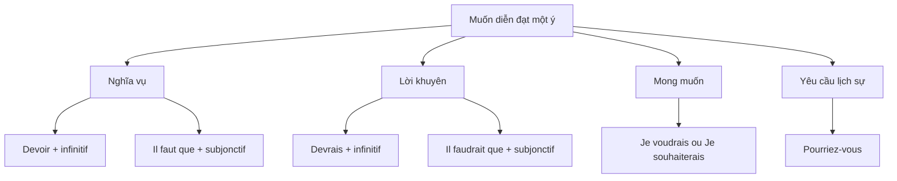

# Unité 4 — Leçon 15 : Demain, j'arrête...

**TL;DR:** Dùng `devoir + infinitif` để diễn đạt nghĩa vụ, `devrais + infinitif` để đưa lời khuyên và `subjonctif présent` sau các cấu trúc như `Il faut que`, `Il faudrait que`. Conditionnel présent còn diễn đạt mong muốn và yêu cầu lịch sự.

## Mục tiêu học tập

- Trình bày vấn đề sức khỏe và thói quen xấu.
- Thành lập và sử dụng subjonctif présent.
- Phân biệt lời khuyên và nghĩa vụ.
- Vận dụng conditionnel présent trong giao tiếp.

## Bối cảnh

Camille muốn từ bỏ những thói quen xấu nhưng chưa thành công. Cô đến gặp bác sĩ để xin lời khuyên và tìm cách cải thiện sức khỏe.

## 15.1. La santé et les habitudes — Sức khỏe và thói quen

### Từ vựng

| Tiếng Pháp | Nghĩa |
| --- | --- |
| un fumeur | Người hút thuốc |
| arrêter de fumer | Bỏ thuốc lá |
| se détendre | Thư giãn |
| prendre du poids | Tăng cân |
| perdre quelques kilos | Giảm vài kilogram |
| sans succès | Không thành công |
| éviter | Tránh |
| indispensable | Thiết yếu |
| se mettre au sport | Bắt đầu tập thể thao |
| prendre rendez-vous | Đặt lịch hẹn |
| conseiller | Khuyên |
| motiver | Tạo động lực |
| le courage | Sự can đảm |
| préoccupant | Đáng lo ngại |

### Trình bày vấn đề

J'ai déjà essayé d'arrêter de fumer, mais sans succès.

— Tôi đã từng thử bỏ thuốc nhưng không thành công.

Je voudrais me mettre au sport.

— Tôi muốn bắt đầu tập thể thao.

Ce problème de santé me préoccupe.

— Vấn đề sức khỏe này khiến tôi lo lắng.

```visual-flow
title: Parler de sa santé
direction: horizontal
alert-triangle | Le problème | Trình bày vấn đề
refresh-cw | Les tentatives | Những giải pháp đã thử
users | Le conseil | Xin lời khuyên
check-circle | La résolution | Quyết tâm thay đổi
```

### Luyện tập

```quiz-deck
L15-01 | single_choice | Camille a essayé plusieurs fois, mais sans succès. Sans succès signifie... | Không khó khăn | Không thành công | Không cần thiết | Không lo lắng | 2 | Sans succès nghĩa là không đạt kết quả mong muốn.
L15-02 | single_choice | Camille veut commencer une activité sportive. Elle veut... | se détendre | prendre du poids | arrêter le sport | se mettre au sport | 4 | Se mettre au sport là bắt đầu tập thể thao.
L15-03 | single_choice | Ce problème me préoccupe. | Vấn đề này khiến tôi lo lắng. | Vấn đề này khiến tôi vui. | Tôi đã giải quyết vấn đề. | Tôi không quan tâm. | 1 | Préoccuper nghĩa là khiến ai đó lo lắng.
L15-04 | word_order | Tôi muốn đặt lịch hẹn với bác sĩ. | avec le médecin / prendre / Je voudrais / rendez-vous | Je voudrais prendre rendez-vous avec le médecin. | Prendre rendez-vous avec quelqu'un là đặt lịch hẹn với ai.
```

## 15.2. Devoir + infinitif — Nghĩa vụ và lời khuyên

Bác sĩ nói với Camille:

Vous devez faire attention à votre santé.

— Bạn phải chú ý đến sức khỏe.

Vous devriez faire du sport régulièrement.

— Bạn nên tập thể thao thường xuyên.

Hai câu có mức độ bắt buộc khác nhau.

### Cách chia devoir

| Sujet | Présent | Conditionnel |
| --- | --- | --- |
| Je | dois | devrais |
| Tu | dois | devrais |
| Il / Elle | doit | devrait |
| Nous | devons | devrions |
| Vous | devez | devriez |
| Ils / Elles | doivent | devraient |

### Cấu trúc

```visual-compare
title: Obligation ou conseil ?
[Obligation]
icon: alert-triangle
badge: Présent
description: Nghĩa vụ hoặc điều cần làm.
send: devoir + infinitif
receive: Tu dois arrêter de fumer.
note: Bạn phải bỏ thuốc.
useCase: Yêu cầu, quy định, nghĩa vụ.
[Conseil]
icon: users
badge: Conditionnel
description: Lời khuyên nhẹ nhàng.
send: devoir au conditionnel + infinitif
receive: Tu devrais te reposer.
note: Bạn nên nghỉ ngơi.
useCase: Tư vấn và đề xuất.
```

### Phủ định

Vous ne devez pas fumer ici.

— Bạn không được hút thuốc ở đây.

Tu ne devrais pas travailler autant.

— Bạn không nên làm việc nhiều như vậy.

Sau `devoir`, động từ chính luôn ở dạng nguyên mẫu.

### Luyện tập

```quiz-deck
L15-05 | single_choice | Nous ___ faire attention à notre santé. | devez | doivent | devons | dois | 3 | Nous devons là dạng présent của devoir.
L15-06 | single_choice | Muốn đưa lời khuyên nhẹ nhàng, bạn nói gì? | Tu devrais te reposer. | Tu dois te reposer. | Tu te reposes. | Tu viens de te reposer. | 1 | Devrais diễn đạt lời khuyên.
L15-07 | single_choice | Vous devez ___ rendez-vous. | prenez | preniez | pris | prendre | 4 | Sau devoir dùng infinitif.
L15-08 | single_choice | Vous ne devez pas fumer ici. | Mong muốn | Điều cấm | Thói quen | Giả định | 2 | Ne devez pas diễn đạt điều không được làm trong ngữ cảnh này.
L15-09 | word_order | Bạn nên ăn ít chất béo hơn. | moins gras / manger / Tu devrais | Tu devrais manger moins gras. | Devrais + infinitif diễn đạt lời khuyên.
```

## 15.3. Le subjonctif présent — Cách chia động từ

Bác sĩ muốn nhấn mạnh sự cần thiết:

Il faut que tu aies du courage.

— Bạn cần có sự can đảm.

Il faut que tu fasses attention.

— Bạn cần phải cẩn thận.

`Aies` và `fasses` thuộc subjonctif présent, không phải indicatif présent.

### Cách thành lập

Với phần lớn động từ:

- Je, tu, il, ils: lấy gốc của `ils` ở présent, bỏ `-ent`.
- Nous, vous: lấy gốc của `nous` ở présent, bỏ `-ons`.
- Thêm đuôi `-e, -es, -e, -ions, -iez, -ent`.

```visual-flow
title: Former le subjonctif
direction: horizontal
search | Ils parlent | Xác định dạng présent
filter | parl- | Bỏ đuôi -ent
settings | parl- + es | Thêm đuôi tương ứng với tu
check-circle | Que tu parles | Subjonctif présent
```

### Động từ thông thường

| Sujet | Đuôi | Parler | Finir |
| --- | --- | --- | --- |
| que je | -e | parle | finisse |
| que tu | -es | parles | finisses |
| qu'il | -e | parle | finisse |
| que nous | -ions | parlions | finissions |
| que vous | -iez | parliez | finissiez |
| qu'ils | -ent | parlent | finissent |

### Động từ bất quy tắc

| Verbe | Je | Tu | Il | Nous | Vous | Ils |
| --- | --- | --- | --- | --- | --- | --- |
| être | sois | sois | soit | soyons | soyez | soient |
| avoir | aie | aies | ait | ayons | ayez | aient |
| aller | aille | ailles | aille | allions | alliez | aillent |
| faire | fasse | fasses | fasse | fassions | fassiez | fassent |
| pouvoir | puisse | puisses | puisse | puissions | puissiez | puissent |
| savoir | sache | saches | sache | sachions | sachiez | sachent |
| vouloir | veuille | veuilles | veuille | voulions | vouliez | veuillent |

### Luyện tập

```quiz-deck
L15-10 | single_choice | Il faut que tu ___ du courage. | as | aurais | aies | auras | 3 | Avoir ở subjonctif với tu là aies.
L15-11 | single_choice | Il est important qu'elle ___ en bonne santé. | soit | est | sera | serait | 1 | Être ở subjonctif với elle là soit.
L15-12 | single_choice | Il faudrait que vous ___ attention. | faites | ferez | feriez | fassiez | 4 | Faire ở subjonctif với vous là fassiez.
L15-13 | single_choice | Il faut que nous ___ au médecin. | parlons | parlions | parlerons | parlerions | 2 | Parler ở subjonctif với nous là parlions.
L15-14 | word_order | Bạn cần hoàn thành công việc này. | ce travail / que tu / Il faut / finisses | Il faut que tu finisses ce travail. | Il faut que yêu cầu subjonctif.
```

## 15.4. Conseil et obligation — Lời khuyên và nghĩa vụ

Camille muốn biết mình cần thay đổi điều gì.

Il faut faire attention à son alimentation.

— Cần chú ý đến chế độ ăn uống.

Il faut que tu fasses attention à ton alimentation.

— Bạn cần chú ý đến chế độ ăn uống của mình.

Câu thứ nhất diễn đạt yêu cầu chung; câu thứ hai xác định rõ người thực hiện.

### Các cấu trúc quan trọng

| Cấu trúc | Ý nghĩa | Ví dụ |
| --- | --- | --- |
| Il faut que... | Cần phải... | Il faut que tu fasses attention. (Bạn cần phải cẩn thận.) |
| Il est indispensable que... | Nhất thiết phải... | Il est indispensable que vous sachiez utiliser cet appareil. (Nhất thiết bạn phải biết dùng thiết bị này.) |
| Il est important que... | Điều quan trọng là... | Il est important qu'elle soit en bonne santé. (Điều quan trọng là cô ấy khỏe mạnh.) |
| Il vaut mieux que... | Tốt hơn hết là... | Il vaut mieux que tu ailles voir un médecin. (Tốt hơn hết bạn nên đi khám bác sĩ.) |
| Il faudrait que... | Nên... | Il faudrait que tu dormes davantage. (Bạn nên ngủ nhiều hơn.) |
| Ce serait bien que... | Sẽ tốt nếu... | Ce serait bien qu'ils en parlent. (Sẽ tốt nếu họ nói về điều đó.) |
| Il serait préférable que... | Sẽ tốt hơn nếu... | Il serait préférable que tu te reposes. (Sẽ tốt hơn nếu bạn nghỉ ngơi.) |

Các cấu trúc trên yêu cầu subjonctif trong mệnh đề theo sau.

### Infinitif hay subjonctif?

```visual-decision
title: Infinitif ou subjonctif ?
Chủ ngữ trực tiếp với devoir | Devoir + infinitif | Tu dois faire du sport.
Yêu cầu chung | Il faut + infinitif | Il faut faire du sport.
Yêu cầu với chủ ngữ cụ thể | Il faut que + subjonctif | Il faut que tu fasses du sport.
Lời khuyên với chủ ngữ cụ thể | Il faudrait que + subjonctif | Il faudrait que tu fasses du sport.
```

### Luyện tập

```quiz-deck
L15-15 | single_choice | Il faut ___ attention. | faire | faites | fassiez | fait | 1 | Il faut không có que đi trực tiếp với infinitif.
L15-16 | single_choice | Il faudrait qu'elle ___ rendez-vous. | prend | prenne | prendra | prendrait | 2 | Prendre ở subjonctif với elle là prenne.
L15-17 | single_choice | Il vaut mieux que vous ___ moins de café. | buvez | boirez | buviez | boiriez | 3 | Boire ở subjonctif với vous là buviez.
L15-18 | single_choice | Il est important qu'il se ___ au sport. | met | mettra | mettrait | mette | 4 | Se mettre ở subjonctif với il là se mette.
L15-19 | word_order | Tốt hơn hết bạn nên đi khám bác sĩ. | que tu / voir un médecin / Il vaut mieux / ailles | Il vaut mieux que tu ailles voir un médecin. | Il vaut mieux que + subjonctif.
```

## 15.5. Les fonctions du conditionnel présent

Camille tiếp tục trao đổi với bác sĩ.

— Je suis très stressée en ce moment.

— Vous devriez prendre des vacances.

— J'aimerais bien, mais j'ai trop de travail.

— Il faudrait que vous en parliez à votre responsable.

<details>
<summary>Dịch</summary>

— Gần đây tôi rất căng thẳng.

— Bạn nên đi nghỉ.

— Tôi rất muốn, nhưng tôi có quá nhiều việc.

— Bạn nên trao đổi về việc đó với người quản lý.

</details>

### Ba chức năng trọng tâm

```visual-grid
title: Les fonctions du conditionnel
columns: 3
users | Conseil | Tu devrais te reposer. — Bạn nên nghỉ ngơi.
star | Souhait | Je souhaiterais voyager. — Tôi muốn đi du lịch.
mail | Demande polie | Pourriez-vous m'aider ? — Bạn có thể giúp tôi không?
```

| Chức năng | Cấu trúc | Ví dụ |
| --- | --- | --- |
| Lời khuyên | Tu devrais... | Tu devrais te reposer. (Bạn nên nghỉ ngơi.) |
| Lời khuyên | Il faudrait que... | Il faudrait que tu fasses du sport. (Bạn nên tập thể thao.) |
| Mong muốn | Je voudrais... | Je voudrais me mettre au sport. (Tôi muốn bắt đầu tập thể thao.) |
| Mong muốn | J'aimerais... | J'aimerais partir en vacances. (Tôi muốn đi nghỉ.) |
| Mong muốn | Je souhaiterais... | Je souhaiterais voyager. (Tôi muốn đi du lịch.) |
| Yêu cầu lịch sự | Pourriez-vous... ? | Pourriez-vous m'aider ? (Bạn có thể giúp tôi không?) |

Conditionnel còn diễn đạt kết quả giả định, đã học ở Leçon 13.

### Luyện tập

```quiz-deck
L15-20 | single_choice | Tu devrais prendre des vacances. | Conseil | Souhait | Demande polie | Fait | 1 | Devrais diễn đạt lời khuyên.
L15-21 | single_choice | Je souhaiterais apprendre à cuisiner. | Obligation | Souhait | Conseil | Habitude | 2 | Souhaiter au conditionnel diễn đạt mong muốn.
L15-22 | single_choice | Pourriez-vous me donner des renseignements ? | Fait | Conseil | Demande polie | Souhait | 3 | Pourriez-vous diễn đạt yêu cầu lịch sự.
L15-23 | single_choice | Il faudrait que tu dormes davantage. | Habitude | Fait | Souhait | Conseil | 4 | Il faudrait que diễn đạt lời khuyên.
L15-24 | word_order | Tôi muốn giảm ba kilogram. | trois kilos / perdre / Je souhaiterais | Je souhaiterais perdre trois kilos. | Conditionnel diễn đạt mong muốn.
```

## 15.6. Prononciation — Phát âm

Một số động từ thay đổi cách phát âm giữa indicatif và subjonctif.

Indicatif présentSubjonctif présentje tiens /tjɛ̃/que je tienne /tjɛn/tu finis /fini/que tu finisses /finis/elle choisit /ʃwazi/qu'elle choisisse /ʃwazis/vous trouvez /tʁuve/que vous trouviez /tʁuvje/on reconnaît /ʁəkɔnɛ/qu'on reconnaisse /ʁəkɔnɛs/

Chú ý âm /s/ trong `finisses`, `choisisse`, `reconnaisse` và âm /j/ trong `trouviez`.

## Lỗi thường gặp

| Sai | Đúng |
| --- | --- |
| Tu dois fais du sport. | Tu dois faire du sport. |
| Il faut que tu fais du sport. | Il faut que tu fasses du sport. |
| Il faut que vous êtes prudents. | Il faut que vous soyez prudents. |
| Il faut que j'ai du courage. | Il faut que j'aie du courage. |
| Il faudrait que tu irais au médecin. | Il faudrait que tu ailles chez le médecin. |
| Si j'aurais le temps... | Si j'avais le temps... |

```visual-callout
tone: warning
title: Hai thức động từ trong cùng một câu
Il faudrait que tu fasses du sport.
Faudrait: conditionnel présent, diễn đạt lời khuyên.
Fasses: subjonctif présent, được yêu cầu bởi cấu trúc Il faudrait que.
```

## Mental Model — Kiến thức tổng thể



## Ôn tập tổng hợp — 20 câu

```quiz-deck
L15-25 | single_choice | Il faut que je ___ de fumer. | arrête | arrêter | arrêterai | arrêterais | 1 | Il faut que yêu cầu subjonctif.
L15-26 | single_choice | Vous devez ___ vos bonnes résolutions. | respectez | respecter | respectiez | respecterez | 2 | Devoir + infinitif.
L15-27 | single_choice | Il est important que nous ___ prudents. | sommes | serons | soyons | serions | 3 | Être ở subjonctif với nous là soyons.
L15-28 | single_choice | Il faudrait que vous ___ davantage de patience. | avez | aurez | auriez | ayez | 4 | Avoir ở subjonctif với vous là ayez.
L15-29 | single_choice | Il vaut mieux qu'elle ___ ses exercices le matin. | fasse | fait | fera | ferait | 1 | Faire ở subjonctif với elle là fasse.
L15-30 | single_choice | Ce serait bien que tu ___ à la piscine demain. | vas | ailles | iras | irais | 2 | Aller ở subjonctif với tu là ailles.
L15-31 | single_choice | Il faut qu'il ___ se détendre. | peut | pourra | puisse | pourrait | 3 | Pouvoir ở subjonctif với il là puisse.
L15-32 | single_choice | Il est indispensable que vous ___ utiliser cet appareil. | savez | saurez | sauriez | sachiez | 4 | Savoir ở subjonctif với vous là sachiez.
L15-33 | single_choice | Quelle phrase exprime une obligation ? | Vous devez respecter les règles. | Vous devriez vous reposer. | J'aimerais voyager. | Pourriez-vous venir ? | 1 | Devoir au présent diễn đạt nghĩa vụ.
L15-34 | single_choice | Si j'avais moins de travail, je ___ davantage. | dormais | dormirais | dors | dormirai | 2 | Si + imparfait, conditionnel présent.
L15-35 | single_choice | Et si nous ___ un peu plus tôt ? | partirions | partons | partions | partirons | 3 | Et si + imparfait diễn đạt đề xuất.
L15-36 | single_choice | Tu parles de tes mauvaises habitudes ? Oui, j'___ parle. | y | lui | le | en | 4 | En thay bổ ngữ có de.
L15-37 | single_choice | Tu penses à tes bonnes résolutions ? Oui, j'___ pense. | y | en | lui | la | 1 | Y thay bổ ngữ có à chỉ sự việc.
L15-38 | single_choice | Je fais du sport ___ les matins. | tout | tous | toute | toutes | 2 | Matins giống đực số nhiều.
L15-39 | single_choice | Elle devrait avoir une ___ alimentation. | mieux | meilleur | meilleure | meilleurs | 3 | Alimentation giống cái số ít.
L15-40 | single_choice | Il faut que vous ___ votre consommation de sucre. | limitez | limiterez | limiter | limitiez | 4 | Limiter ở subjonctif với vous là limitiez.
L15-41 | word_order | Anh ấy phải tránh những thói quen xấu. | les mauvaises habitudes / éviter / Il doit | Il doit éviter les mauvaises habitudes. | Devoir + infinitif.
L15-42 | word_order | Chúng ta nên đi nghỉ. | que nous / des vacances / Il faudrait / prenions | Il faudrait que nous prenions des vacances. | Il faudrait que + subjonctif.
L15-43 | word_order | Điều quan trọng là cô ấy trao đổi về việc đó với bác sĩ. | qu'elle / Il est important / en parle / à son médecin | Il est important qu'elle en parle à son médecin. | Kết hợp subjonctif và đại từ en.
L15-44 | word_order | Bạn có thể giải thích vấn đề cho tôi không? | le problème / m'expliquer / Pourriez-vous | Pourriez-vous m'expliquer le problème ? | Conditionnel diễn đạt yêu cầu lịch sự.
```

## Flashcards — Từ vựng và cấu trúc

```flipcard
un fumeur | Người hút thuốc | C'est un ancien fumeur.
arrêter de fumer | Bỏ thuốc lá | Je voudrais arrêter de fumer.
se détendre | Thư giãn | Tu devrais te détendre.
prendre du poids | Tăng cân | Il a pris du poids.
perdre quelques kilos | Giảm vài kilogram | Elle voudrait perdre quelques kilos.
sans succès | Không thành công | J'ai essayé sans succès.
éviter | Tránh | Il faut éviter les mauvaises habitudes.
indispensable | Thiết yếu | C'est indispensable.
se mettre au sport | Bắt đầu tập thể thao | Je voudrais me mettre au sport.
prendre rendez-vous | Đặt lịch hẹn | Je dois prendre rendez-vous.
conseiller | Khuyên | Le médecin me conseille.
motiver | Tạo động lực | Elle me motive.
le courage | Sự can đảm | Il faut avoir du courage.
préoccupant | Đáng lo ngại | Ce problème est préoccupant.
devoir + infinitif | Nghĩa vụ | Tu dois travailler.
devrais + infinitif | Lời khuyên | Tu devrais te reposer.
Il faut que | Sự cần thiết + subjonctif | Il faut que tu sois prudent.
Il faudrait que | Lời khuyên + subjonctif | Il faudrait que tu dormes plus.
Il vaut mieux que | Tốt hơn hết + subjonctif | Il vaut mieux que tu partes.
Je souhaiterais | Mong muốn | Je souhaiterais voyager.
Pourriez-vous | Yêu cầu lịch sự | Pourriez-vous m'aider ?
```

## Tóm tắt — TL;DR

| Kiến thức | Cấu trúc | Ví dụ |
| --- | --- | --- |
| Nghĩa vụ | devoir + infinitif | Tu dois travailler. (Bạn phải làm việc.) |
| Lời khuyên | devrais + infinitif | Tu devrais travailler. (Bạn nên làm việc.) |
| Yêu cầu chung | Il faut + infinitif | Il faut travailler. (Cần phải làm việc.) |
| Nghĩa vụ cụ thể | Il faut que + subjonctif | Il faut que tu travailles. (Bạn cần phải làm việc.) |
| Lời khuyên nhẹ nhàng | Il faudrait que + subjonctif | Il faudrait que tu travailles. (Bạn nên làm việc.) |
| Mong muốn | Je voudrais / J'aimerais / Je souhaiterais + infinitif | Je souhaiterais voyager. (Tôi muốn đi du lịch.) |
| Yêu cầu lịch sự | Pourriez-vous + infinitif ? | Pourriez-vous m'aider ? (Bạn có thể giúp tôi không?) |
| Đuôi subjonctif | -e, -es, -e, -ions, -iez, -ent | Il faut que tu parles. (Bạn cần phải nói.) |

**Ghi nhớ:** Devoir đi với infinitif. Các cấu trúc như `Il faut que` và `Il faudrait que` yêu cầu subjonctif.

**Sau bài này, tôi có thể:** trình bày vấn đề sức khỏe, đưa lời khuyên, diễn đạt nghĩa vụ và giao tiếp lịch sự.

*Camille là nhân vật minh họa. Không đưa bài nghe Piste 19, hình ảnh và ô chữ vào bài tập vì thiếu dữ liệu. Nội dung sức khỏe chỉ phục vụ việc học tiếng Pháp.*
