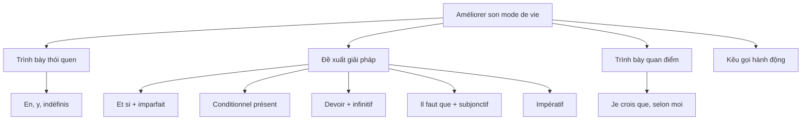

# Unité 4 — Leçon 16 : La journée du sport

**TL;DR:** Vận dụng `subjonctif`, `conditionnel`, `en`, `y` và các cấu trúc chỉ nghĩa vụ, lời khuyên để thảo luận về sức khỏe, trình bày quan điểm và viết bản tuyên ngôn. Đây là bài ôn tập tổng hợp Leçon 13–15.

## Mục tiêu học tập

- Trình bày nguyên nhân, hậu quả và giải pháp.
- Bày tỏ quan điểm đồng tình hoặc phản đối.
- Chia sẻ trải nghiệm thay đổi thói quen.
- Viết bản tuyên ngôn kêu gọi hành động.

## Bối cảnh

Camille tham gia *La journée du sport*. Cô tìm hiểu vấn đề thiếu vận động, thảo luận với những người tham gia và viết bản tuyên ngôn khuyến khích lối sống năng động.

## 16.1. L'activité physique — Hoạt động thể chất

### Từ vựng

| Tiếng Pháp | Nghĩa |
| --- | --- |
| une activité physique | Hoạt động thể chất |
| le manque d'exercice | Thiếu vận động |
| une maladie | Bệnh tật |
| un décès | Ca tử vong |
| mondial(e) | Toàn cầu |
| entraîner | Dẫn đến |
| augmenter | Tăng lên |
| une influence | Sự ảnh hưởng |
| le mode de vie | Lối sống |
| suffisant(e) | Đủ |
| prendre une décision | Đưa ra quyết định |
| un responsable politique | Người có trách nhiệm chính trị |

### Trình bày nguyên nhân và hậu quả

| Cấu trúc | Nghĩa | Ví dụ |
| --- | --- | --- |
| être la cause de | Là nguyên nhân của | Le manque d'exercice est la cause de problèmes de santé. (Thiếu vận động là nguyên nhân của các vấn đề sức khỏe.) |
| entraîner | Dẫn đến | Le manque d'exercice peut entraîner des problèmes de santé. (Thiếu vận động có thể dẫn đến các vấn đề sức khỏe.) |
| avoir une influence sur | Có ảnh hưởng đến | L'alimentation a une influence sur la santé. (Chế độ ăn uống ảnh hưởng đến sức khỏe.) |

```visual-flow
title: Cause, conséquence et solution
direction: horizontal
alert-triangle | Le manque d'exercice | Thiếu vận động
activity | Les problèmes de santé | Các vấn đề sức khỏe
check-circle | Bouger davantage | Vận động nhiều hơn
```

### Luyện tập

```quiz-deck
L16-01 | single_choice | Le manque d'exercice signifie... | Tập luyện quá nhiều | Thiếu vận động | Thiếu thức ăn | Thiếu thời gian | 2 | Le manque de diễn đạt sự thiếu hụt.
L16-02 | single_choice | Le mode de vie désigne... | Công việc | Phương tiện | Thu nhập | Lối sống | 4 | Le mode de vie là cách sống.
L16-03 | single_choice | Le manque d'exercice peut entraîner des problèmes. Entraîner signifie... | Dẫn đến | Ngăn chặn | Điều trị | Giảm bớt | 1 | Entraîner diễn đạt hậu quả.
L16-04 | single_choice | L'alimentation a une influence ___ la santé. | de | à | sur | en | 3 | Avoir une influence sur quelque chose.
L16-05 | word_order | Những người có trách nhiệm chính trị phải đưa ra quyết định. | des décisions / doivent / Les responsables politiques / prendre | Les responsables politiques doivent prendre des décisions. | Devoir + infinitif.
```

## 16.2. Le manifeste — Viết bản tuyên ngôn

Camille muốn khuyến khích mọi người vận động. Cô cần trình bày thực trạng, đề xuất giải pháp và kêu gọi hành động.

### Cấu trúc bản tuyên ngôn

```visual-flow
title: Construire un manifeste
direction: vertical
search | La situation actuelle | Trình bày thực trạng và vấn đề
settings | Les objectifs | Xác định mục tiêu và giải pháp
zap | Le slogan | Kêu gọi mọi người hành động
```

### Các cấu trúc cần sử dụng

| Cấu trúc | Chức năng | Ví dụ |
| --- | --- | --- |
| Il faut que + subjonctif | Nghĩa vụ | Il faut que les gens bougent davantage. (Mọi người cần vận động nhiều hơn.) |
| Il est indispensable que + subjonctif | Sự cần thiết | Il est indispensable que vous soyez prudents. (Điều tối cần thiết là bạn phải cẩn thận.) |
| Il faudrait que + subjonctif | Đề xuất | Il faudrait que nous soyons plus actifs. (Chúng ta nên năng động hơn.) |
| Devoir + infinitif | Nghĩa vụ | Les responsables doivent prendre des décisions. (Những người có trách nhiệm phải đưa ra quyết định.) |
| Impératif | Kêu gọi hành động | Ensemble, bougeons ! (Cùng nhau vận động!) |

### Bản tuyên ngôn mẫu — Pour une vie plus active

**La situation actuelle**

Beaucoup de personnes ne font pas assez de sport.

**Les objectifs**

Il faut que les gens bougent davantage.

Il faudrait que les responsables politiques prennent des décisions.

**Le slogan**

Ensemble, bougeons !

<details>
<summary>Dịch</summary>

**Thực trạng hiện tại**

Nhiều người không tập thể thao đủ.

**Mục tiêu**

Mọi người cần vận động nhiều hơn.

Những người có trách nhiệm chính trị nên đưa ra các quyết định.

**Khẩu hiệu**

Cùng nhau vận động!

</details>

### Luyện tập

```quiz-deck
L16-06 | single_choice | Il faut que les gens ___ davantage. | bougent | bouger | bougeront | bougeraient | 1 | Il faut que yêu cầu subjonctif.
L16-07 | single_choice | Il faudrait que nous ___ plus actifs. | sommes | soyons | serons | serions | 2 | Être ở subjonctif với nous là soyons.
L16-08 | single_choice | Ensemble, bougeons ! Cette phrase correspond à... | La situation actuelle | La cause | Le slogan | Une hypothèse | 3 | Khẩu hiệu kêu gọi hành động.
L16-09 | single_choice | Les responsables doivent ___ des décisions. | prennent | prendront | prendraient | prendre | 4 | Devoir đi với infinitif.
L16-10 | word_order | Hãy tham gia các hoạt động! | aux / Participez / activités | Participez aux activités ! | Impératif dùng để kêu gọi hành động.
```

## 16.3. Pour ou contre ? — Đồng tình và phản đối

Trong ngày hội thể thao, Camille đọc những ý kiến khác nhau về việc ăn kiêng.

### Từ vựng

| Tiếng Pháp | Nghĩa |
| --- | --- |
| être pour | Ủng hộ |
| être contre | Phản đối |
| être bien dans sa peau | Cảm thấy thoải mái với bản thân |
| être satisfait de | Hài lòng với |
| refuser de | Từ chối |
| respecter | Tôn trọng |
| un souci | Mối lo |
| peser | Có cân nặng |
| une balance | Cái cân |
| un objectif | Mục tiêu |

### Trình bày quan điểm

Je suis contre les régimes.

— Tôi phản đối việc ăn kiêng.

J'estime que le sport est important.

— Tôi cho rằng thể thao quan trọng.

Je crois que chacun doit faire ce qu'il veut.

— Tôi nghĩ mỗi người có quyền lựa chọn.

Il faut respecter les choix de chacun.

— Cần tôn trọng lựa chọn của mỗi người.

```visual-grid
title: Exprimer son opinion
columns: 3
check-circle | Être pour | Bày tỏ sự ủng hộ
unlink | Être contre | Bày tỏ sự phản đối
users | Je crois que... | Trình bày quan điểm cá nhân
```

### Đọc hiểu — Pour ou contre les régimes ?

| Personne | Quan điểm |
| --- | --- |
| Max | Tôn trọng lựa chọn cá nhân, coi trọng vận động. |
| Édith | Phản đối ăn kiêng vì làm mất niềm vui. |
| Abdel | Quan điểm phụ thuộc vào văn hóa. |
| Fabrice | Từng phản đối nhưng hiện cho rằng đôi khi ăn kiêng là cần thiết. |

Theo bài đọc, Fabrice giảm từ 82 kg xuống 77 kg. Mục tiêu ban đầu của anh là giảm 7 kg.

### Luyện tập

```quiz-deck
L16-11 | single_choice | Qui est contre les régimes parce qu'ils réduisent le plaisir ? | Max | Abdel | Édith | Fabrice | 3 | Édith phản đối việc ăn kiêng.
L16-12 | single_choice | Qui parle des différences culturelles ? | Abdel | Max | Fabrice | Édith | 1 | Abdel đề cập đến văn hóa.
L16-13 | single_choice | Combien de kilos Fabrice a-t-il perdus ? | Deux | Trois | Sept | Cinq | 4 | Fabrice giảm 82 - 77 = 5 kg.
L16-14 | single_choice | J'estime que le sport est important. | Une obligation | Une opinion | Une question | Un ordre | 2 | J'estime que dùng để trình bày quan điểm.
L16-15 | word_order | Tôi từ chối ăn kiêng. | un régime / de faire / Je refuse | Je refuse de faire un régime. | Refuser de + infinitif.
```

## 16.4. Le témoignage — Chia sẻ trải nghiệm

Camille muốn kể lại quá trình thay đổi thói quen của mình.

Avant, je ne faisais pas beaucoup de sport.

— Trước đây, tôi không tập thể thao nhiều.

J'ai décidé de changer mes habitudes.

— Tôi đã quyết định thay đổi thói quen.

Aujourd'hui, je marche régulièrement et je me sens mieux.

— Hiện nay, tôi đi bộ thường xuyên và cảm thấy khỏe hơn.

Si j'avais plus de temps, je ferais davantage de sport.

— Nếu có nhiều thời gian hơn, tôi sẽ tập thể thao nhiều hơn.

### Lựa chọn thì và thức động từ

```visual-timeline
title: Raconter son expérience
Avant | Imparfait | Mô tả thói quen trước đây
La décision | Passé composé | Kể sự kiện thay đổi
Aujourd'hui | Présent | Mô tả tình trạng hiện tại
Hypothèse | Conditionnel | Diễn đạt kết quả giả định
```

### Đưa ra giải pháp giả định

Que feriez-vous si vous étiez responsable politique ?

— Bạn sẽ làm gì nếu là người có trách nhiệm chính trị?

Si j'étais responsable politique, je prendrais des décisions pour encourager les activités physiques.

— Nếu đảm nhiệm vai trò đó, tôi sẽ đưa ra các quyết định khuyến khích hoạt động thể chất.

### Bài chia sẻ mẫu

> Avant, je ne faisais pas beaucoup de sport. J'ai décidé de changer mes habitudes. Aujourd'hui, je marche régulièrement et je me sens mieux.
> 
> Selon moi, il est important que chacun fasse attention à sa santé. Il vaut mieux choisir des activités qui nous plaisent.

<details>
<summary>Dịch</summary>

Trước đây, tôi không tập thể thao nhiều. Tôi đã quyết định thay đổi thói quen. Hiện nay, tôi đi bộ thường xuyên và cảm thấy khỏe hơn.

Theo tôi, điều quan trọng là mỗi người chú ý đến sức khỏe. Tốt hơn hết nên chọn những hoạt động mình yêu thích.

</details>

### Luyện tập

```quiz-deck
L16-16 | single_choice | Avant, Camille ne ___ pas régulièrement de sport. | faisait | ferait | fera | faire | 1 | Imparfait mô tả thói quen trước đây.
L16-17 | single_choice | Hier, elle a ___ de changer ses habitudes. | décide | décidé | décider | décidait | 2 | Passé composé dùng participe passé.
L16-18 | single_choice | Si j'étais responsable politique, je ___ les activités physiques. | encourageais | encouragerai | encouragerais | encourager | 3 | Kết quả giả định dùng conditionnel.
L16-19 | single_choice | Il est important que chacun ___ attention à sa santé. | fait | fera | ferait | fasse | 4 | Faire ở subjonctif là fasse.
L16-20 | word_order | Tôi đã quyết định thay đổi thói quen. | mes habitudes / J'ai décidé / de changer | J'ai décidé de changer mes habitudes. | Passé composé diễn đạt quyết định đã xảy ra.
```

## 16.5. Révision grammaticale — Ôn tập ngữ pháp

### En và y

| Câu hỏi | Trả lời |
| --- | --- |
| Tu fais du sport ? | Oui, j'en fais. |
| Tu parles de ta santé ? | Oui, j'en parle. |
| Tu vas à la piscine ? | Oui, j'y vais. |
| Tu penses à ta santé ? | Oui, j'y pense. |

### Tính từ và đại từ bất định

Adjectif indéfiniPronom indéfinicertains participantscertainsquelques participantesquelques-unesplusieurs personnesplusieurstous les sportifstous

### Những lỗi thường gặp

| Sai | Đúng |
| --- | --- |
| Si j'aurais le temps... | Si j'avais le temps... |
| Et si tu ferais du sport ? | Et si tu faisais du sport ? |
| Tu dois fais attention. | Tu dois faire attention. |
| Il faut que tu fais attention. | Il faut que tu fasses attention. |
| Je vais y. | J'y vais. |
| Chaque jours | Chaque jour |

## Lỗi thường gặp

```visual-callout
tone: pitfall
title: Các lỗi dễ mắc trong bài
- **Nhầm thức động từ sau `il faut que` / `il faudrait que` và `devoir`:** Các cấu trúc `il faut que`, `il est indispensable que`, `il faudrait que` luôn đi với **subjonctif**, còn `devoir` đi với **infinitif**. Ví dụ đúng: *Il faut que les gens bougent davantage.* (Mọi người cần vận động nhiều hơn.) — *Les responsables doivent prendre des décisions.* (Những người có trách nhiệm phải đưa ra quyết định.)
- **Chia sai `être` ở subjonctif với `nous`:** Tránh dùng *sommes*, phải dùng *soyons*. Ví dụ đúng: *Il faudrait que nous soyons plus actifs.* (Chúng ta nên năng động hơn.)
- **Dùng sai giới từ sau `avoir une influence` và `refuser`:** Dùng `sur` cho *avoir une influence* và `de` cho *refuser* + infinitif. Ví dụ đúng: *L'alimentation a une influence sur la santé.* (Chế độ ăn uống có ảnh hưởng đến sức khỏe.) — *Je refuse de faire un régime.* (Tôi từ chối ăn kiêng.)
- **Sai thì trong câu giả định `Si + imparfait`:** Mệnh đề kết quả phải chia ở **conditionnel présent**, không dùng *futur simple*. Ví dụ đúng: *Si j'avais plus de temps, je ferais davantage de sport.* (Nếu có nhiều thời gian hơn, tôi sẽ tập thể thao nhiều hơn.)
```

## Mental Model — Tổng hợp Unité 4



## Ôn tập tổng hợp — 20 câu

```quiz-deck
L16-21 | single_choice | Si vous ___ mieux, vous seriez moins fatigués. | dormiez | dormiriez | dormez | dormirez | 1 | Si + imparfait.
L16-22 | single_choice | Si elle avait du temps, elle ___ à la piscine. | allait | irait | ira | aller | 2 | Kết quả giả định dùng conditionnel.
L16-23 | single_choice | Il fait un footing ___ matin. | plusieurs | quelques | chaque | certains | 3 | Chaque + danh từ số ít.
L16-24 | single_choice | Elle prend des cours de gym ___ les semaines. | tout | tous | toute | toutes | 4 | Semaines giống cái số nhiều.
L16-25 | single_choice | Tu as acheté trois pommes ? Oui, j'en ai acheté ___. | trois | des | du | de | 1 | Giữ số lượng khi dùng en.
L16-26 | single_choice | Vous allez au stade ? Oui, nous ___ allons. | en | y | le | lui | 2 | Y thay thế nơi chốn.
L16-27 | single_choice | Je ne suis pas satisfait de mon alimentation. | Je n'y suis pas satisfait. | Je ne la suis pas satisfait. | Je n'en suis pas satisfait. | Je ne lui suis pas satisfait. | 3 | Être satisfait de dùng en.
L16-28 | single_choice | Toutes tes amies font du sport ? Non, ___ seulement. | quelques-uns | certains | tous | quelques-unes | 4 | Amies giống cái số nhiều.
L16-29 | single_choice | Il faut que tu ___ tes bonnes résolutions. | respectes | respecter | respecteras | respecterais | 1 | Il faut que + subjonctif.
L16-30 | single_choice | Il vaut mieux que nous ___ chez le médecin. | allons | allions | irons | irions | 2 | Aller ở subjonctif với nous là allions.
L16-31 | single_choice | Vous devez ___ attention à votre alimentation. | faites | fassiez | faire | ferez | 3 | Devoir + infinitif.
L16-32 | single_choice | Il faudrait qu'elle ___ du courage. | a | aura | aurait | ait | 4 | Avoir ở subjonctif với elle là ait.
L16-33 | single_choice | Il est indispensable que vous ___ prudents. | soyez | êtes | serez | seriez | 1 | Être ở subjonctif với vous là soyez.
L16-34 | single_choice | Je voudrais changer mon mode de vie. | Conseil | Souhait | Obligation | Fait | 2 | Je voudrais diễn đạt mong muốn.
L16-35 | single_choice | Pourriez-vous me conseiller ? | Conseil | Fait | Demande polie | Obligation | 3 | Conditionnel diễn đạt yêu cầu lịch sự.
L16-36 | single_choice | Il faudrait que tu en parles à quelqu'un. | Habitude | Fait | Souhait | Conseil | 4 | Il faudrait que diễn đạt lời khuyên.
L16-37 | word_order | Bạn nên nghỉ ngơi nhiều hơn. | davantage / Tu devrais / te reposer | Tu devrais te reposer davantage. | Devrais + infinitif.
L16-38 | word_order | Điều quan trọng là bạn thay đổi thói quen. | que vous / vos habitudes / Il est important / changiez | Il est important que vous changiez vos habitudes. | Subjonctif présent.
L16-39 | word_order | Hay là chúng ta cùng đi bơi nhé? | à la piscine / Et si / ensemble / nous allions | Et si nous allions ensemble à la piscine ? | Et si + imparfait.
L16-40 | word_order | Chúng ta cần tôn trọng lựa chọn của mỗi người. | les choix de chacun / nous respections / Il faut que | Il faut que nous respections les choix de chacun. | Il faut que + subjonctif.
```

## Flashcards — Từ vựng và cấu trúc

```flipcard
une activité physique | Hoạt động thể chất | Je pratique une activité physique.
le manque d'exercice | Thiếu vận động | Le manque d'exercice est préoccupant.
une maladie | Bệnh tật | Il faut prévenir les maladies.
un décès | Ca tử vong | Le nombre de décès augmente.
mondial | Toàn cầu | Un problème mondial.
entraîner | Dẫn đến | Cela peut entraîner des problèmes.
augmenter | Tăng lên | Le nombre de participants augmente.
une influence | Sự ảnh hưởng | Le sport a une influence sur la santé.
le mode de vie | Lối sống | Je voudrais changer mon mode de vie.
suffisant | Đủ | Ce temps est suffisant.
prendre une décision | Đưa ra quyết định | Nous devons prendre une décision.
un responsable politique | Người có trách nhiệm chính trị | Il est responsable politique.
être pour | Ủng hộ | Je suis pour cette idée.
être contre | Phản đối | Je suis contre les régimes.
être bien dans sa peau | Thoải mái với bản thân | Elle est bien dans sa peau.
être satisfait de | Hài lòng với | Je suis satisfait de mon travail.
refuser de | Từ chối | Il refuse de partir.
respecter | Tôn trọng | Il faut respecter les autres.
un souci | Mối lo | J'ai un souci.
peser | Có cân nặng | Il pèse 77 kilos.
une balance | Cái cân | Je monte sur la balance.
un objectif | Mục tiêu | J'ai un nouvel objectif.
un manifeste | Bản tuyên ngôn | Nous écrivons un manifeste.
un témoignage | Bài chia sẻ trải nghiệm | Voici mon témoignage.
davantage | Nhiều hơn | Il faut bouger davantage.
J'estime que | Tôi cho rằng | J'estime que le sport est important.
Ensemble, bougeons ! | Cùng nhau vận động! | Ensemble, bougeons !
```

## Tóm tắt — TL;DR

| Kiến thức | Cấu trúc | Ví dụ |
| --- | --- | --- |
| Giả định | Si + imparfait, conditionnel | Si j'avais plus de temps, je ferais davantage de sport. (Nếu có nhiều thời gian hơn, tôi sẽ tập thể thao nhiều hơn.) |
| Đề xuất | Et si + imparfait ? | Et si nous allions ensemble à la piscine ? (Hay là chúng ta cùng đi bơi nhé?) |
| Tính từ bất định | chaque, plusieurs, quelques | Il fait un footing chaque matin. (Anh ấy chạy bộ mỗi sáng.) |
| Đại từ bất định | certains, tous, quelques-uns | Certains pratiquent un sport régulièrement. (Một số người tập thể thao thường xuyên.) |
| En | thay thế cụm có *de* / số lượng | J'en fais régulièrement. (Tôi thường xuyên tập.) |
| Y | thay thế nơi chốn / *à* + danh từ | J'y pense souvent. (Tôi thường xuyên nghĩ đến nó.) |
| Nghĩa vụ | Devoir + infinitif | Nous devons prendre une décision. (Chúng ta phải đưa ra quyết định.) |
| Sự cần thiết | Il faut que + subjonctif | Il faut que les gens bougent davantage. (Mọi người cần vận động nhiều hơn.) |
| Lời khuyên | Il faudrait que + subjonctif | Il faudrait que nous soyons plus actifs. (Chúng ta nên năng động hơn.) |
| Quan điểm | Je crois que..., J'estime que... | J'estime que le sport est important. (Tôi cho rằng thể thao quan trọng.) |
| Kêu gọi hành động | Impératif | Participez aux activités ! (Hãy tham gia các hoạt động!) |
| Bản tuyên ngôn | Situation, objectifs, slogan | Ensemble, bougeons ! (Cùng nhau vận động!) |

**Sau bài này, tôi có thể:** thảo luận về lối sống, trình bày nguyên nhân và hậu quả, đưa lời khuyên, kể lại trải nghiệm và viết bản tuyên ngôn ngắn bằng tiếng Pháp.

*Camille là nhân vật minh họa. Bài học không bổ sung chủ điểm ngữ pháp mới. Nội dung sức khỏe phục vụ việc học ngôn ngữ; các bài tập phụ thuộc vào hình ảnh chưa được cung cấp được lược bỏ.*
