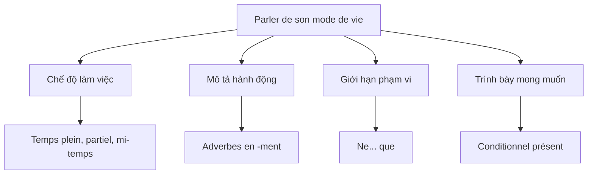

# Unité 5 — Leçon 18 : À mi-temps

**TL;DR:** Sử dụng trạng từ `-ment` để diễn đạt cách thức, tần suất, thời gian và mức độ; sử dụng `ne... que` để diễn đạt sự giới hạn. Vận dụng vào thảo luận về công việc và cân bằng cuộc sống.

## Mục tiêu học tập

- Phân biệt temps plein, temps partiel và mi-temps.
- Thành lập và sử dụng trạng từ đuôi `-ment`.
- Diễn đạt sự giới hạn bằng `ne... que`.
- Trình bày mong muốn và quan điểm về chế độ làm việc.

## Bối cảnh

Camille đang làm việc toàn thời gian. Sau khi có con, cô muốn giảm giờ làm để dành nhiều thời gian hơn cho gia đình. Cô cần trình bày mong muốn và thảo luận với giám đốc.

## 18.1. Le temps de travail — Chế độ làm việc

### Từ vựng

| Tiếng Pháp | Nghĩa |
| --- | --- |
| à temps plein | Toàn thời gian |
| à temps partiel | Bán thời gian |
| à mi-temps | Nửa thời gian |
| un congé | Kỳ nghỉ phép |
| une nourrice /nuʁis/ | Người trông trẻ |
| élever ses enfants | Nuôi dạy con |
| s'occuper de | Chăm sóc |
| reprendre son travail | Quay lại làm việc |
| la naissance /nɛsɑ̃s/ | Sự ra đời |
| une décision | Quyết định |
| une obligation | Nghĩa vụ |
| un loisir | Hoạt động giải trí |
| les mentalités | Quan niệm, tư duy |

### Phân biệt chế độ làm việc

Je travaille à temps plein.

— Tôi làm việc toàn thời gian.

J'aimerais travailler à mi-temps pour m'occuper de mes enfants.

— Tôi muốn làm việc nửa thời gian để chăm sóc con.

```visual-grid
title: Les modes de travail
columns: 3
clock | Temps plein | 35 giờ mỗi tuần
clock | Temps partiel | Ví dụ 28 giờ mỗi tuần
clock | Mi-temps | 17,5 giờ mỗi tuần
```

Với tuần làm việc toàn thời gian 35 giờ, `mi-temps` tương ứng với 17,5 giờ. Đây là một trường hợp của `temps partiel`.

### Luyện tập

```quiz-deck
L18-01 | single_choice | Camille travaille 17,5 heures sur une base de 35 heures. | Elle est au chômage. | Elle travaille à mi-temps. | Elle travaille à temps plein. | Elle est en congé. | 2 | Mi-temps tương ứng với một nửa thời gian làm việc.
L18-02 | single_choice | Qui s'occupe des enfants pendant l'absence des parents ? | Un recruteur | Un directeur | Un candidat | Une nourrice | 4 | Une nourrice là người trông trẻ.
L18-03 | single_choice | Après son congé, Camille retourne au bureau. | Elle reprend son travail. | Elle perd son emploi. | Elle change de métier. | Elle arrête de travailler. | 1 | Reprendre son travail nghĩa là quay lại làm việc.
L18-04 | single_choice | Elle a arrêté de travailler pour ___ ses enfants. | licencier | postuler | élever | reprendre | 3 | Élever ses enfants nghĩa là nuôi dạy con.
L18-05 | word_order | Người trông trẻ chăm sóc các con. | des enfants / s'occupe / La nourrice | La nourrice s'occupe des enfants. | S'occuper de nghĩa là chăm sóc.
```

## 18.2. Les adverbes en -ment — Thành lập trạng từ

Camille muốn giải thích rằng cô có thể tổ chức công việc theo cách khác.

Nous pouvons travailler différemment.

— Chúng ta có thể làm việc theo cách khác.

Je travaille sérieusement.

— Tôi làm việc nghiêm túc.

`Différemment` và `sérieusement` là trạng từ được thành lập từ tính từ.

### Quy tắc 1: Féminin + ment

| Masculin | Féminin | Adverbe |
| --- | --- | --- |
| seul | seule | seulement |
| régulier | régulière | régulièrement |
| sérieux | sérieuse | sérieusement |
| lent | lente | lentement |
| positif | positive | positivement |
| dernier | dernière | dernièrement |

### Quy tắc 2: Tính từ kết thúc bằng nguyên âm

Thông thường, thêm `-ment` trực tiếp vào dạng giống đực kết thúc bằng `-i`, `-u` hoặc `-é`.

AdjectifAdverbevraivraimentpolipolimentabsoluabsolument

### Quy tắc 3: Tính từ kết thúc bằng -ant hoặc -ent

AdjectifAdverbesuffisantsuffisammentdifférentdifféremmentrécentrécemmentfréquentfréquemmentintelligentintelligemment

```visual-decision
title: Former un adverbe
Kết thúc bằng -ant | Đổi thành -amment | suffisant devient suffisamment
Kết thúc bằng -ent | Thường đổi thành -emment | fréquent devient fréquemment
Kết thúc bằng -i, -u, -é | Thường thêm -ment trực tiếp | poli devient poliment
Trường hợp thông thường | Féminin + ment | sérieux devient sérieusement
```

**Lưu ý:** Có ngoại lệ, chẳng hạn `lent` thành `lentement`, không phải `lentemment`.

### Luyện tập

```quiz-deck
L18-06 | single_choice | Camille travaille avec sérieux. Elle travaille ___. | sérieusement | sérieuxement | sérieuxment | sérieusamment | 1 | Sérieuse + ment.
L18-07 | single_choice | Le directeur répond avec politesse. Il répond ___. | poliement | poliment | polamment | polimenté | 2 | Poli + ment.
L18-08 | single_choice | Quel est l'adverbe de suffisant ? | suffisantement | suffisemment | suffisamment | suffisantment | 3 | Đuôi -ant chuyển thành -amment.
L18-09 | single_choice | Quel est l'adverbe de fréquent ? | fréquentement | fréquentment | fréquamment | fréquemment | 4 | Đuôi -ent thường chuyển thành -emment.
L18-10 | word_order | Anh ấy làm việc một cách nghiêm túc. | sérieusement / travaille / Il | Il travaille sérieusement. | Trạng từ bổ nghĩa cho động từ.
```

## 18.3. Employer les adverbes — Sử dụng trạng từ

Camille cần giải thích cách làm việc, tần suất và mức độ hiệu quả của mình.

Elle travaille efficacement.

— Cô ấy làm việc hiệu quả.

Elle fait du sport régulièrement.

— Cô ấy tập thể thao thường xuyên.

C'est vraiment difficile.

— Điều đó thực sự khó khăn.

### Chức năng của trạng từ

```visual-grid
title: Les fonctions des adverbes
columns: 2
settings | Manière | Cách thức: efficacement, poliment
refresh-cw | Fréquence | Tần suất: régulièrement, rarement
clock | Temps | Thời gian: récemment, actuellement
trending-up | Intensité | Mức độ: vraiment, absolument
database | Quantité | Số lượng: suffisamment
```

### Trạng từ thường gặp

| Adverbe | Nghĩa |
| --- | --- |
| difficilement | Một cách khó khăn |
| facilement | Một cách dễ dàng |
| rarement | Hiếm khi |
| dernièrement | Gần đây |
| récemment | Gần đây |
| quotidiennement | Hằng ngày |
| actuellement | Hiện nay |
| suffisamment | Đủ |
| efficacement | Một cách hiệu quả |
| rapidement | Một cách nhanh chóng |

### Vị trí của trạng từ

| Trường hợp | Ví dụ |
| --- | --- |
| Bổ nghĩa động từ | Elle travaille sérieusement. |
| Bổ nghĩa tính từ | C'est vraiment difficile. |
| Bổ nghĩa trạng từ | Il travaille très efficacement. |
| Bổ nghĩa số lượng | Elle gagne suffisamment d'argent. |
| Passé composé | Il a rapidement trouvé un emploi. |

Vị trí trạng từ có thể thay đổi tùy loại trạng từ và ý muốn nhấn mạnh. Trạng từ không biến đổi theo giống và số.

### Luyện tập

```quiz-deck
L18-11 | single_choice | Camille fait du sport tous les jours. Elle en fait ___. | rarement | récemment | quotidiennement | difficilement | 3 | Quotidiennement nghĩa là hằng ngày.
L18-12 | single_choice | Elle a changé de poste il y a peu de temps. | Elle a récemment changé de poste. | Elle a rarement changé de poste. | Elle a lentement changé de poste. | Elle a suffisamment changé de poste. | 1 | Récemment nghĩa là gần đây.
L18-13 | single_choice | Elle gagne assez d'argent pour payer son loyer. | rarement | lentement | actuellement | suffisamment | 4 | Suffisamment diễn đạt số lượng đủ.
L18-14 | single_choice | C'est vraiment difficile. Vraiment exprime... | La fréquence | L'intensité | Le temps | Le lieu | 2 | Vraiment bổ nghĩa mức độ cho tính từ difficile.
L18-15 | word_order | Chúng tôi tổ chức công việc theo cách khác. | différemment / nous organisons / Nous | Nous nous organisons différemment. | Différemment diễn đạt cách thức.
```

## 18.4. Ne... que — Diễn đạt sự giới hạn

Camille muốn nói rằng cô chỉ làm việc vào buổi sáng.

Je travaille seulement le matin.

— Tôi chỉ làm việc buổi sáng.

Je ne travaille que le matin.

— Tôi chỉ làm việc buổi sáng.

Hai câu có cùng ý nghĩa.

### Cấu trúc

`Sujet + ne + verbe + que + élément limité`

| Seulement | Ne... que |
| --- | --- |
| Je travaille seulement le matin. | Je ne travaille que le matin. |
| Elle apprend seulement l'anglais. | Elle n'apprend que l'anglais. |
| Il gagne seulement 1 500 euros. | Il ne gagne que 1 500 euros. |
| J'ai pris seulement trois semaines de congés. | Je n'ai pris que trois semaines de congés. |

`Que` đứng ngay trước thành phần muốn giới hạn.

### Phân biệt với phủ định

```visual-compare
title: Négation et restriction
[Ne... pas]
icon: eye-off
description: Phủ định hành động
note: Je ne travaille pas.
useCase: Tôi không làm việc.
[Ne... plus]
icon: clock
description: Hành động không còn tiếp tục
note: Je ne travaille plus.
useCase: Tôi không còn làm việc.
[Ne... que]
icon: filter
description: Giới hạn phạm vi
note: Je ne travaille que le matin.
useCase: Tôi chỉ làm việc buổi sáng.
[Ne... plus que]
icon: filter
description: Phạm vi còn lại sau thay đổi
note: Je ne travaille plus que le matin.
useCase: Bây giờ tôi chỉ còn làm việc buổi sáng.
```

**Lưu ý:** `Ne... que` không phải phủ định hoàn toàn. Danh từ sau `que` vẫn giữ mạo từ phù hợp.

Elle n'achète que des livres.

— Cô ấy chỉ mua sách.

### Luyện tập

```quiz-deck
L18-16 | single_choice | Camille travaille seulement l'après-midi. | Elle ne travaille que l'après-midi. | Elle ne travaille pas l'après-midi. | Elle ne travaille plus. | Elle travaille rarement. | 1 | Ne... que tương đương seulement.
L18-17 | single_choice | Nous avons seulement une semaine de congés. | Nous n'avons pas de congés. | Nous n'avons qu'une semaine de congés. | Nous n'avons plus de congés. | Nous avons plusieurs semaines de congés. | 2 | Que rút gọn thành qu' trước nguyên âm.
L18-18 | single_choice | Elle ne voit ses enfants que le soir. | Cô ấy không gặp con. | Cô ấy gặp con cả ngày. | Cô ấy chỉ gặp con buổi tối. | Cô ấy không còn gặp con. | 3 | Que giới hạn thời gian.
L18-19 | single_choice | Je ne travaille plus que quatre jours par semaine. | Tôi không làm việc nữa. | Tôi làm hơn bốn ngày. | Tôi không làm bốn ngày. | Bây giờ tôi chỉ còn làm bốn ngày mỗi tuần. | 4 | Ne... plus que diễn đạt phạm vi còn lại.
L18-20 | word_order | Tôi chỉ nghỉ ba tuần. | que / trois semaines de congés / Je n'ai pris | Je n'ai pris que trois semaines de congés. | Ne... que trong passé composé.
```

## 18.5. Parler de son mode de vie — Thảo luận về lối sống

### Hội thoại

**Camille :** J'aimerais travailler à mi-temps pour m'occuper de mes enfants.

**Directeur :** Vous ne voudriez travailler que le matin ?

**Camille :** Oui, je pourrais organiser mon travail différemment.

**Directeur :** Je ne suis pas vraiment d'accord.

<details>
<summary>Dịch</summary>

**Camille :** Tôi muốn làm việc nửa thời gian để chăm sóc con.

**Directeur :** Bạn chỉ muốn làm việc buổi sáng thôi sao?

**Camille :** Vâng, tôi có thể tổ chức công việc theo cách khác.

**Directeur :** Tôi không thực sự đồng ý.

</details>

### Thể hiện sự ngạc nhiên

| Expression | Nghĩa |
| --- | --- |
| Vraiment ?! | Thật sao?! |
| Sérieusement ?! | Nghiêm túc đấy chứ?! |
| Une semaine seulement ?! | Chỉ một tuần thôi sao?! |

### Luyện tập

```quiz-deck
L18-21 | single_choice | J'aimerais travailler à temps partiel. | Un souhait | Une obligation | Un fait passé | Un ordre | 1 | Conditionnel diễn đạt mong muốn.
L18-22 | single_choice | Je ne suis pas vraiment d'accord. | Tôi hoàn toàn đồng ý. | Tôi không thực sự đồng ý. | Tôi không hiểu. | Tôi rất ngạc nhiên. | 2 | Vraiment bổ nghĩa mức độ đồng tình.
L18-23 | single_choice | Votre collègue annonce une nouvelle inattendue. Comment exprimer votre surprise ? | Quotidiennement ! | Suffisamment ! | Vraiment ?! | Actuellement ! | 3 | Vraiment có thể diễn đạt sự ngạc nhiên.
L18-24 | single_choice | Si Camille travaillait moins, elle ___ plus de temps pour ses enfants. | avait | aura | a | aurait | 4 | Si + imparfait, conditionnel présent.
L18-25 | word_order | Tôi có thể tổ chức công việc theo cách khác. | mon travail / Je pourrais / différemment / organiser | Je pourrais organiser mon travail différemment. | Conditionnel kết hợp trạng từ chỉ cách thức.
```

## Lỗi thường gặp

| Sai | Đúng |
| --- | --- |
| sérieuxement | sérieusement |
| fréquentement | fréquemment |
| vraiement | vraiment |
| dernierment | dernièrement |
| rarment | rarement |
| Elles travaillent sérieusesment. | Elles travaillent sérieusement. |
| Je ne travaille pas que le matin. | Je ne travaille que le matin. |

Hai câu cuối về `ne... que` có nghĩa khác nhau:

- `Je ne travaille que le matin.` — Tôi chỉ làm việc buổi sáng.
- `Je ne travaille pas que le matin.` — Tôi không chỉ làm việc buổi sáng.

## Mental Model — Tổng hợp kiến thức



## Ôn tập tổng hợp — 20 câu

```quiz-deck
L18-26 | single_choice | Quel est l'adverbe de intelligent ? | intelligemment | intelligentement | intelligamment | intelligentment | 1 | Đuôi -ent chuyển thành -emment.
L18-27 | single_choice | Le recruteur donne une réponse positive. Il répond ___. | positifment | positivement | positivamment | positivemment | 2 | Positive + ment.
L18-28 | single_choice | Elle vient à la piscine de manière régulière. | régulierment | régulirement | régulièrement | régulieramment | 3 | Régulière + ment.
L18-29 | single_choice | Quel est l'adverbe de absolu ? | absoluement | absolumment | absoluamment | absolument | 4 | Absolu + ment.
L18-30 | single_choice | Le bus avance de manière lente. | lentement | lentamment | lentemment | lentment | 1 | Lentement là ngoại lệ của nhóm -ent.
L18-31 | single_choice | Cet exercice est facile. Je le comprends ___. | facilment | facilement | facilamment | facilemment | 2 | Facile + ment.
L18-32 | single_choice | Ils organisent leur travail de manière différente. | différentement | différamment | différemment | différentment | 3 | Différent trở thành différemment.
L18-33 | single_choice | Paul va très peu souvent au cinéma. | sérieusement | régulièrement | actuellement | rarement | 4 | Rarement nghĩa là hiếm khi.
L18-34 | single_choice | Elle achète seulement des livres. | Elle n'achète que des livres. | Elle n'achète pas de livres. | Elle n'achète plus de livres. | Elle achète rarement des livres. | 1 | Ne... que diễn đạt giới hạn.
L18-35 | single_choice | Il n'a travaillé que deux heures. | Anh ấy không làm việc. | Anh ấy chỉ làm việc hai giờ. | Anh ấy làm hơn hai giờ. | Anh ấy làm việc mỗi hai giờ. | 2 | Que giới hạn thời lượng.
L18-36 | single_choice | Ils sont seulement huit dans l'entreprise. | Ils ne sont pas huit. | Ils ne travaillent plus. | Ils ne sont que huit. | Ils sont plus de huit. | 3 | Ne... que tương đương seulement.
L18-37 | single_choice | Elle prend seulement un jour de congé. Elle ne prend ___ un jour de congé. | plus de | pas de | jamais de | qu' | 4 | Que rút gọn trước nguyên âm.
L18-38 | single_choice | Avant la naissance de son enfant, elle ___ à temps plein. | travaillait | travaille | travailler | travaillera | 1 | Imparfait mô tả hoàn cảnh quá khứ.
L18-39 | single_choice | L'année dernière, il ___ de travailler à mi-temps. | décidera | a décidé | décide demain | décider | 2 | Passé composé kể sự kiện đã hoàn thành.
L18-40 | single_choice | Si j'avais des enfants, je ___ à temps partiel. | travaillais | travaille | travaillerais | travailler | 3 | Kết quả giả định dùng conditionnel.
L18-41 | single_choice | Il faut que vous ___ une décision. | prenez | prendre | prendrez | preniez | 4 | Il faut que + subjonctif.
L18-42 | word_order | Cô ấy kiếm đủ tiền. | d'argent / suffisamment / Elle gagne | Elle gagne suffisamment d'argent. | Suffisamment de + danh từ.
L18-43 | word_order | Anh ấy chỉ làm việc hai ngày mỗi tuần. | par semaine / que / deux jours / Il ne travaille | Il ne travaille que deux jours par semaine. | Que giới hạn số ngày.
L18-44 | word_order | Tôi hiếm khi đi nghỉ. | des vacances / rarement / Je prends | Je prends rarement des vacances. | Rarement diễn đạt tần suất.
L18-45 | word_order | Tôi muốn làm việc bán thời gian để nuôi dạy con. | pour élever mes enfants / travailler / J'aimerais / à temps partiel | J'aimerais travailler à temps partiel pour élever mes enfants. | Conditionnel diễn đạt mong muốn.
```

## Flashcards — Từ vựng và cấu trúc

```flipcard
à temps plein | Toàn thời gian | Je travaille à temps plein.
à temps partiel | Bán thời gian | Elle travaille à temps partiel.
à mi-temps | Nửa thời gian | Il travaille à mi-temps.
un congé | Kỳ nghỉ phép | Je prends un congé.
une nourrice | Người trông trẻ | La nourrice garde les enfants.
élever ses enfants | Nuôi dạy con | Elle veut élever ses enfants.
s'occuper de | Chăm sóc | Je m'occupe de mes enfants.
reprendre son travail | Quay lại làm việc | Elle reprend son travail lundi.
la naissance | Sự ra đời | Après la naissance de son enfant.
une décision | Quyết định | Il faut prendre une décision.
une obligation | Nghĩa vụ | C'est une obligation.
un loisir | Hoạt động giải trí | La lecture est mon loisir préféré.
les mentalités | Quan niệm, tư duy | Les mentalités changent.
seulement | Chỉ | Je travaille seulement le matin.
régulièrement | Thường xuyên | Je fais du sport régulièrement.
sérieusement | Một cách nghiêm túc | Il étudie sérieusement.
lentement | Một cách chậm rãi | Elle parle lentement.
positivement | Một cách tích cực | Il a répondu positivement.
vraiment | Thực sự | C'est vraiment intéressant.
poliment | Một cách lịch sự | Elle répond poliment.
absolument | Hoàn toàn | Je suis absolument d'accord.
suffisamment | Đủ | Elle gagne suffisamment d'argent.
différemment | Theo cách khác | Nous travaillons différemment.
récemment | Gần đây | J'ai récemment changé de poste.
fréquemment | Thường xuyên | Il voyage fréquemment.
intelligemment | Một cách thông minh | Elle agit intelligemment.
difficilement | Một cách khó khăn | Je comprends difficilement.
facilement | Một cách dễ dàng | Il apprend facilement.
rarement | Hiếm khi | Elle sort rarement.
dernièrement | Gần đây | Je l'ai vu dernièrement.
quotidiennement | Hằng ngày | Je marche quotidiennement.
actuellement | Hiện nay | Il est actuellement au chômage.
efficacement | Một cách hiệu quả | Nous travaillons efficacement.
rapidement | Một cách nhanh chóng | Elle répond rapidement.
ne... que | Chỉ | Je ne travaille que le matin.
ne... plus que | Bây giờ chỉ còn | Il ne travaille plus que deux jours.
```

## Tóm tắt — TL;DR

| Kiến thức | Cấu trúc / Ví dụ |
| --- | --- |
| Temps plein | Toàn thời gian |
| Temps partiel | Bán thời gian |
| Mi-temps | Nửa thời gian |
| Féminin + ment | sérieuse → sérieusement |
| Masculin + ment | poli → poliment |
| -ant → -amment | suffisant → suffisamment |
| -ent → -emment | différent → différemment |
| Ngoại lệ | lent → lentement |
| Giới hạn | ne... que = seulement |
| Giới hạn trong quá khứ | Je n'ai travaillé que deux heures. |
| Phạm vi còn lại | ne... plus que |

**Ghi nhớ:** Trạng từ không biến đổi theo giống và số. Đặt `que` ngay trước thành phần muốn giới hạn.

**Sau bài này, tôi có thể:** mô tả cách thức làm việc, diễn đạt sự giới hạn, trình bày mong muốn giảm giờ làm và thảo luận về cân bằng công việc với cuộc sống.

*Camille là nhân vật minh họa. Bài nghe Piste 21 và bài nhận diện ngữ điệu được lược bỏ vì chưa có audio. Ví dụ 35 giờ được giữ theo ngữ cảnh giáo trình.*
