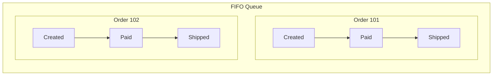
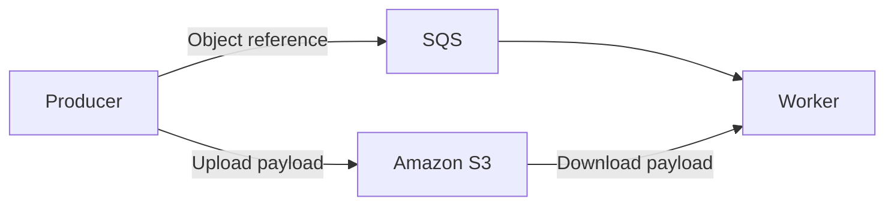
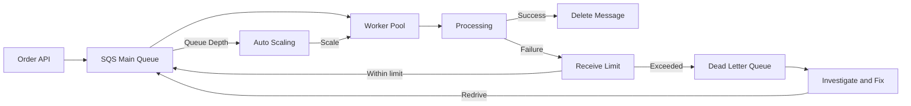

# **M08.1: Messaging Fundamentals – Amazon SQS & DLQ**

## **TL;DR**

- **SQS:** Tách producer khỏi consumer, hấp thụ traffic spike và hỗ trợ retry.
- **Standard vs FIFO:** Đánh đổi giữa throughput và ordering.
- **Visibility Timeout:** Tạm ẩn message trong khi worker xử lý.
- **DLQ:** Cô lập message liên tục thất bại.
- **Idempotency:** Ngăn business logic thực thi trùng lặp.

## **1. Message Queue – Tại sao cần SQS?**

Một hệ thống e-commerce cần gửi email và xử lý tồn kho sau khi khách hàng đặt hàng.

```
title: Xử lý đồng bộ
direction: horizontal
🛒 | Order API | Tiếp nhận đơn hàng
📧 | Email Service | Gửi email
📦 | Inventory Service | Cập nhật tồn kho
```

Nếu Email Service bị timeout, Order API có thể thất bại. Khi traffic tăng đột biến, các service phía sau dễ quá tải.

**Root cause:** Producer phụ thuộc trực tiếp vào tốc độ và tính sẵn sàng của consumer.

### **Giải pháp: Amazon SQS**

```
title: Xử lý bất đồng bộ
direction: horizontal
🛒 | Order API | Gửi message
📥 | SQS Queue | Lưu và buffer message
⚙️ | Worker | Xử lý theo năng lực
🗄️ | Database | Lưu kết quả
```

```
title: SQS giải quyết vấn đề gì?
columns: 2
🔗 | Decoupling | Producer và consumer hoạt động độc lập.
📥 | Buffering | Hấp thụ traffic spike.
🛡️ | Reliability | Lưu message chờ xử lý.
🔄 | Retry | Xử lý lại message thất bại.
📈 | Scaling | Tăng worker theo queue depth.
```

```
type: queue-buffer
title: Queue hấp thụ traffic spike
```

**Trade-off:** Producer không nhận ngay kết quả xử lý cuối cùng. Hệ thống cần quản lý trạng thái bất đồng bộ.

```
SQS-001 | single_choice | Flash Sale tạo 10000 đơn hàng nhưng worker không xử lý kịp. Nên làm gì? | Tăng API timeout | Đặt SQS giữa API và worker | Xử lý tuần tự trong API | Tắt retry | 2 | SQS buffer message để worker xử lý theo năng lực.
SQS-002 | single_choice | Email Service tạm thời ngừng hoạt động. Kiến trúc nào giúp Order API ít bị ảnh hưởng nhất? | Gọi Email Service trực tiếp | Tăng timeout | Retry đồng bộ liên tục | Gửi công việc vào SQS | 4 | Queue tách sự phụ thuộc trực tiếp giữa producer và consumer.
```

## **2. Standard vs FIFO – Khi thứ tự trở nên quan trọng**

SQS giải quyết quá tải, nhưng phát sinh vấn đề mới: message có thể đến sai thứ tự hoặc bị nhận nhiều lần.

Ví dụ, một đơn hàng có ba sự kiện:

`Created → Paid → Shipped`

Nếu `Shipped` được xử lý trước `Paid`, trạng thái nghiệp vụ có thể sai.

```
title: SQS Standard vs FIFO
[Standard]
icon: ⚡
badge: High Throughput
description: Ưu tiên tốc độ và khả năng mở rộng.
send: A → B → C
receive: A → C → B → B
note: Best-effort ordering, at-least-once delivery.
useCase: Email, image processing.
[FIFO]
icon: 🔢
badge: Strict Ordering
description: Ưu tiên thứ tự và deduplication.
send: A → B → C
receive: A → B → C
note: Đảm bảo thứ tự trong cùng Message Group ID.
useCase: Order lifecycle, inventory updates.
```

Với e-commerce, sử dụng `OrderId` làm Message Group ID để giữ thứ tự riêng cho từng đơn hàng.



```
tone: warning
title: FIFO không thay thế Idempotency
FIFO hỗ trợ deduplication và ordering, nhưng consumer vẫn có thể xử lý lại message khi gặp lỗi. Business logic cần idempotent.
```

```
SQS-003 | single_choice | Hệ thống gửi email marketing cần throughput cao và không quan tâm thứ tự. Chọn gì? | SQS Standard | SQS FIFO | Delay Queue | DLQ | 1 | Standard phù hợp công việc không yêu cầu strict ordering.
SQS-004 | single_choice | Cần giữ thứ tự trạng thái trong từng đơn hàng nhưng vẫn xử lý nhiều đơn song song. Chọn gì? | Standard Queue | Một Message Group ID chung | FIFO với OrderId làm Message Group ID | DLQ | 3 | FIFO giữ thứ tự trong từng group và cho phép xử lý các group khác nhau song song.
```

## **3. Visibility Timeout – Ngăn worker xử lý đồng thời**

Worker A nhận message để cập nhật tồn kho. Trong lúc xử lý, SQS cần ngăn worker khác nhận cùng message.

**Giải pháp:** Tạm ẩn message bằng Visibility Timeout.

```
title: Message lifecycle
direction: horizontal
📥 | Receive | Worker nhận message
🔒 | Invisible | Tạm ẩn message
⚙️ | Process | Thực thi nghiệp vụ
🗑️ | Delete | Xóa sau khi thành công
```

### **Failure scenario**

Worker cần 60 giây xử lý, nhưng Visibility Timeout chỉ có 30 giây.

```
title: Duplicate Processing
0s | Worker A | Nhận message và bắt đầu xử lý.
30s | Timeout | Message xuất hiện trở lại.
35s | Worker B | Nhận cùng message.
60s | Worker A | Hoàn thành xử lý.
95s | Worker B | Có thể thực thi nghiệp vụ trùng lặp.
```

```
type: sqs-visibility-timeout
title: Mô phỏng Visibility Timeout
visibilityTimeout: 30
processingTime: 60
```

```
title: Visibility Timeout
columns: 2
⏱️ | Default | 30 giây | Giá trị mặc định.
⏳ | Maximum | 12 giờ | Giới hạn tối đa.
```

Giải pháp:

- Cấu hình timeout phù hợp với processing time.
- Gia hạn bằng `ChangeMessageVisibility` khi cần.
- Thiết kế consumer idempotent.

**Trade-off:** Timeout quá ngắn gây duplicate processing; quá dài làm chậm retry khi worker lỗi.

```
SQS-005 | single_choice | Worker cần 90 giây xử lý nhưng Visibility Timeout là 30 giây. Rủi ro chính là gì? | Message bị xóa | Queue ngừng hoạt động | Message xuất hiện lại và bị xử lý trùng | Message chuyển ngay vào DLQ | 3 | Message xuất hiện lại khi timeout hết mà chưa được xóa.
SQS-006 | single_choice | Processing time thay đổi theo kích thước đơn hàng. Nên xử lý thế nào? | Tắt retry | Xóa message trước khi xử lý | Luôn đặt timeout 30 giây | Gia hạn visibility khi cần và dùng idempotency | 4 | Gia hạn giúp hạn chế duplicate processing, idempotency bảo vệ nghiệp vụ.
```

## **4. Dead Letter Queue – Cô lập message lỗi**

Retry hữu ích với lỗi tạm thời. Nhưng nếu payload không hợp lệ, retry nhiều lần vẫn thất bại.

Message như vậy thường được gọi là **poison message**.

```
title: Dead Letter Queue
direction: vertical
📥 | Main Queue | Nhận công việc
⚙️ | Worker | Xử lý thất bại
🔄 | Retry | Nhận lại message
⚠️ | Redrive Policy | Vượt ngưỡng nhận cho phép
📦 | DLQ | Cô lập message lỗi
🔍 | Investigate | Điều tra và sửa lỗi
↩️ | Redrive | Đưa message trở lại xử lý
```

Ví dụ: `maxReceiveCount = 5` cho phép consumer nhận message tối đa năm lần trước khi message đủ điều kiện chuyển sang DLQ.

**Trade-off:** DLQ không tự sửa lỗi. Hệ thống vẫn cần điều tra và redrive sau khi khắc phục nguyên nhân.

```
SQS-007 | single_choice | Một message chứa payload không hợp lệ và liên tục thất bại. Giải pháp nào phù hợp? | Cấu hình DLQ | Tăng worker | Tăng throughput | Dùng Long Polling | 1 | DLQ cô lập message lỗi khỏi main queue.
SQS-008 | single_choice | Developer đã sửa lỗi khiến message nằm trong DLQ. Bước tiếp theo là gì? | Xóa toàn bộ queue | Redrive message | Tăng retention | Tắt worker | 2 | Redrive đưa message trở lại queue để xử lý.
```

## **5. Tối ưu SQS trong production**

Hệ thống đã hoạt động ổn định. Bước tiếp theo là tối ưu chi phí, payload và khả năng mở rộng.

```
title: Các tính năng quan trọng
columns: 2
🔍 | Long Polling | Chờ tối đa 20 giây, giảm empty responses.
📅 | Message Retention | 1 phút–14 ngày, mặc định 4 ngày.
⏳ | Delay Queue | Trì hoãn message tối đa 15 phút.
🔐 | Encryption | HTTPS và KMS bảo vệ dữ liệu.
📈 | Auto Scaling | Scale consumer theo queue depth.
📦 | Message Size | Tối đa 1 MiB theo giới hạn AWS mới hơn.
```

### **Xử lý payload lớn**

Không đưa toàn bộ file lớn vào message. Lưu file trong S3 và gửi object reference.



```
tone: info
title: Lưu ý về giới hạn message
Tài liệu gốc ghi 256 KB. Giới hạn SQS đã được nâng lên 1 MiB vào năm 2025. Nên đối chiếu tài liệu AWS khi ôn thi.
```

```
SQS-009 | single_choice | Consumer thường xuyên polling nhưng nhận empty response. Nên sử dụng gì? | Delay Queue | DLQ | Long Polling | FIFO | 3 | Long Polling giảm empty responses và số API calls không cần thiết.
SQS-010 | single_choice | Producer cần gửi payload 50 MB cho worker. Kiến trúc nào phù hợp? | Tăng Visibility Timeout | Gửi trực tiếp qua SQS | Dùng FIFO | Lưu payload trong S3 và gửi object reference | 4 | S3 lưu payload lớn, SQS truyền thông tin tham chiếu.
```

## **6. Mental Model tổng thể**



## **7. Bảng tóm tắt**

| Vấn đề                 | Giải pháp          |
| ---------------------- | ------------------ |
| Service phụ thuộc nhau | SQS Decoupling     |
| Traffic spike          | Queue Buffering    |
| Throughput cao         | Standard           |
| Strict ordering        | FIFO               |
| Duplicate processing   | Idempotency        |
| Worker xử lý lâu       | Visibility Timeout |
| Poison message         | DLQ                |
| Empty responses        | Long Polling       |
| Payload lớn            | S3 + SQS           |

## **8. Quiz tổng hợp**

```
SQS-011 | single_choice | Queue depth liên tục tăng trong Flash Sale. Nên làm gì? | Scale consumer | Giảm retention | Tắt polling | Tăng Delay Queue | 1 | Tăng consumer giúp xử lý backlog nhanh hơn.
SQS-012 | single_choice | Worker cập nhật tồn kho thành công nhưng crash trước khi xóa message. Điều gì bảo vệ nghiệp vụ? | FIFO luôn ngăn xử lý lại | Idempotency | Long Polling | Encryption | 2 | Idempotency ngăn việc cập nhật tồn kho trùng khi message được nhận lại.
SQS-013 | single_choice | Visibility Timeout quá dài và worker bị crash. Hạn chế chính là gì? | Mất ordering | Mất encryption | Retry bị trì hoãn | Queue bị xóa | 3 | Message phải chờ hết timeout mới xuất hiện lại.
SQS-014 | single_choice | Cần trì hoãn công việc gửi thông báo trong 10 phút. Chọn gì? | DLQ | Long Polling | Retention | Delay Queue | 4 | Delay Queue hỗ trợ trì hoãn message tối đa 15 phút.
```

## **9. Flashcard**

```
Decoupling | Tách sự phụ thuộc trực tiếp giữa producer và consumer | Order API gửi message thay vì gọi Email Service.
Buffering | Lưu công việc khi tốc độ gửi vượt tốc độ xử lý | Flash Sale.
Standard Queue | Throughput cao, không đảm bảo strict ordering | Email marketing.
FIFO Queue | Ordering trong cùng Message Group ID và deduplication | Order lifecycle.
Visibility Timeout | Khoảng thời gian message tạm ẩn sau khi được nhận | Worker xử lý tồn kho.
Idempotency | Xử lý lặp lại mà không tạo thêm tác động nghiệp vụ | Không trừ tồn kho hai lần.
DLQ | Queue cô lập message liên tục thất bại | Payload không hợp lệ.
Redrive | Đưa message lỗi trở lại xử lý | Retry sau khi sửa bug.
Long Polling | Chờ message để giảm empty responses | Consumer polling tối đa 20 giây.
Queue Depth | Số message tồn đọng trong queue | Metric để scale worker.
```