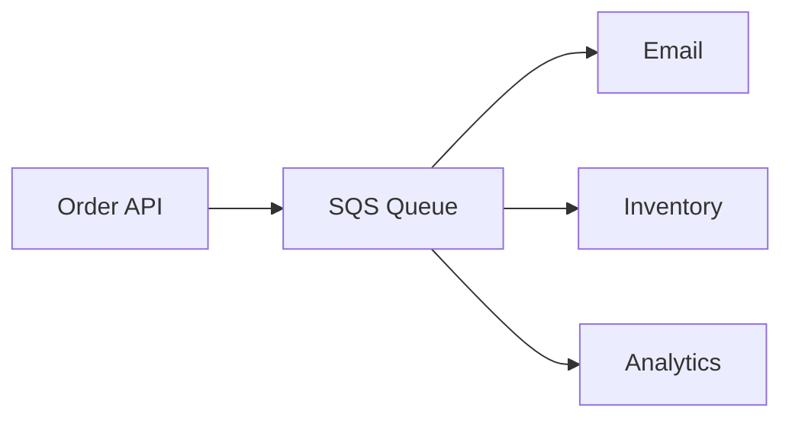
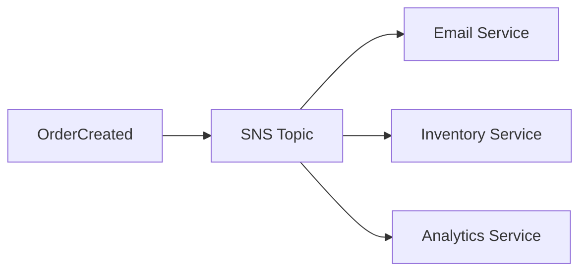
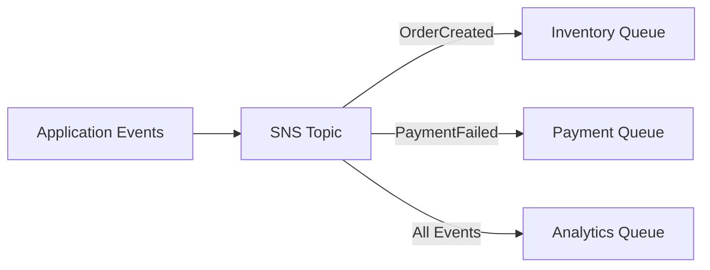
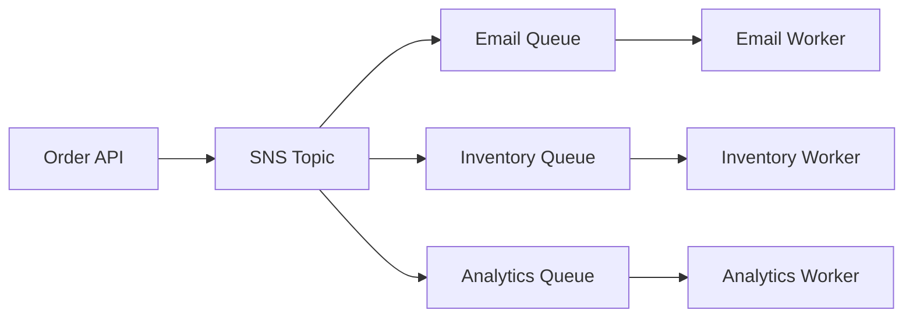
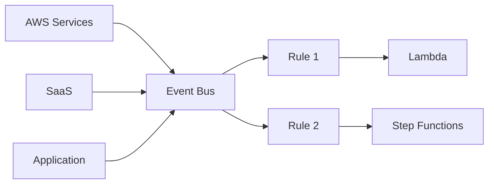
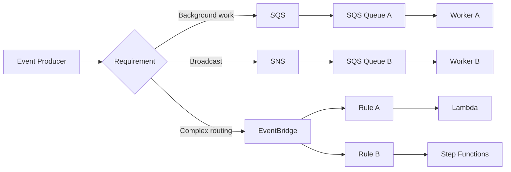

# **M08.2: SNS, Fanout Pattern & EventBridge**

## **TL;DR**

- **SNS:** Phân phối một event đến nhiều subscribers.
- **SNS + SQS Fanout:** Mỗi consumer có queue riêng để xử lý, retry và scale độc lập.
- **Message Filtering:** Subscriber chỉ nhận message phù hợp.
- **EventBridge:** Định tuyến event theo nội dung và tích hợp AWS, SaaS, application.
- **Mental Model:** SQS lưu công việc, SNS phân phối thông báo, EventBridge định tuyến sự kiện.

## **1. Amazon SNS – Một event, nhiều consumers**

Tiếp tục hệ thống e-commerce ở bài trước. Khi khách hàng đặt hàng thành công, hệ thống cần gửi email, cập nhật tồn kho và thu thập dữ liệu analytics.

Nếu cả ba service cùng đọc một SQS Queue, chúng sẽ cạnh tranh nhận message thay vì mỗi service nhận một bản sao.



**Root cause:** SQS là work queue, không phải cơ chế broadcast.

### **Giải pháp: Amazon SNS**

SNS là managed Publish/Subscribe service, cho phép producer publish một event đến nhiều subscribers.



```
title: Thành phần của SNS
columns: 3
📤 | Publisher | Phát sinh event.
📡 | Topic | Phân phối event.
📥 | Subscriber | Nhận và xử lý event.
```

SNS hỗ trợ nhiều loại subscriber: SQS, Lambda, HTTP/HTTPS, Email, SMS, Mobile Push và Firehose.

**Trade-off:** SNS giải quyết broadcast, nhưng không cung cấp cơ chế lưu công việc để worker chủ động polling như SQS.

```
SNS-001 | single_choice | OrderCreated cần được gửi đến cả Email và Analytics. Một shared SQS Queue có đủ không? | Có vì SQS broadcast | Không vì consumers cạnh tranh nhận message | Có nếu bật Long Polling | Có nếu tăng retention | 2 | Shared SQS Queue không cung cấp một bản sao riêng cho mỗi service.
SNS-002 | single_choice | Producer muốn publish một event mà không cần biết danh sách consumers. Chọn gì? | Delay Queue | DLQ | Visibility Timeout | SNS Topic | 4 | SNS tách publisher khỏi danh sách subscribers.
```

## **2. SNS Standard, FIFO và Message Filtering**

Hệ thống có hai yêu cầu khác nhau: gửi thông báo marketing với throughput cao và phân phối trạng thái đơn hàng theo thứ tự.

```
title: SNS Standard vs FIFO
[Standard]
icon: ⚡
badge: High Throughput
description: Ưu tiên khả năng phân phối lớn.
send: A → B → C
receive: A → C → B → B
note: At-least-once, best-effort ordering.
useCase: Email, SMS, notifications.
[FIFO]
icon: 🔢
badge: Ordered Delivery
description: Hỗ trợ ordering và deduplication.
send: A → B → C
receive: A → B → C
note: Giữ thứ tự trong cùng Message Group ID khi kết hợp phù hợp với SQS FIFO.
useCase: Ordered business events.
```

### **Message Filtering**

Không phải subscriber nào cũng cần nhận tất cả events. Nếu mỗi service tự lọc, hệ thống phải truyền và xử lý nhiều message không cần thiết.

SNS Filter Policy giúp lọc message trước khi phân phối đến subscriber.



**Trade-off:** Filter Policy giảm xử lý dư thừa nhưng cần quản lý chính xác điều kiện subscription.

```
SNS-003 | single_choice | Inventory Service cần nhận trạng thái đơn hàng theo đúng thứ tự. Chọn gì? | SNS FIFO kết hợp SQS FIFO | SNS Standard | Email Subscription | Shared Standard Queue | 1 | FIFO hỗ trợ ordering và deduplication.
SNS-004 | single_choice | Payment Service chỉ muốn nhận PaymentFailed. Nên cấu hình gì? | Visibility Timeout | Message Retention | SNS Filter Policy | DLQ | 3 | Filter Policy chỉ phân phối message phù hợp điều kiện.
```

## **3. SNS + SQS Fanout – Xử lý độc lập**

SNS đã giải quyết broadcast. Tuy nhiên, Inventory Service có thể quá tải hoặc tạm ngừng hoạt động.

Làm sao để Inventory xử lý event sau khi phục hồi mà không ảnh hưởng đến Email và Analytics?

### **Giải pháp: Fanout Pattern**

Kết hợp SNS với một SQS Queue riêng cho mỗi service.



Giả sử Inventory Worker ngừng hoạt động:

```
title: Failure Isolation
columns: 3
🟢 | Email | Tiếp tục xử lý.
🔴 | Inventory | Worker ngừng, message tích lũy trong queue.
🟢 | Analytics | Tiếp tục xử lý.
```

Khi Inventory Worker phục hồi, nó tiếp tục xử lý backlog trong queue.

```
tone: tip
title: Why SNS + SQS?
SNS phân phối event.
SQS lưu message, buffer và hỗ trợ retry.
Kết hợp cả hai giúp consumers xử lý và scale độc lập.
```

**Trade-off:** Tăng số lượng queue, chi phí và công việc quản lý, đổi lại khả năng failure isolation tốt hơn.

```
SNS-005 | single_choice | Inventory Worker ngừng hoạt động nhưng Email phải tiếp tục xử lý. Chọn kiến trúc nào? | Shared SQS Queue | SNS fanout đến các SQS Queue riêng | Gọi REST tuần tự | Một worker chung | 2 | Queue riêng cô lập lỗi và lưu message cho từng service.
SNS-006 | single_choice | Analytics Queue có backlog lớn nhưng Email Queue gần như trống. Nên làm gì? | Scale toàn bộ hệ thống | Tạo lại SNS Topic | Xóa backlog | Chỉ scale Analytics Worker | 4 | Fanout cho phép mỗi consumer scale độc lập.
```

## **4. Amazon EventBridge – Định tuyến theo nội dung**

E-commerce tiếp tục mở rộng và cần xử lý events từ nhiều nguồn:

- Application phát sinh `OrderCreated`.
- AWS phát sinh `EC2Terminated`.
- SaaS phát sinh `PaymentFailed`.

SNS hỗ trợ filtering, nhưng hệ thống tích hợp nhiều nguồn và cần quản lý routing rules linh hoạt hơn.

### **Giải pháp: Amazon EventBridge**

EventBridge là serverless Event Bus, định tuyến event đến target dựa trên nội dung event.



```
title: Ba loại Event Bus
columns: 3
☁️ | Default | Events từ AWS services.
🤝 | Partner | Events từ SaaS partners.
⚙️ | Custom | Events từ applications.
```

### **Content-based Routing**

Ví dụ: Chỉ kích hoạt Lambda khi EC2 instance bị terminated.

```
{
  "source": ["aws.ec2"],
  "detail": {
    "state": ["terminated"]
  }
}
```

```
title: Event matching
direction: horizontal
📤 | Event | EC2 state = terminated
📡 | Event Bus | Tiếp nhận event
🔍 | Rule | Kiểm tra source và state
⚡ | Lambda | Thực thi nếu phù hợp
```

EventBridge còn hỗ trợ:

- **Scheduled Events:** Kích hoạt tác vụ định kỳ.
- **Schema Registry:** Quản lý cấu trúc event.

**Trade-off:** Routing linh hoạt hơn nhưng cần quản lý event schemas, rules và targets.

```
SNS-007 | single_choice | Một SaaS partner cần gửi events đến AWS targets. Chọn gì? | SQS Standard | SNS FIFO | EventBridge Partner Event Bus | DLQ | 3 | Partner Event Bus hỗ trợ tích hợp SaaS.
SNS-008 | single_choice | Chỉ muốn kích hoạt Lambda khi EC2 chuyển sang terminated. Chọn gì? | EventBridge Rule lọc event detail | SQS Long Polling | SNS FIFO Ordering | Message Retention | 1 | EventBridge Rule định tuyến dựa trên nội dung event.
```

## **5. SNS vs EventBridge – Chọn công cụ nào?**

```
title: Hai mô hình phân phối event
[SNS]
icon: 📡
badge: Pub/Sub
description: Phân phối một message đến nhiều subscribers.
send: Publisher → Topic
receive: Topic → Subscribers
note: Hỗ trợ subscription filtering.
useCase: Notifications, fanout.
[EventBridge]
icon: 🔀
badge: Event Routing
description: Định tuyến events theo rules và nội dung.
send: Event Sources → Event Bus
receive: Rules → Matching Targets
note: Tích hợp AWS, SaaS và applications.
useCase: Event-driven integrations.
```

```
title: Architecture Decision
Một event cần broadcast | SNS | Publish/Subscribe đơn giản.
Mỗi consumer cần buffer và retry riêng | SNS + SQS | Failure isolation.
Subscriber chỉ cần một nhóm message | SNS Filter Policy | Lọc trước khi phân phối.
Nhiều nguồn event và routing phức tạp | EventBridge | Content-based routing.
Kích hoạt tác vụ định kỳ | EventBridge | Scheduled Events.
```

```
SNS-009 | single_choice | OrderCreated cần broadcast đến ba queue độc lập. Không có routing phức tạp. Chọn gì? | Partner Event Bus | Shared Queue | Scheduled Events | SNS + SQS | 4 | Fanout đáp ứng broadcast và buffering độc lập.
SNS-010 | single_choice | Hệ thống cần tích hợp AWS, SaaS và custom events với nhiều routing rules. Chọn gì? | SNS FIFO | EventBridge | SQS Standard | Delay Queue | 2 | EventBridge phù hợp tích hợp nhiều nguồn và content-based routing.
```

## **6. Mental Model tổng thể**



## **7. Bảng tóm tắt**

| Vấn đề                | Giải pháp         |
| --------------------- | ----------------- |
| Background processing | SQS               |
| Broadcast event       | SNS               |
| Ordered notifications | SNS FIFO          |
| Subscriber filtering  | SNS Filter Policy |
| Consumer độc lập      | SNS + SQS Fanout  |
| Content-based routing | EventBridge       |
| SaaS integration      | Partner Event Bus |
| Application events    | Custom Event Bus  |
| Scheduled invocation  | EventBridge       |

## **8. Quiz tổng hợp**

```
SNS-011 | single_choice | Producer muốn gửi một event đến ba services nhưng mỗi service phải retry độc lập. Chọn gì? | SNS trực tiếp | Shared Queue | SNS fanout đến ba SQS Queue | REST đồng bộ | 3 | SNS broadcast và SQS cung cấp buffering riêng.
SNS-012 | single_choice | Một Lambda cần chạy định kỳ mỗi năm phút. Chọn gì? | EventBridge Schedule | SNS FIFO | DLQ | Message Filtering | 1 | EventBridge hỗ trợ scheduled invocation.
SNS-013 | single_choice | Inventory Queue chỉ cần OrderCreated nhưng đang nhận mọi event. Cách tối ưu là gì? | Tăng worker | Tăng retention | Tăng timeout | SNS Filter Policy | 4 | Filter Policy loại bỏ message không phù hợp trước khi phân phối.
SNS-014 | single_choice | Application cần phát sinh custom events và định tuyến theo nhiều field. Chọn gì? | Default Event Bus | Custom Event Bus với Rules | Partner Event Bus | Shared SQS Queue | 2 | Custom Event Bus tiếp nhận application events và định tuyến theo rules.
```

## **9. Flashcard**

```
Publish/Subscribe | Một publisher phân phối event đến nhiều subscribers | OrderCreated gửi đến Email và Inventory.
SNS Topic | Kênh phân phối message | Order Events Topic.
SNS FIFO | Hỗ trợ ordering và deduplication | Order status events.
Filter Policy | Lọc message theo điều kiện subscription | Chỉ nhận PaymentFailed.
Fanout Pattern | Phân phối một event đến nhiều consumers độc lập | SNS kết hợp nhiều SQS Queue.
Failure Isolation | Cô lập lỗi giữa các consumers | Inventory lỗi nhưng Email vẫn hoạt động.
EventBridge | Serverless Event Bus định tuyến event theo rules | EC2 terminated kích hoạt Lambda.
Default Event Bus | Tiếp nhận AWS service events | EC2 state change.
Partner Event Bus | Tiếp nhận SaaS partner events | SaaS payment events.
Custom Event Bus | Tiếp nhận application events | OrderCreated.
Event Rule | Điều kiện xác định event được định tuyến | State bằng terminated.
Schema Registry | Quản lý cấu trúc event | Order event schema.
```