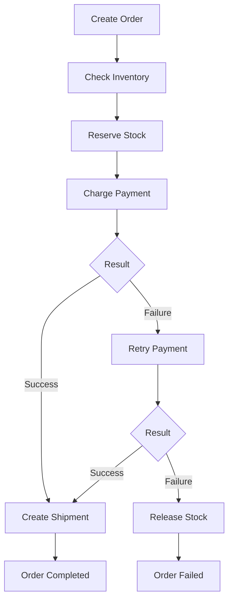
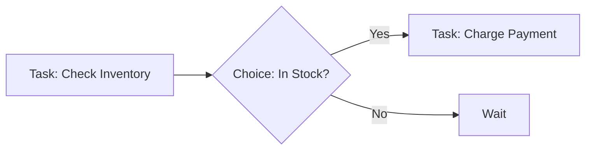
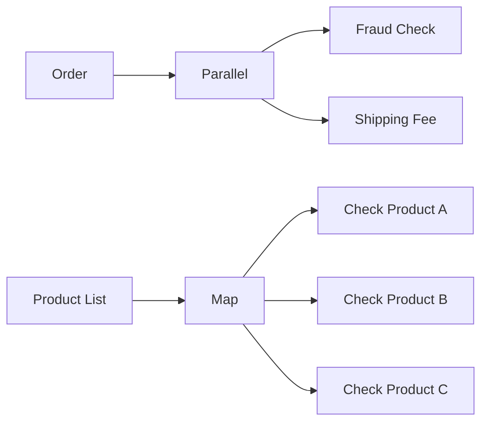
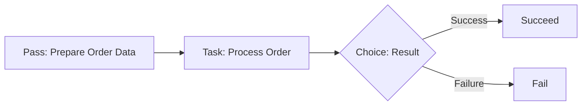
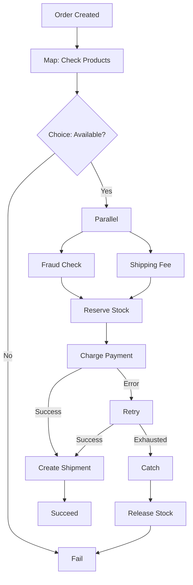

# **M08.3: AWS Step Functions – Workflow Orchestration**

## **TL;DR**

- **Step Functions:** Điều phối quy trình nghiệp vụ nhiều bước có trạng thái và phụ thuộc.
- **Standard:** Workflow dài, tối đa một năm.
- **Express:** Workflow ngắn, tần suất cao, tối đa năm phút.
- **State:** Định nghĩa công việc, điều kiện, vòng lặp và nhánh xử lý.
- **Retry & Catch:** Xử lý lỗi tạm thời và điều hướng khi thất bại.

## **1. Workflow Orchestration – Tại sao cần Step Functions?**

Tiếp tục hệ thống e-commerce. Một đơn hàng cần trải qua nhiều bước nghiệp vụ phụ thuộc nhau.

visual-flow

`title: Order Processing
direction: vertical
🛒 | Create Order | Tạo đơn hàng.
🔍 | Check Inventory | Kiểm tra tồn kho.
📦 | Reserve Stock | Giữ hàng.
💳 | Charge Payment | Thanh toán.
🚚 | Create Shipment | Tạo vận đơn.`

SQS giúp truyền công việc giữa các service. Tuy nhiên, nếu thanh toán thất bại sau khi giữ hàng:

- Ai quản lý trạng thái hiện tại?
- Ai quyết định retry thanh toán?
- Ai giải phóng hàng đã giữ?

**Root cause:** Truyền message không đồng nghĩa với điều phối toàn bộ quy trình nghiệp vụ.

### **Giải pháp: AWS Step Functions**

Step Functions sử dụng State Machine để định nghĩa và điều phối workflow.

visual-grid

`title: Step Functions quản lý những gì?
columns: 3
📍 | State | Trạng thái hiện tại.
🔄 | Retry | Thử lại khi lỗi.
⏱️ | Timeout | Giới hạn thời gian xử lý.
🔀 | Branching | Chọn nhánh nghiệp vụ.
⚡ | Parallel | Thực thi đồng thời.
📋 | History | Theo dõi execution.`

**Trade-off:** Workflow rõ ràng và dễ theo dõi hơn, nhưng phát sinh chi phí orchestration và sự phụ thuộc vào State Machine.

quiz-deck

`SF-001 | single_choice | Order processing cần quản lý nhiều bước phụ thuộc nhau và compensation khi lỗi. Chọn gì? | SQS Standard | SNS | Step Functions | Firehose | 3 | Step Functions điều phối trạng thái và thứ tự thực thi.
SF-002 | single_choice | Hệ thống chỉ cần buffer công việc gửi email cho worker. Chọn gì? | SQS | Step Functions | EventBridge Partner Bus | SNS FIFO | 1 | SQS phù hợp background processing không cần workflow phức tạp.`

## **2. Standard vs Express Workflow**

Hệ thống có hai quy trình:

- Đơn hàng giá trị lớn cần quản lý phê duyệt trong nhiều ngày.
- Đơn hàng thông thường cần xử lý nhanh với tần suất cao.

Một loại workflow không tối ưu cho cả hai.

visual-compare

`title: Standard vs Express Workflow
[Standard]
icon: 📋
badge: Long-running
description: Workflow dài, nhiều bước nghiệp vụ.
note: Tối đa 1 năm. Tính phí theo state transition.
useCase: Approval, order processing, ETL.
[Express]
icon: ⚡
badge: High-volume
description: Workflow ngắn, tần suất thực thi cao.
note: Tối đa 5 phút. Tính phí theo số execution, duration và memory.
useCase: IoT, streaming, mobile.`

visual-metrics

`title: Execution Duration
columns: 2
📋 | Standard | 1 năm | Workflow dài.
⚡ | Express | 5 phút | Workflow ngắn.`

visual-decision

`title: Chọn Workflow
Chờ phê duyệt nhiều ngày | Standard | Hỗ trợ long-running workflow.
Xử lý hàng nghìn IoT events | Express | Workflow ngắn, tần suất cao.
Quy trình order kéo dài nhiều giờ | Standard | Không vượt giới hạn execution.`

**Trade-off:** Standard phù hợp quy trình dài; Express phù hợp workload ngắn và lớn. Cần xem xét cả thời gian thực thi lẫn mô hình tính phí.

quiz-deck

`SF-003 | single_choice | Approval workflow cần chờ quản lý phê duyệt trong ba ngày. Chọn gì? | Express | Standard | SQS Delay Queue | SNS FIFO | 2 | Standard hỗ trợ execution tối đa một năm.
SF-004 | single_choice | IoT platform chạy hàng nghìn workflow mỗi giây, mỗi workflow mất vài giây. Chọn gì? | Standard bắt buộc | Amazon MQ | SQS FIFO | Express | 4 | Express phù hợp workflow ngắn và tần suất cao.`

## **3. State Machine – Xây dựng workflow**

Sau khi chọn loại workflow, cần mô tả từng bước nghiệp vụ bằng các State.

### **3.1 Task, Choice và Wait**

visual-grid

`title: Điều phối công việc
columns: 3
⚙️ | Task | Thực hiện công việc.
🔀 | Choice | Chọn nhánh theo điều kiện.
⏳ | Wait | Tạm dừng workflow.`

Ví dụ: Kiểm tra tồn kho trước khi thanh toán.

Task thực thi công việc; Choice quyết định bước tiếp theo; Wait trì hoãn workflow.

quiz-deck

`SF-005 | single_choice | Workflow cần chọn nhánh InStock hoặc OutOfStock. State nào phù hợp? | Task | Parallel | Choice | Map | 3 | Choice điều hướng workflow dựa trên điều kiện.
SF-006 | single_choice | Workflow cần chờ một khoảng thời gian trước khi kiểm tra lại tồn kho. Chọn state nào? | Wait | Pass | Fail | Parallel | 1 | Wait tạm dừng execution trước bước tiếp theo.`

### **3.2 Parallel vs Map**

Đơn hàng có nhiều sản phẩm. Hệ thống cần kiểm tra từng sản phẩm và thực hiện các công việc độc lập đồng thời.

visual-compare

`title: Parallel vs Map
[Parallel]
icon: 🔀
description: Thực thi nhiều nhánh nghiệp vụ khác nhau đồng thời.
send: Order
receive: Fraud Check + Shipping Fee Calculation
note: Các nhánh có logic khác nhau.
useCase: Kiểm tra gian lận và tính phí vận chuyển.
[Map]
icon: 🔁
description: Áp dụng cùng một logic cho nhiều phần tử.
send: Product A, B, C
receive: Check A, Check B, Check C
note: Lặp qua collection.
useCase: Kiểm tra tồn kho từng sản phẩm.`

**Mental Model:** Parallel chạy nhiều quy trình khác nhau; Map chạy cùng quy trình trên nhiều phần tử.

quiz-deck

`SF-007 | single_choice | Cần kiểm tra tồn kho cho 500 sản phẩm bằng cùng một logic. Chọn gì? | Parallel | Map | Choice | Pass | 2 | Map áp dụng cùng logic cho từng phần tử.
SF-008 | single_choice | Cần kiểm tra gian lận và tính phí vận chuyển đồng thời. Chọn gì? | Wait | Map | Fail | Parallel | 4 | Parallel thực thi các nhánh nghiệp vụ khác nhau đồng thời.`

### **3.3 Pass, Succeed và Fail**

Workflow cần chuẩn bị dữ liệu và biểu diễn kết quả cuối cùng.

visual-grid

`title: Data và Terminal States
columns: 3
📤 | Pass | Truyền hoặc biến đổi dữ liệu.
✅ | Succeed | Kết thúc thành công.
❌ | Fail | Kết thúc thất bại.`

quiz-deck

`SF-009 | single_choice | Workflow cần chuẩn bị dữ liệu mà không gọi service bên ngoài. Chọn state nào? | Pass | Fail | Wait | Parallel | 1 | Pass truyền hoặc biến đổi dữ liệu.
SF-010 | single_choice | Đơn hàng không thể tiếp tục và workflow cần kết thúc với trạng thái lỗi. Chọn gì? | Succeed | Pass | Fail | Map | 3 | Fail kết thúc execution với trạng thái thất bại.`

## **4. Retry & Catch – Xử lý lỗi nghiệp vụ**

Workflow đã có đầy đủ các bước. Tuy nhiên, Payment Service có thể timeout sau khi Inventory Service giữ hàng thành công.

Không thể bỏ qua lỗi hoặc retry vô hạn.

### **Giải pháp: Retry và Catch**

visual-flow

`title: Payment Error Handling
direction: vertical
💳 | Payment Task | Thực hiện thanh toán.
⚠️ | Error | Thanh toán thất bại.
🔄 | Retry | Thử lại theo cấu hình.
🚨 | Catch | Bắt lỗi nếu retry không thành công.
📦 | Compensation | Giải phóng hàng đã giữ.
❌ | Fail | Kết thúc workflow.`

visual-compare

`title: Retry vs Catch
[Retry]
icon: 🔄
description: Thực thi lại state khi gặp lỗi phù hợp.
useCase: Payment Service timeout tạm thời.
[Catch]
icon: 🛡️
description: Điều hướng sang state xử lý lỗi.
useCase: Giải phóng tồn kho khi thanh toán thất bại.`

visual-callout

`tone: warning
title: Compensation không phải Database Rollback
Step Functions điều phối compensation nhưng không tự hoàn tác nghiệp vụ. Developer phải định nghĩa công việc giải phóng tồn kho hoặc hoàn tiền.`

**Trade-off:** Retry tăng khả năng phục hồi nhưng có thể thực thi lại nghiệp vụ. Payment Task nên được thiết kế idempotent.

quiz-deck

`SF-011 | single_choice | Payment Service timeout tạm thời. Cơ chế nào giúp thử lại task? | Catch | Retry | Pass | Succeed | 2 | Retry thực thi lại task khi gặp lỗi phù hợp.
SF-012 | single_choice | Thanh toán vẫn thất bại sau tất cả lần retry. Cần giải phóng tồn kho. Chọn gì? | Wait | Map | Retry vô hạn | Catch chuyển sang Compensation Task | 4 | Catch điều hướng workflow sang bước xử lý lỗi.`

## **5. Mental Model tổng thể**

## **6. Bảng tóm tắt**

| Vấn đề | Giải pháp |
| --- | --- |
| Truyền công việc | SQS |
| Điều phối workflow | Step Functions |
| Workflow dài | Standard |
| Workflow ngắn, tần suất cao | Express |
| Thực hiện công việc | Task |
| Rẽ nhánh | Choice |
| Nhiều nhánh đồng thời | Parallel |
| Xử lý danh sách | Map |
| Trì hoãn | Wait |
| Chuẩn bị dữ liệu | Pass |
| Lỗi tạm thời | Retry |
| Điều hướng khi lỗi | Catch |
| Hoàn tác nghiệp vụ | Compensation |
| Kết thúc workflow | Succeed / Fail |

## **7. Quiz tổng hợp**

quiz-deck

`SF-013 | single_choice | Order workflow kéo dài hai giờ và cần quản lý nhiều trạng thái. Chọn gì? | Standard | Express | SNS | SQS Delay Queue | 1 | Standard hỗ trợ workflow dài.
SF-014 | single_choice | Payment thành công nhưng task timeout trước khi trả kết quả. Retry có thể gây vấn đề gì? | Mất workflow | Thanh toán trùng | Mất ordering | Xóa tồn kho | 2 | Retry có thể thực thi lại nghiệp vụ nếu thiếu idempotency.
SF-015 | single_choice | Workflow cần xử lý danh sách sản phẩm rồi quyết định có tiếp tục thanh toán không. Chọn gì? | Wait và Pass | Parallel và Fail | Map và Choice | Retry và Succeed | 3 | Map xử lý danh sách, Choice quyết định nhánh tiếp theo.
SF-016 | single_choice | Payment thất bại sau khi giữ hàng. Step Functions có tự giải phóng tồn kho không? | Có với Standard | Có với Express | Có nếu dùng Retry | Không, cần định nghĩa Compensation Task | 4 | Compensation là nghiệp vụ do developer định nghĩa.`

## **8. Flashcard**

flipcard

`Workflow Orchestration | Điều phối thứ tự và trạng thái của nhiều bước nghiệp vụ | Order processing.
State Machine | Mô hình định nghĩa các state và transition | Inventory → Payment → Shipment.
Standard Workflow | Workflow dài tối đa một năm | Manual approval.
Express Workflow | Workflow ngắn tối đa năm phút | IoT event processing.
Task | Thực hiện công việc | Charge Payment.
Choice | Rẽ nhánh theo điều kiện | Kiểm tra tồn kho.
Parallel | Chạy nhiều nhánh khác nhau đồng thời | Fraud Check và Shipping Fee.
Map | Áp dụng cùng logic cho danh sách | Kiểm tra từng sản phẩm.
Wait | Tạm dừng workflow | Chờ kiểm tra lại tồn kho.
Pass | Truyền hoặc biến đổi dữ liệu | Chuẩn bị Order Data.
Succeed | Kết thúc thành công | Order Completed.
Fail | Kết thúc thất bại | Order Failed.
Retry | Thực thi lại state khi lỗi | Payment timeout.
Catch | Điều hướng sang state xử lý lỗi | Chuyển sang Compensation.
Compensation | Hoàn tác tác động nghiệp vụ bằng công việc riêng | Release Stock.`