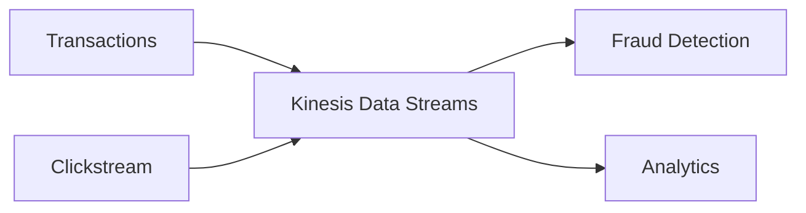
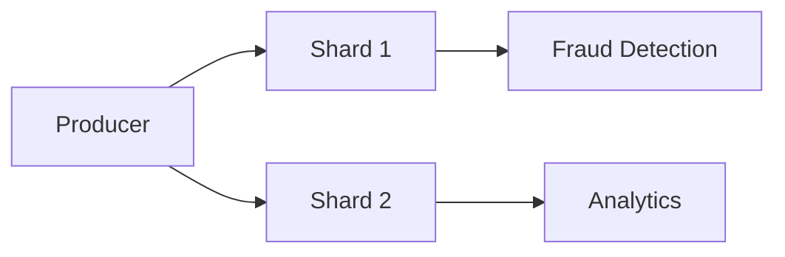
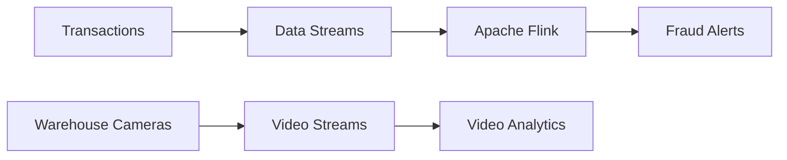
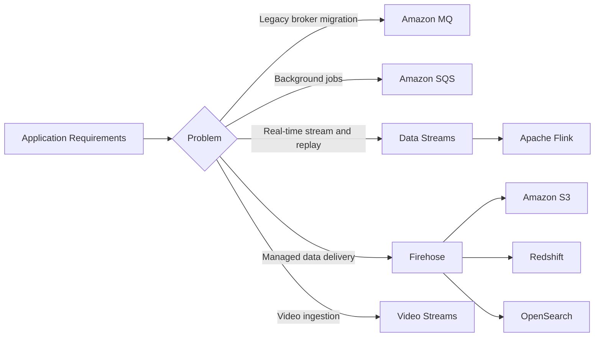

# **M08.4: Amazon MQ & Kinesis Streaming**

## **TL;DR**

- **Amazon MQ:** Migration hệ thống ActiveMQ/RabbitMQ lên AWS mà không cần viết lại messaging layer.
- **Kinesis Data Streams:** Xử lý dữ liệu liên tục, nhiều consumers, hỗ trợ replay.
- **Firehose:** Tự động chuyển streaming data đến destinations.
- **Data Analytics:** Phân tích streaming data bằng Apache Flink.
- **SQS vs Kinesis:** Work queue vs replayable data stream.

## **1. Amazon MQ – Migration hệ thống legacy**

Hệ thống e-commerce đang sử dụng RabbitMQ để truyền message giữa Order Service và Inventory Service.

Khi migrate lên AWS, chuyển sang SQS có thể yêu cầu thay đổi messaging protocol và application code.

**Root cause:** Ứng dụng phụ thuộc vào traditional message broker.

### **Giải pháp: Amazon MQ**

Amazon MQ là managed message broker, hỗ trợ ActiveMQ và RabbitMQ.

visual-compare

`title: Legacy Messaging Migration
[Self-managed RabbitMQ]
icon: 🖥️
description: Doanh nghiệp tự vận hành message broker.
send: Application → RabbitMQ
receive: RabbitMQ → Consumer
note: Tự quản lý broker infrastructure.
[Amazon MQ]
icon: ☁️
description: AWS quản lý message broker.
send: Application → Amazon MQ
receive: Amazon MQ → Consumer
note: Giảm thay đổi messaging layer.
useCase: Legacy migration.`

visual-decision

`title: Chọn Messaging Service
Ứng dụng phụ thuộc RabbitMQ hoặc ActiveMQ | Amazon MQ | Giữ protocol tương thích.
Ứng dụng cloud-native cần work queue | SQS | Background processing.
Cần broadcast event | SNS | Publish/Subscribe.
Cần routing theo nội dung | EventBridge | Event-driven integration.`

**Trade-off:** Amazon MQ giảm công sức migration nhưng vẫn duy trì mô hình traditional message broker.

quiz-deck

`MQK-001 | single_choice | Doanh nghiệp muốn migrate RabbitMQ lên AWS mà không rewrite messaging protocol. Chọn gì? | SQS | Amazon MQ | EventBridge | Firehose | 2 | Amazon MQ hỗ trợ RabbitMQ và ActiveMQ.
MQK-002 | single_choice | Một ứng dụng cloud-native mới chỉ cần background jobs và retry. Không phụ thuộc broker protocol. Chọn gì? | Amazon MQ | Kinesis Video Streams | EventBridge Partner Bus | SQS | 4 | SQS phù hợp managed work queue.`

## **2. Amazon Kinesis – Từ message đến data stream**

E-commerce mở rộng và bắt đầu thu thập clickstream, transaction events và application logs liên tục.

Dữ liệu này cần phục vụ nhiều mục đích: phát hiện gian lận, phân tích hành vi và lưu trữ lịch sử.

visual-grid

`title: Streaming Data Sources
columns: 3
🖱️ | Clickstream | Hành vi khách hàng.
💳 | Transactions | Giao dịch thanh toán.
📋 | Application Logs | Hoạt động hệ thống.`

SQS phù hợp xử lý công việc rồi xóa message. Nhưng analytics cần nhiều consumers đọc cùng dữ liệu và có thể đọc lại lịch sử.

**Root cause:** Work queue không phải replayable data stream.

### **Giải pháp: Amazon Kinesis**

visual-grid

`title: Kinesis Streaming Ecosystem
columns: 2
🌊 | Data Streams | Ingest, process và replay dữ liệu.
🚚 | Data Firehose | Chuyển dữ liệu đến destinations.
📊 | Data Analytics | Phân tích stream bằng Apache Flink.
🎥 | Video Streams | Ingest video từ thiết bị.`

Mỗi dịch vụ giải quyết một giai đoạn khác nhau của streaming pipeline.

quiz-deck

`MQK-003 | single_choice | E-commerce cần nhiều consumers đọc cùng clickstream và replay dữ liệu. Chọn gì? | Kinesis Data Streams | SQS | Amazon MQ | SNS Email | 1 | Data Streams hỗ trợ nhiều consumers và replay.
MQK-004 | single_choice | Hệ thống cần ingest video liên tục từ camera. Chọn gì? | Firehose | SQS FIFO | Kinesis Video Streams | SNS | 3 | Video Streams chuyên xử lý video ingestion.`

## **3. Kinesis Data Streams – Xử lý và replay dữ liệu**

Fraud Detection cần phân tích giao dịch ngay khi phát sinh. Analytics Service cần đọc cùng dữ liệu để phân tích hành vi khách hàng.

Khác với SQS, việc một consumer đọc record không xóa record khỏi stream. Các consumer khác vẫn có thể đọc dữ liệu đó.

### **Shard – Đơn vị phân chia stream**

Stream được chia thành nhiều shard để tăng khả năng xử lý.

visual-metrics

`title: Kinesis Data Streams
columns: 2
📥 | Shard Input | 1 MB/s | Throughput ghi mỗi shard.
📤 | Shard Output | 2 MB/s | Shared read throughput mỗi shard.
📅 | Retention | 1–365 ngày | Lưu dữ liệu để replay.
🔢 | Ordering | Per Shard | Không đảm bảo global ordering.`

### **Replay – Tại sao quan trọng?**

Giả sử Analytics Service có bug khiến báo cáo ba ngày gần nhất bị sai.

visual-flow

`title: Replay Historical Events
direction: horizontal
🐛 | Detect Bug | Phát hiện báo cáo sai.
🔧 | Fix Consumer | Sửa logic analytics.
⏪ | Replay | Đọc lại dữ liệu còn retention.
📊 | Recalculate | Tính lại báo cáo.`

**Trade-off:** Data Streams hỗ trợ replay và real-time processing nhưng cần quản lý capacity, retention và consumer processing.

quiz-deck

`MQK-005 | single_choice | Analytics Service cần tính lại báo cáo từ dữ liệu ba ngày trước. Tính năng nào phù hợp? | DLQ | Delay Queue | SNS Filtering | Kinesis Replay | 4 | Replay cho phép đọc lại records còn trong retention.
MQK-006 | single_choice | Một shard đã đạt giới hạn throughput ghi trong provisioned mode. Nên làm gì? | Giảm retention | Tăng số shard | Tạo DLQ | Bật Long Polling | 2 | Tăng shard giúp mở rộng stream capacity.
MQK-007 | single_choice | Fraud Detection đọc một record từ Kinesis. Analytics có thể đọc record đó không? | Có, nếu record còn retention | Không vì record bị xóa | Chỉ khi dùng DLQ | Chỉ khi producer gửi lại | 1 | Consumers có thể đọc cùng dữ liệu độc lập.`

## **4. Firehose – Tự động chuyển dữ liệu đến destinations**

Không phải dữ liệu nào cũng cần xử lý từng record tức thời.

Application logs chỉ cần được chuyển liên tục đến S3 để lưu trữ và phân tích sau.

Nếu sử dụng Data Streams, developer phải xây dựng consumer để đọc, buffer, transform và ghi dữ liệu.

### **Giải pháp: Amazon Data Firehose**

visual-flow

`title: Managed Data Delivery
direction: vertical
📋 | Application Logs | Phát sinh dữ liệu liên tục.
🚚 | Firehose | Ingest, buffer và tự động scale.
⚡ | Lambda | Transform dữ liệu nếu cần.
🗄️ | Destination | S3, Redshift hoặc OpenSearch.`

visual-compare

`title: Data Streams vs Firehose
[Data Streams]
icon: 🌊
description: Streaming platform cho custom consumers.
note: Hỗ trợ replay và real-time processing.
useCase: Fraud Detection.
[Firehose]
icon: 🚚
description: Managed streaming data delivery.
note: Tự động scale, buffering và transformation.
useCase: Application logs đến S3.`

**Trade-off:** Buffering giúp tối ưu delivery nhưng tạo độ trễ. Firehose phù hợp near real-time delivery hơn xử lý tức thời từng record.

quiz-deck

`MQK-008 | single_choice | Công ty muốn tự động chuyển application logs đến S3 và transform bằng Lambda. Chọn gì? | SQS FIFO | Amazon MQ | Firehose | Step Functions | 3 | Firehose cung cấp managed delivery và transformation.
MQK-009 | single_choice | Fraud Detection cần xử lý transaction ngay khi phát sinh. Chọn gì? | Firehose | Data Streams | Delay Queue | SNS Email | 2 | Data Streams phù hợp real-time processing.`

## **5. Streaming Analytics và Video Ingestion**

Hệ thống tiếp tục mở rộng: cần phân tích transaction stream và thu thập video từ camera tại kho hàng.

visual-grid

`title: Specialized Streaming Services
columns: 2
📊 | Data Analytics | Phân tích streaming data bằng Apache Flink.
🎥 | Video Streams | Thu thập video liên tục từ camera.`

visual-callout

`tone: info
title: Tên dịch vụ cần lưu ý
Kinesis Data Firehose hiện có tên Amazon Data Firehose. Kinesis Data Analytics for Apache Flink hiện có tên Amazon Managed Service for Apache Flink. Phiên bản Data Analytics for SQL đã ngừng hoạt động.`

quiz-deck

`MQK-010 | single_choice | Fraud Detection cần phân tích transaction stream bằng Apache Flink. Chọn gì? | Amazon MQ | SNS | SQS | Managed Service for Apache Flink | 4 | Apache Flink hỗ trợ streaming analytics.
MQK-011 | single_choice | Kho hàng cần ingest video liên tục để phục vụ video analytics. Chọn gì? | Kinesis Video Streams | Firehose | SQS | Amazon MQ | 1 | Video Streams được thiết kế cho video ingestion.`

## **6. SQS vs Kinesis – Work Queue hay Data Stream?**

visual-compare

`title: Hai mô hình xử lý dữ liệu
[SQS]
icon: 📥
badge: Work Queue
description: Phân phối công việc cho workers.
send: Producer → Queue
receive: Worker → Process → Delete
note: Retention tối đa 14 ngày.
useCase: Background jobs, retry, DLQ.
[Kinesis Data Streams]
icon: 🌊
badge: Data Stream
description: Lưu dòng dữ liệu cho nhiều consumers.
send: Producer → Stream
receive: Multiple Consumers → Process hoặc Replay
note: Retention tối đa 365 ngày.
useCase: Real-time analytics.`

quiz-deck

`MQK-012 | single_choice | Hệ thống cần background jobs, retry, DLQ và không cần replay. Chọn gì? | Data Streams | Video Streams | SQS | Firehose | 3 | SQS phù hợp work queue.
MQK-013 | single_choice | Nhiều analytics consumers cần đọc độc lập cùng dữ liệu lịch sử. Chọn gì? | Shared SQS Queue | Data Streams | Amazon MQ | SNS Email | 2 | Data Streams hỗ trợ multiple consumers và replay.`

## **7. Mental Model tổng thể**

## **8. Bảng tóm tắt**

| Vấn đề | Giải pháp |
| --- | --- |
| Legacy broker migration | Amazon MQ |
| Background jobs | SQS |
| Real-time stream processing | Data Streams |
| Multiple consumers và replay | Data Streams |
| Managed data delivery | Firehose |
| Streaming analytics | Apache Flink |
| Video ingestion | Video Streams |

## **9. Quiz tổng hợp**

quiz-deck

`MQK-014 | single_choice | Legacy application phụ thuộc RabbitMQ protocol. Ưu tiên giảm thay đổi code. Chọn gì? | Amazon MQ | SQS | Firehose | EventBridge | 1 | Amazon MQ duy trì broker compatibility.
MQK-015 | single_choice | Clickstream cần replay và nhiều consumers độc lập. Chọn gì? | SNS | SQS | Firehose | Data Streams | 4 | Data Streams lưu records để nhiều consumers đọc và replay.
MQK-016 | single_choice | Cần lưu logs vào S3 mà không xây dựng custom delivery consumer. Chọn gì? | Data Streams | Firehose | Amazon MQ | SNS | 2 | Firehose quản lý buffering và delivery.
MQK-017 | single_choice | Tại sao Firehose không tối ưu cho fraud detection tức thời từng record? | Không hỗ trợ streaming | Không hỗ trợ Lambda | Buffering tạo delivery latency | Không hỗ trợ scaling | 3 | Firehose ưu tiên managed delivery thay vì xử lý tức thời từng record.`

## **10. Flashcard**

flipcard

`Amazon MQ | Managed traditional message broker | Migration RabbitMQ.
Kinesis Data Streams | Streaming platform hỗ trợ nhiều consumers và replay | Clickstream analytics.
Shard | Đơn vị phân chia capacity của stream | Mở rộng throughput.
Retention | Khoảng thời gian lưu records | Lưu transactions trong 30 ngày.
Replay | Đọc lại dữ liệu còn retention | Tính lại báo cáo sau khi sửa bug.
Firehose | Managed streaming data delivery | Application logs đến S3.
Buffering | Tích lũy dữ liệu trước khi chuyển đến destination | Firehose delivery.
Apache Flink | Streaming analytics engine | Fraud Detection.
Kinesis Video Streams | Dịch vụ video ingestion | Camera tại kho hàng.
Work Queue | Phân phối công việc cho workers | Amazon SQS.
Data Stream | Dòng dữ liệu cho nhiều consumers đọc độc lập | Kinesis Data Streams.`