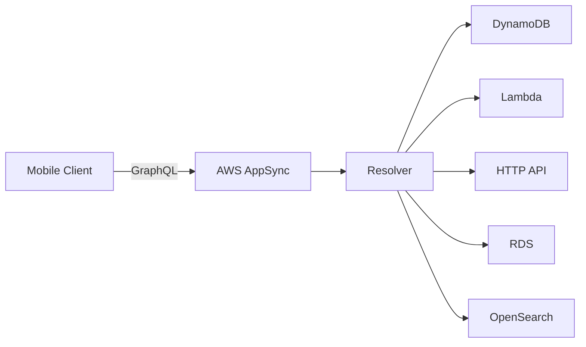
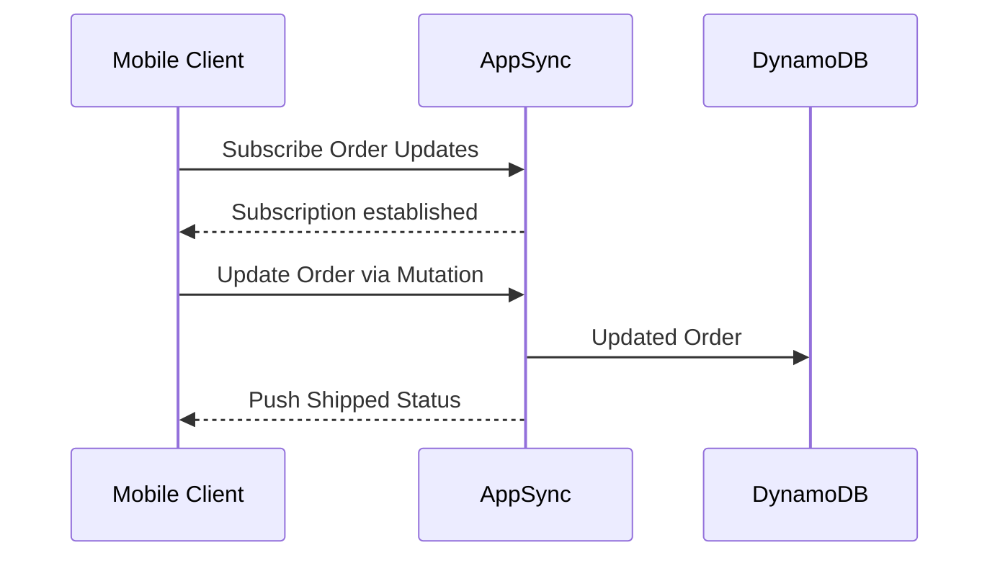
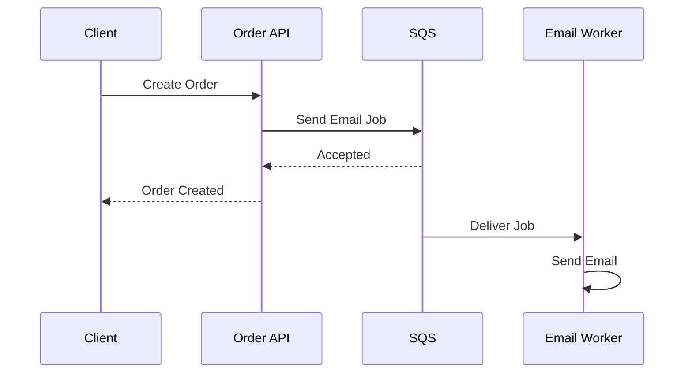
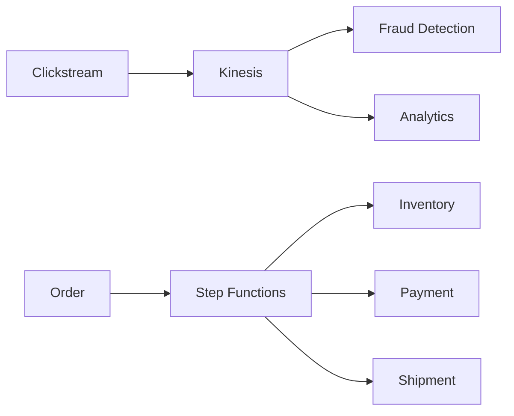
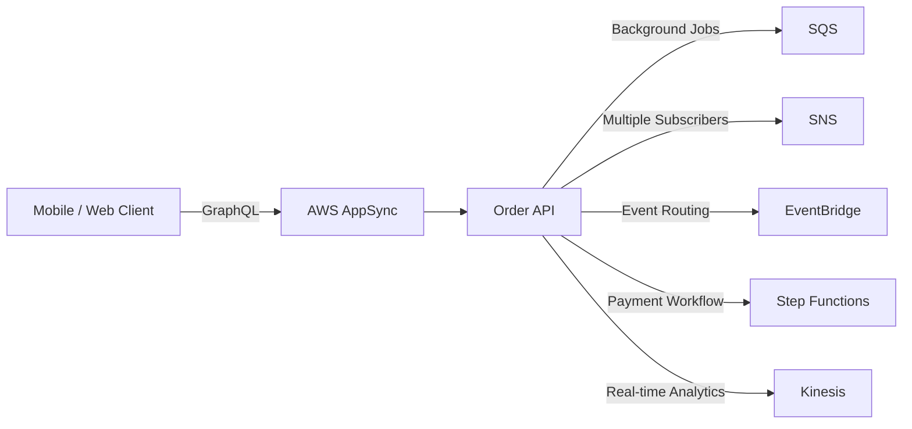

# **M08.5: AWS AppSync & Integration Patterns**

## **TL;DR**

- **AWS AppSync:** Managed GraphQL API, real-time updates và offline synchronization.
- **Synchronous:** Client cần kết quả ngay.
- **Asynchronous:** Xử lý công việc mà không bắt producer chờ consumer.
- **Streaming:** Xử lý dòng dữ liệu liên tục.
- **Workflow:** Điều phối nhiều bước nghiệp vụ phụ thuộc nhau.

## **1. AWS AppSync – Đồng bộ dữ liệu với client**

Tiếp tục hệ thống e-commerce. Mobile application cần hiển thị trạng thái đơn hàng, cập nhật khi giao hàng và hỗ trợ khách hàng khi mất kết nối Internet.

Với REST API truyền thống, client có thể phải polling liên tục để kiểm tra trạng thái mới.

visual-flow

`title: Traditional Polling
direction: horizontal
📱 | Mobile Client | Gửi request định kỳ.
🌐 | REST API | Truy vấn trạng thái.
🗄️ | Database | Trả về dữ liệu hiện tại.`

**Root cause:** Client phải chủ động kiểm tra dữ liệu dù trạng thái chưa thay đổi.

### **Giải pháp: AWS AppSync**

AppSync là managed GraphQL service, kết nối client với nhiều data sources và hỗ trợ cập nhật real-time.

visual-grid

`title: AppSync Capabilities
columns: 2
🔍 | Query | Đọc dữ liệu.
✏️ | Mutation | Thay đổi dữ liệu.
📡 | Subscription | Nhận cập nhật real-time.
📴 | Offline Sync | Đồng bộ khi kết nối trở lại.
🔀 | Conflict Resolution | Giải quyết xung đột dữ liệu.
🔗 | Resolver | Kết nối GraphQL với data sources.`

### **Real-time Subscription**

Khách hàng đang theo dõi đơn hàng. Khi trạng thái chuyển từ `Paid` sang `Shipped`, client nhận cập nhật mà không cần polling liên tục.

### **Offline Synchronization**

Khi mất Internet, ứng dụng có thể lưu thay đổi cục bộ và đồng bộ khi kết nối trở lại thông qua cơ chế offline sync phù hợp.

visual-flow

`title: Offline Synchronization
direction: horizontal
📴 | Offline | Lưu thay đổi cục bộ.
🌐 | Reconnect | Khôi phục kết nối.
🔄 | Synchronize | Đồng bộ dữ liệu.
🔀 | Resolve | Xử lý conflict nếu có.`

**Trade-off:** AppSync giảm công sức xây dựng GraphQL và real-time infrastructure, nhưng developer vẫn cần thiết kế schema, resolver, client synchronization và conflict resolution.

quiz-deck

`APP-001 | single_choice | Mobile application cần GraphQL API và real-time order updates. Chọn gì? | Amazon SQS | AWS AppSync | Amazon MQ | Firehose | 2 | AppSync hỗ trợ GraphQL và real-time subscriptions.
APP-002 | single_choice | Client muốn nhận trạng thái đơn hàng mới mà không polling liên tục. Dùng gì? | Query định kỳ | Delay Queue | Message Retention | GraphQL Subscription | 4 | Subscription cho phép client nhận cập nhật real-time.
APP-003 | single_choice | Hai client cập nhật cùng dữ liệu trong thời gian offline. Cơ chế nào cần thiết khi đồng bộ? | Conflict Resolution | Long Polling | DLQ | Message Filtering | 1 | Conflict Resolution giải quyết các thay đổi dữ liệu xung đột.`

## **2. Synchronous vs Asynchronous Integration**

AppSync giải quyết giao tiếp giữa client và backend. Tuy nhiên, không phải công việc nào phía backend cũng cần thực hiện ngay.

Ví dụ, khách hàng cần biết đăng nhập thành công hay không ngay lập tức, nhưng không cần chờ email xác nhận đơn hàng được gửi.

visual-compare

`title: Synchronous vs Asynchronous
[Synchronous]
icon: ⏱️
description: Client gửi request và chờ response.
send: Client → API → Service
receive: Service → API → Client
note: Client phụ thuộc vào thời gian xử lý.
useCase: Login, validation.
[Asynchronous]
icon: 📥
description: Producer gửi công việc và không chờ consumer hoàn thành.
send: Producer → Queue
receive: Consumer → Process Later
note: Giảm coupling và hỗ trợ buffering.
useCase: Email, background processing.`

**Trade-off:** Synchronous trả kết quả trực tiếp nhưng tạo runtime dependency. Asynchronous giảm coupling nhưng kết quả nghiệp vụ có thể đến muộn.

quiz-deck

`APP-004 | single_choice | Client cần kết quả xác thực ngay để quyết định đăng nhập. Chọn pattern nào? | Streaming | Asynchronous | Synchronous | Workflow | 3 | Client cần response trước khi tiếp tục.
APP-005 | single_choice | Order API không muốn chờ Email Service gửi email thành công. Chọn gì? | Asynchronous Messaging | Synchronous REST | Video Streaming | Polling | 1 | Messaging cho phép xử lý email độc lập.`

## **3. Streaming vs Workflow Orchestration**

E-commerce tiếp tục phát sinh hai yêu cầu:

- Phân tích clickstream liên tục.
- Điều phối quy trình thanh toán, giữ hàng và giao hàng.

Cả hai đều xử lý nhiều dữ liệu hoặc công việc, nhưng mục tiêu khác nhau.

visual-compare

`title: Streaming vs Workflow
[Streaming]
icon: 🌊
description: Xử lý dòng dữ liệu liên tục.
send: Events → Data Stream
receive: Multiple Consumers → Analytics
note: Hỗ trợ continuous processing và replay với Data Streams.
useCase: Clickstream, real-time analytics.
[Workflow]
icon: 🔀
description: Điều phối nhiều bước nghiệp vụ phụ thuộc nhau.
send: Order → State Machine
receive: Inventory → Payment → Shipment
note: Quản lý state, retry và branching.
useCase: Order lifecycle.`

**Trade-off:** Streaming cần quản lý dòng dữ liệu và consumer processing. Workflow cần định nghĩa trạng thái, transition và error handling.

quiz-deck

`APP-006 | single_choice | Nhiều analytics consumers cần đọc cùng clickstream liên tục. Chọn pattern nào? | Synchronous | Workflow | Work Queue | Streaming | 4 | Streaming hỗ trợ continuous ingestion và multiple consumers.
APP-007 | single_choice | Order processing cần kiểm tra tồn kho, thanh toán, retry và compensation. Chọn pattern nào? | Streaming | Workflow Orchestration | Synchronous đơn giản | Video Streaming | 2 | Workflow điều phối nhiều bước nghiệp vụ có trạng thái.`

## **4. Kết hợp Integration Patterns trong thực tế**

Một kiến trúc e-commerce có thể kết hợp nhiều integration patterns, mỗi pattern giải quyết một vấn đề riêng.

visual-decision

`title: Architecture Decision
Client cần GraphQL và real-time updates | AppSync | Quản lý client-data integration.
Client cần kết quả ngay | Synchronous API | Request-response.
Consumer có thể tạm ngừng | SQS | Buffer và retry.
Một event gửi đến nhiều services | SNS | Publish/Subscribe.
Event cần routing theo nội dung | EventBridge | Event rules.
Nhiều bước nghiệp vụ phụ thuộc | Step Functions | Workflow orchestration.
Dữ liệu liên tục cần analytics | Kinesis | Stream processing.
Legacy broker migration | Amazon MQ | Protocol compatibility.`

visual-callout

`tone: warning
title: Tránh Overengineering
Không sử dụng tất cả dịch vụ chỉ vì chúng có sẵn. Bắt đầu từ requirement, xác định vấn đề rồi chọn giải pháp đơn giản nhất đáp ứng yêu cầu.`

quiz-deck

`APP-008 | single_choice | Consumer có thể ngừng hoạt động trong một giờ nhưng producer vẫn cần gửi công việc. Chọn gì? | REST trực tiếp | SQS | GraphQL Query | CloudFront | 2 | SQS lưu công việc để consumer xử lý sau.
APP-009 | single_choice | Một ứng dụng nhỏ chỉ cần gửi email bất đồng bộ. Có cần triển khai cả Kinesis và Step Functions không? | Có để tăng throughput | Có để đảm bảo ordering | Không, SQS có thể đủ | Có để hỗ trợ replay | 3 | Chỉ thêm dịch vụ khi requirement thực sự yêu cầu.`

## **5. Mental Model tổng thể**

visual-grid

`title: AWS Integration Mental Model
columns: 2
📱 | AppSync | Client cần truy vấn và đồng bộ dữ liệu.
📥 | SQS | Công việc cần được lưu và xử lý sau.
📡 | SNS | Một message cần gửi đến nhiều subscribers.
🔀 | EventBridge | Event cần định tuyến theo nội dung.
⚙️ | Step Functions | Nhiều bước cần được điều phối.
🌊 | Kinesis | Dữ liệu cần xử lý liên tục và replay.
🔌 | Amazon MQ | Ứng dụng cần giữ broker protocol.
🚚 | Firehose | Streaming data cần chuyển đến destinations.`

## **6. Bảng tóm tắt**

| Pattern | Cơ chế | Use case |
| --- | --- | --- |
| Synchronous | Request-response | Login, validation |
| Asynchronous | Không chờ consumer | Background jobs |
| Streaming | Continuous data | Real-time analytics |
| Workflow | Stateful orchestration | Order lifecycle |

## **7. Quiz tổng hợp**

quiz-deck

`APP-010 | single_choice | Mobile client cần nhận trạng thái shipment ngay khi thay đổi. Chọn gì? | AppSync Subscription | SQS Long Polling | Firehose | Amazon MQ | 1 | Subscription hỗ trợ real-time client updates.
APP-011 | single_choice | OrderCreated cần gửi đến ba services có khả năng retry độc lập. Chọn gì? | Shared Queue | Synchronous API | Kinesis Video Streams | SNS kết hợp SQS | 4 | Fanout cung cấp queue độc lập cho mỗi consumer.
APP-012 | single_choice | AWS và SaaS events cần định tuyến đến targets dựa trên nội dung. Chọn gì? | Amazon MQ | EventBridge | AppSync | Firehose | 2 | EventBridge hỗ trợ content-based routing.
APP-013 | single_choice | Payment thất bại sau khi giữ hàng và cần thực hiện compensation. Chọn gì? | SNS | Kinesis | Step Functions | AppSync | 3 | Step Functions điều phối error handling và compensation.
APP-014 | single_choice | Analytics cần đọc lại transaction events sau khi sửa bug. Chọn gì? | Kinesis Data Streams | SQS Delay Queue | SNS Email | GraphQL Query | 1 | Data Streams hỗ trợ replay dữ liệu còn retention.`

## **8. Flashcard**

flipcard

`AWS AppSync | Managed GraphQL service | Mobile order tracking.
Query | Đọc dữ liệu GraphQL | Lấy thông tin đơn hàng.
Mutation | Thay đổi dữ liệu GraphQL | Cập nhật trạng thái đơn hàng.
Subscription | Nhận cập nhật real-time | Nhận trạng thái Shipped.
Resolver | Kết nối GraphQL operation với data source | Truy vấn DynamoDB.
Offline Sync | Đồng bộ dữ liệu khi kết nối trở lại | Mobile mất Internet.
Conflict Resolution | Giải quyết thay đổi dữ liệu xung đột | Hai client cập nhật cùng record.
Synchronous | Client chờ kết quả | Login.
Asynchronous | Producer không chờ consumer hoàn thành | Gửi email.
Streaming | Xử lý dòng dữ liệu liên tục | Clickstream analytics.
Workflow Orchestration | Điều phối nhiều bước nghiệp vụ | Inventory → Payment → Shipment.
Overengineering | Thêm độ phức tạp không cần thiết | Dùng nhiều dịch vụ cho một background job đơn giản.`