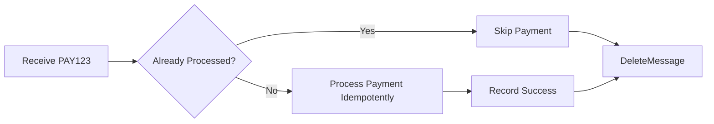
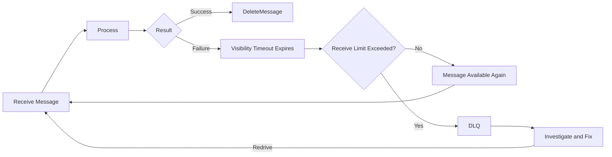
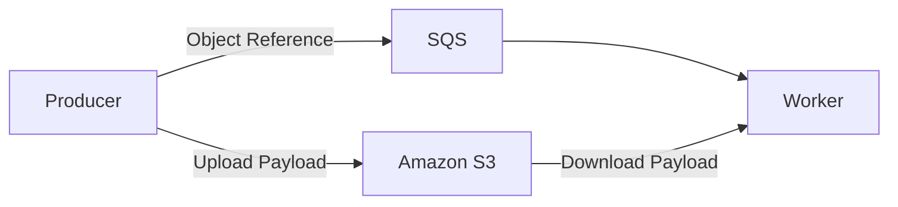
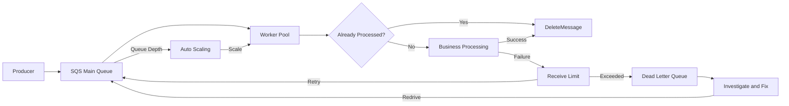

# **M08.6: Reliability, Scaling & Service Selection**

## **TL;DR**

- **Idempotency:** Ngăn xử lý trùng lặp gây sai nghiệp vụ.
- **Retry & DLQ:** Phục hồi lỗi tạm thời, cô lập message liên tục thất bại.
- **Visibility Timeout:** Hạn chế message xuất hiện lại khi worker đang xử lý.
- **Auto Scaling:** Tăng processing capacity theo backlog.
- **Service Selection:** Chọn dịch vụ theo vấn đề thực tế, tránh overengineering.

## **1. Idempotency – Bảo vệ tính đúng đắn của nghiệp vụ**

Tiếp tục hệ thống e-commerce. Payment Worker nhận message thanh toán `PAY123`, trừ tiền thành công nhưng crash trước khi gọi `DeleteMessage`.

visual-timeline

`title: Duplicate Payment
0s | Receive | Worker A nhận PAY123.
10s | Payment Success | Khách hàng bị trừ tiền.
15s | Worker Crash | Message chưa được xóa.
30s | Visibility Expired | Message xuất hiện lại.
35s | Worker B | Nhận PAY123 và có thể trừ tiền lần nữa.`

**Root cause:** Message delivery và business transaction không phải một thao tác nguyên tử.

### **Giải pháp: Idempotent Consumer**

Sử dụng business identifier như `payment_id` để nhận diện nghiệp vụ đã thực hiện.

visual-compare

`title: Non-idempotent vs Idempotent
[Non-idempotent]
icon: ❌
send: PAY123 → PAY123
receive: Charge → Charge Again
note: Khách hàng có thể bị trừ tiền hai lần.
[Idempotent]
icon: 🛡️
send: PAY123 → PAY123
receive: Charge → Skip
note: Cùng business ID không tạo thêm tác động nghiệp vụ.`

visual-callout

`tone: warning
title: Check rồi Process chưa đủ an toàn
Hai workers có thể đồng thời kiểm tra và cùng thấy payment chưa được xử lý. Cần cơ chế atomic deduplication hoặc idempotency key tại Payment Service.
FIFO không thay thế application-level idempotency.`

**Trade-off:** Idempotency cần quản lý thêm trạng thái nghiệp vụ, nhưng bảo vệ hệ thống trước duplicate processing.

quiz-deck

`REL-001 | single_choice | Worker thanh toán thành công nhưng crash trước DeleteMessage. Cách tránh charge hai lần? | Tăng workers | Dùng SNS | Tắt retry | Idempotency theo payment ID | 4 | Idempotency bảo vệ business side effects khi message được xử lý lại.
REL-002 | single_choice | Hai workers đồng thời kiểm tra cùng payment ID và đều thấy chưa xử lý. Cần gì? | Atomic deduplication | Long Polling | Delay Queue | Tăng retention | 1 | Kiểm tra và ghi nhận thông thường có thể gặp race condition.`

## **2. Retry, Visibility Timeout và DLQ**

Idempotency bảo vệ nghiệp vụ khi retry. Nhưng hệ thống vẫn cần phân biệt lỗi tạm thời với lỗi liên tục.

visual-grid

`title: Reliability Mechanisms
columns: 2
🔄 | Retry | Phục hồi lỗi tạm thời.
⏱️ | Visibility Timeout | Tạm ẩn message khi xử lý.
🗑️ | DeleteMessage | Xóa message sau khi thành công.
📦 | DLQ | Cô lập message liên tục thất bại.`

### **Visibility Timeout quá ngắn**

visual-simulation

`type: sqs-visibility-timeout
title: Processing Time vượt Visibility Timeout
visibilityTimeout: 30
processingTime: 90`

Worker cần 90 giây nhưng message xuất hiện lại sau 30 giây.

Giải pháp: Điều chỉnh timeout hoặc gia hạn bằng `ChangeMessageVisibility`.

**Trade-off:** Timeout quá ngắn gây duplicate processing; quá dài làm chậm retry khi worker crash.

quiz-deck

`REL-003 | single_choice | Worker xử lý thành công nhưng không gọi DeleteMessage. Điều gì xảy ra? | Message tự biến mất | Queue chuyển sang FIFO | Message có thể xuất hiện lại | Message lập tức vào DLQ | 3 | Message chưa được xóa có thể xuất hiện lại sau Visibility Timeout.
REL-004 | single_choice | Processing time thay đổi từ 30 giây đến vài phút. Chọn gì? | Giảm retention | Điều chỉnh và gia hạn Visibility Timeout | Tắt retry | Tăng queue depth | 2 | ChangeMessageVisibility giúp điều chỉnh thời gian ẩn message.
REL-005 | single_choice | Payload không hợp lệ khiến message liên tục thất bại. Chọn gì? | DLQ với redrive policy | Long Polling | Tăng workers | Tăng retention | 1 | DLQ cô lập poison message để điều tra và xử lý.`

## **3. Scaling theo Queue Depth**

Flash Sale tạo ra 1.000 messages/giây, nhưng worker pool chỉ xử lý được 600 messages/giây.

visual-metrics

`title: Flash Sale – Processing Capacity
columns: 3
📥 | Incoming Rate | 1000 msg/s | Producer.
⚙️ | Processing Rate | 600 msg/s | Consumer.
📈 | Backlog Growth | +400 msg/s | Queue tăng liên tục.`

**Root cause:** Incoming rate lớn hơn processing rate.

Queue chỉ buffer công việc, không tự tăng năng lực xử lý.

### **Giải pháp: Auto Scaling Consumers**

visual-flow

`title: Queue-based Auto Scaling
direction: vertical
📈 | Queue Depth tăng | Backlog tích lũy.
🔍 | Monitor | Phát hiện backlog.
⚙️ | Scale Out | Tăng số consumers.
⚡ | Capacity tăng | Xử lý nhiều messages hơn.
📉 | Queue Depth giảm | Giải phóng backlog.`

visual-simulation

`type: queue-buffer
title: Producer Rate vs Consumer Capacity`

visual-compare

`title: Trước và sau Scaling
[Before Scaling]
icon: 🔴
description: Producer gửi nhanh hơn consumer xử lý.
send: 1000 msg/s
receive: 600 msg/s
note: Backlog tăng 400 msg/s.
[After Scaling]
icon: 🟢
description: Consumer capacity vượt incoming rate.
send: 1000 msg/s
receive: 1200 msg/s
note: Backlog giảm 200 msg/s khi còn công việc.`

**Trade-off:** Tăng consumers làm tăng chi phí và có thể gây quá tải downstream services.

quiz-deck

`REL-006 | single_choice | Producer gửi 1000 msg/s nhưng consumer xử lý 600 msg/s. Backlog tăng bao nhiêu? | 600 msg/s | 1000 msg/s | 1600 msg/s | 400 msg/s | 4 | Backlog tăng bằng incoming rate trừ processing rate.
REL-007 | single_choice | Queue depth liên tục tăng trong giờ cao điểm. Giải pháp phù hợp? | Giảm retention | Auto Scaling consumers | Tăng Delay Queue | Tắt polling | 2 | Tăng processing capacity giúp giải phóng backlog.`

## **4. Service Selection – Chọn đúng công cụ**

Hệ thống đáng tin cậy không chỉ cần cấu hình đúng mà còn cần chọn đúng dịch vụ.

visual-decision

`title: AWS Integration Service Selection
Cần strict ordering | SQS FIFO | Ordering trong Message Group ID.
Cần background jobs | SQS | Buffer, retry và DLQ.
Cần broadcast và queue riêng | SNS + SQS | Consumer độc lập.
Cần content-based routing | EventBridge | Event rules.
Cần điều phối nhiều bước | Step Functions | Stateful workflow.
Cần giữ broker protocol | Amazon MQ | Legacy compatibility.
Cần xử lý stream tức thời | Kinesis Data Streams | Real-time processing.
Cần chuyển stream đến destination | Firehose | Managed delivery.
Cần GraphQL và real-time client updates | AppSync | Client-data integration.`

### **Payload quá lớn**

Khi payload vượt giới hạn SQS, lưu dữ liệu trong S3 và gửi object reference.

visual-callout

`tone: info
title: Lưu ý về giới hạn SQS
Tài liệu gốc sử dụng giới hạn cũ 256 KB. Giới hạn mới là 1 MiB. Pattern S3 + SQS vẫn phù hợp với payload vượt giới hạn.`

quiz-deck

`REL-008 | single_choice | Team dùng EventBridge để buffer hàng triệu background jobs. Dịch vụ nào phù hợp hơn? | AppSync | ACM | SQS | Route 53 | 3 | SQS được thiết kế cho work queue và buffering.
REL-009 | single_choice | Producer cần gửi payload 50 MB cho worker. Chọn gì? | S3 kết hợp SQS object reference | SNS Email | Tắt encryption | Tăng Visibility Timeout | 1 | S3 lưu payload lớn và SQS truyền reference.`

## **5. Common Pitfalls**

| Sai lầm | Giải pháp |
| --- | --- |
| Standard khi cần ordering | FIFO |
| Consumer không idempotent | Business ID deduplication |
| Visibility Timeout quá ngắn | Điều chỉnh hoặc gia hạn |
| Quên DeleteMessage | Xóa sau khi thành công |
| Không có DLQ | Redrive policy |
| SNS trực tiếp khi cần buffering | SNS + SQS |
| EventBridge làm work queue | SQS |
| Step Functions chỉ để truyền message | SQS / SNS |
| MQ khi không cần broker protocol | SQS / SNS / EventBridge |
| Firehose cho xử lý tức thời | Data Streams |

## **6. Mental Model tổng thể**

visual-checklist

`title: Production Readiness
[ ] Consumer có idempotency.
[ ] Visibility Timeout phù hợp processing time.
[ ] DeleteMessage sau khi xử lý thành công.
[ ] Có DLQ và redrive policy.
[ ] Theo dõi queue depth.
[ ] Consumer Auto Scaling phù hợp.
[ ] Chọn đúng integration service.
[ ] Payload lớn được lưu ngoài queue.`

## **7. Quiz tổng hợp**

quiz-deck

`REL-010 | single_choice | Hệ thống dùng FIFO nhưng worker crash sau khi thanh toán. Có cần idempotency không? | Không vì FIFO | Có vì nghiệp vụ vẫn có thể thực thi lại | Không nếu có DLQ | Không nếu bật encryption | 2 | FIFO không đảm bảo business side effects chỉ xảy ra một lần.
REL-011 | single_choice | Visibility Timeout quá dài và worker crash. Rủi ro chính là gì? | Mất ordering | Queue bị xóa | Mất encryption | Retry bị trì hoãn | 4 | Message phải chờ hết timeout mới xuất hiện lại.
REL-012 | single_choice | Inventory Service tạm ngừng nhưng Email Service phải tiếp tục nhận events. Chọn gì? | SNS fanout đến các SQS Queue riêng | Shared Queue | REST tuần tự | Một worker chung | 1 | Queue riêng cung cấp buffering và failure isolation.
REL-013 | single_choice | Fraud Detection cần xử lý transaction ngay khi phát sinh. Chọn gì? | Firehose | Amazon MQ | Kinesis Data Streams | SQS Delay Queue | 3 | Data Streams phù hợp real-time processing.
REL-014 | single_choice | Sau khi sửa bug gây poison messages, bước tiếp theo là gì? | Xóa main queue | Redrive từ DLQ | Tắt worker | Giảm retention | 2 | Redrive đưa message trở lại xử lý.`

## **8. Flashcard**

flipcard

`Idempotency | Xử lý lặp mà không tạo thêm business side effects | Không charge PAY123 hai lần.
Business ID | Định danh duy nhất của nghiệp vụ | Payment ID.
Atomic Deduplication | Ngăn nhiều workers đồng thời xử lý cùng nghiệp vụ | Unique payment record.
Visibility Timeout | Khoảng thời gian message tạm ẩn | Worker đang xử lý.
DeleteMessage | Xóa message sau khi xử lý thành công | Payment completed.
Retry | Thử lại công việc thất bại | Payment timeout.
DLQ | Cô lập message liên tục thất bại | Invalid payload.
Redrive | Đưa message trở lại xử lý | Retry sau khi sửa bug.
Queue Depth | Số message tồn đọng | Flash Sale backlog.
Processing Capacity | Số message xử lý được mỗi đơn vị thời gian | 1200 msg/s.
Auto Scaling | Điều chỉnh số consumers theo workload | Scale out khi backlog tăng.
Failure Isolation | Ngăn lỗi lan sang consumer khác | SNS + SQS Fanout.`