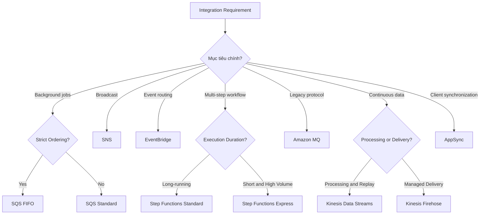
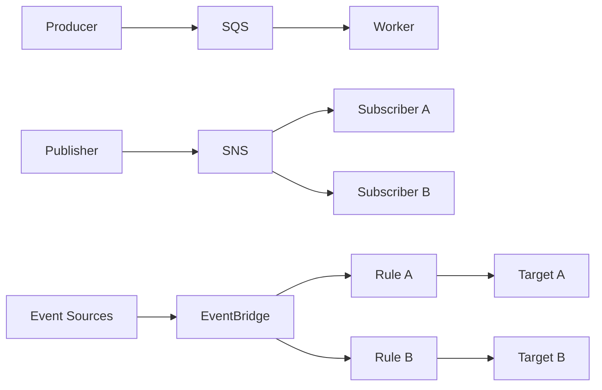
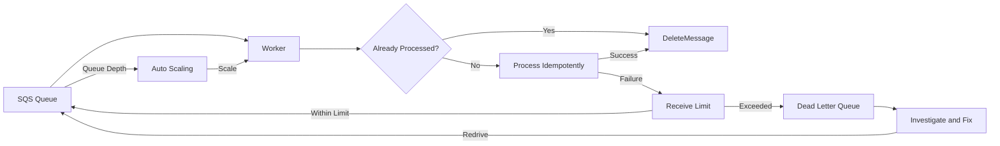

# **M08.7: So sánh, Pitfalls & Cheatsheet Integration**

## **TL;DR**

- **SQS:** Lưu và phân phối công việc.
- **SNS:** Broadcast message đến nhiều subscribers.
- **EventBridge:** Định tuyến event theo nội dung.
- **Step Functions:** Điều phối quy trình nghiệp vụ.
- **Kinesis:** Xử lý dữ liệu streaming.
- **Amazon MQ:** Tương thích legacy broker.
- **AppSync:** GraphQL và real-time client synchronization.

## **1. Architecture Decision – Chọn dịch vụ từ requirement**

Tiếp tục hệ thống e-commerce. Thay vì ghi nhớ từng dịch vụ riêng lẻ, hãy xác định vấn đề cần giải quyết trước khi chọn công nghệ.

visual-callout

`tone: tip
title: First Principles
Không bắt đầu bằng tên dịch vụ AWS.
Bắt đầu bằng requirement, constraint và failure scenario.
Chọn dịch vụ đơn giản nhất đáp ứng yêu cầu.`

## **2. Những dịch vụ dễ nhầm trong SAA-C03**

### **2.1 SQS vs SNS vs EventBridge**

visual-grid

`title: Messaging và Event Routing
columns: 3
📥 | SQS | Lưu công việc để worker xử lý.
📡 | SNS | Phân phối message đến nhiều subscribers.
🔀 | EventBridge | Định tuyến event theo rules.`

visual-decision

`title: Khi nào sử dụng?
Worker cần xử lý công việc sau | SQS | Buffer và retry.
Một message cần gửi nhiều nơi | SNS | Publish/Subscribe.
Mỗi subscriber cần queue riêng | SNS + SQS | Durable fanout.
Event cần routing theo nhiều field | EventBridge | Content-based rules.`

quiz-deck

`REV-001 | single_choice | Ba services cần nhận cùng OrderCreated và xử lý độc lập khi worker bị lỗi. Chọn gì? | Shared SQS Queue | SNS + SQS Fanout | REST đồng bộ | Step Functions | 2 | Fanout cung cấp queue riêng cho từng service.
REV-002 | single_choice | Events từ AWS và SaaS cần định tuyến theo nội dung. Chọn gì? | SQS FIFO | Amazon MQ | Firehose | EventBridge | 4 | EventBridge hỗ trợ nhiều nguồn event và content-based routing.`

### **2.2 SQS Standard vs FIFO**

visual-compare

`title: Throughput vs Ordering
[Standard]
icon: ⚡
description: Ưu tiên throughput.
send: A → B → C
receive: A → C → B → B
note: Best-effort ordering, at-least-once delivery.
useCase: Email, image processing.
[FIFO]
icon: 🔢
description: Ưu tiên ordering và deduplication.
send: A → B → C
receive: A → B → C
note: Ordering trong cùng Message Group ID.
useCase: Transaction updates, order lifecycle.`

visual-callout

`tone: pitfall
title: FIFO không thay thế Idempotency
Worker vẫn có thể thực thi lại nghiệp vụ khi crash hoặc timeout. Consumer phải bảo vệ business side effects.`

quiz-deck

`REV-003 | single_choice | Các updates của cùng transaction phải được xử lý đúng thứ tự. Chọn gì? | FIFO với transaction ID làm Message Group ID | Standard | Firehose | SNS Standard | 1 | FIFO giữ ordering trong cùng message group.
REV-004 | single_choice | FIFO consumer crash sau khi thanh toán nhưng trước DeleteMessage. Cần cơ chế nào? | Long Polling | Delay Queue | Idempotency | Encryption | 3 | Idempotency ngăn thanh toán trùng khi xử lý lại.`

### **2.3 Step Functions vs Messaging**

visual-compare

`title: Messaging vs Orchestration
[Messaging]
icon: 📥
description: Truyền công việc hoặc event giữa services.
send: Producer → Queue
receive: Worker → Process
useCase: Background jobs.
[Orchestration]
icon: ⚙️
description: Điều phối thứ tự và trạng thái của nhiều bước.
send: Order → State Machine
receive: Inventory → Payment → Shipment
useCase: Multi-step business workflow.`

visual-metrics

`title: Step Functions Workflow Types
columns: 2
📋 | Standard | 1 năm | Long-running workflow.
⚡ | Express | 5 phút | Short, high-volume workflow.`

quiz-deck

`REV-005 | single_choice | Payment thất bại sau khi reserve stock và cần compensation. Chọn gì? | SNS | Step Functions | Firehose | SQS Delay Queue | 2 | Step Functions điều phối retry, branching và compensation.
REV-006 | single_choice | Hàng triệu IoT workflows hoàn thành trong vài giây. Chọn gì? | Amazon MQ | Standard bắt buộc | SQS FIFO | Express Workflow | 4 | Express phù hợp short high-volume workflows.`

### **2.4 SQS vs Data Streams vs Firehose**

visual-grid

`title: Queue, Stream và Delivery
columns: 3
📥 | SQS | Process rồi delete message.
🌊 | Data Streams | Nhiều consumers đọc và replay.
🚚 | Firehose | Buffer và chuyển dữ liệu đến destination.`

visual-compare

`title: Data Streams vs Firehose
[Data Streams]
icon: 🌊
description: Real-time stream processing.
note: Multiple consumers, retention, replay.
useCase: Fraud Detection.
[Firehose]
icon: 🚚
description: Managed streaming data delivery.
note: Automatic scaling, buffering, transformation.
useCase: Application logs đến S3.`

quiz-deck

`REV-007 | single_choice | Fraud Detection cần nhiều consumers và replay transaction events. Chọn gì? | Data Streams | Firehose | SQS | Amazon MQ | 1 | Data Streams hỗ trợ real-time processing và replay.
REV-008 | single_choice | Cần tự động buffer, transform và chuyển logs đến S3. Chọn gì? | SQS FIFO | Step Functions | Firehose | Amazon MQ | 3 | Firehose cung cấp managed data delivery.`

## **3. Reliability & Troubleshooting Cheatsheet**

visual-grid

`title: Bốn nguyên tắc Reliability
columns: 2
🛡️ | Idempotency | Ngăn duplicate business effects.
⏱️ | Visibility Timeout | Tạm ẩn message đang xử lý.
📦 | DLQ | Cô lập poison messages.
📈 | Auto Scaling | Tăng processing capacity theo backlog.`

| Triệu chứng | Root cause | Giải pháp |
| --- | --- | --- |
| Thanh toán hai lần | Duplicate processing | Idempotency |
| Message xuất hiện quá sớm | Timeout ngắn | Tăng hoặc gia hạn timeout |
| Message thành công vẫn xuất hiện | Quên DeleteMessage | Delete sau thành công |
| Retry liên tục | Poison message | DLQ |
| Backlog tăng | Consumer capacity thấp | Auto Scaling |
| Message sai thứ tự | Standard Queue | FIFO |
| Payload quá lớn | Message size limit | S3 + SQS reference |

## **4. Architecture Cheatsheet**

visual-grid

`title: AWS Application Integration
columns: 2
📥 | SQS Standard | High-throughput work queue.
🔢 | SQS FIFO | Ordered work queue.
📡 | SNS | One-to-many messaging.
🔗 | SNS + SQS | Durable fanout.
🔀 | EventBridge | Content-based routing.
📅 | EventBridge Scheduler | Scheduled invocation.
📋 | Step Functions Standard | Long-running workflow.
⚡ | Step Functions Express | Short, high-volume workflow.
🔌 | Amazon MQ | RabbitMQ và ActiveMQ compatibility.
🌊 | Kinesis Data Streams | Real-time processing và replay.
🚚 | Amazon Data Firehose | Managed data delivery.
📊 | Apache Flink | Streaming analytics.
🎥 | Kinesis Video Streams | Video ingestion.
📱 | AppSync | GraphQL, real-time và offline sync.`

## **5. Bảng so sánh trước kỳ thi**

| Dịch vụ | Chọn khi | Không tối ưu khi |
| --- | --- | --- |
| SQS Standard | Throughput cao | Strict ordering |
| SQS FIFO | Ordered processing | Không cần ordering |
| SNS | Broadcast | Cần worker queue riêng |
| EventBridge | Event routing | Simple work queue |
| Step Functions | Multi-step workflow | Chỉ truyền message |
| Amazon MQ | Legacy migration | Không cần broker protocol |
| Data Streams | Streaming, replay | Simple background job |
| Firehose | Managed delivery | Xử lý tức thời từng record |
| AppSync | GraphQL, real-time | Chỉ cần message queue |

## **6. AWS SAA-C03 – Scenario-Based Exam Practice**

12 câu · Architecture · Troubleshooting · Reliability · Performance · Trade-offs

quiz-deck

`INT-EX01 | single_choice | Order API gọi đồng bộ Email và Inventory khiến checkout chậm. Cần giảm coupling và giữ retry. Chọn gì? | Tăng timeout | Gom services vào EC2 | SNS fanout đến SQS queues riêng | Route 53 Failover | 3 | SNS + SQS giúp consumers xử lý độc lập và retry mà không làm checkout chờ.
INT-EX02 | single_choice | Các updates của cùng transaction cần strict ordering và deduplication. Chọn gì? | SQS FIFO với Message Group ID theo transaction | SQS Standard | SNS Standard | Firehose | 1 | FIFO giữ thứ tự trong cùng message group và hỗ trợ deduplication.
INT-EX03 | single_choice | Lambda consumer xử lý mất hai phút nhưng Visibility Timeout chỉ 30 giây. Message bị xử lý trùng. Chọn gì? | Tắt DLQ | Tắt concurrency | Route 53 | Tăng hoặc gia hạn timeout và bảo đảm idempotency | 4 | Timeout ngắn gây premature redelivery. Idempotency bảo vệ nghiệp vụ.
INT-EX04 | single_choice | Billing, Inventory và Analytics cần nhận cùng event với tốc độ xử lý khác nhau và queue riêng. Chọn gì? | Shared SQS Queue | SNS Topic với SQS riêng cho từng service | SNS Email | REST đồng bộ | 2 | Fanout cung cấp buffering và failure isolation.
INT-EX05 | single_choice | Cần định tuyến AWS, SaaS và custom events theo nội dung đến Lambda hoặc Step Functions. Chọn gì? | EventBridge | Amazon MQ | SQS Long Polling | Video Streams | 1 | EventBridge hỗ trợ event buses và content-based rules.
INT-EX06 | single_choice | Order workflow gồm reserve stock, payment và shipment. Payment lỗi cần retry rồi compensation. Chọn gì? | SNS Standard | SQS Delay Queue | Step Functions Standard | Firehose | 3 | Step Functions điều phối workflow và error handling.
INT-EX07 | single_choice | IoT platform chạy hàng triệu workflows ngắn trong vài giây. Chọn gì? | Standard | Amazon MQ | SQS FIFO | Step Functions Express | 4 | Express phù hợp short high-volume executions.
INT-EX08 | single_choice | Doanh nghiệp muốn migrate RabbitMQ với thay đổi application code ít nhất. Chọn gì? | EventBridge | Amazon MQ | SQS | SNS | 2 | Amazon MQ hỗ trợ RabbitMQ compatibility.
INT-EX09 | single_choice | Fraud Detection cần ingest transactions real-time, nhiều consumers và replay. Chọn gì? | Kinesis Data Streams | SQS | Firehose | AWS Batch | 1 | Data Streams hỗ trợ continuous processing và replay.
INT-EX10 | single_choice | Công ty cần chuyển logs liên tục đến S3 với managed scaling, buffering và Lambda transformation. Chọn gì? | SQS FIFO | Step Functions | Amazon Data Firehose | Amazon MQ | 3 | Firehose cung cấp managed streaming data delivery.
INT-EX11 | single_choice | Mobile application cần GraphQL, real-time subscriptions và offline synchronization. Chọn gì? | SNS | SQS | Step Functions | AppSync | 4 | AppSync hỗ trợ GraphQL và client synchronization.
INT-EX12 | single_choice | Background processing có nhiều poison messages. Cần cô lập, điều tra và xử lý lại sau khi sửa bug. Chọn gì? | Tắt retry | DLQ với redrive policy | Timeout 12 giờ cho mọi message | Route 53 | 2 | DLQ cô lập message lỗi và hỗ trợ redrive.`

## **7. Flashcard tổng hợp**

flipcard

`SQS Standard | High-throughput work queue | Email processing.
SQS FIFO | Ordering trong cùng Message Group ID | Transaction updates.
Visibility Timeout | Tạm ẩn message đang xử lý | Worker processing.
Idempotency | Ngăn duplicate business effects | Không charge hai lần.
DLQ | Cô lập message liên tục thất bại | Invalid payload.
SNS | One-to-many messaging | OrderCreated broadcast.
Fanout | SNS kết hợp nhiều SQS Queue | Consumer độc lập.
EventBridge | Content-based event routing | EC2 terminated event.
Step Functions Standard | Long-running orchestration | Approval workflow.
Step Functions Express | Short high-volume orchestration | IoT processing.
Amazon MQ | Legacy broker compatibility | RabbitMQ migration.
Data Streams | Real-time processing và replay | Fraud Detection.
Firehose | Managed streaming delivery | Logs đến S3.
Apache Flink | Streaming analytics | Transaction analysis.
Video Streams | Video ingestion | Warehouse cameras.
AppSync | GraphQL và real-time synchronization | Mobile order tracking.`

## **8. Tự kiểm tra cuối module**

visual-checklist

`title: M08 – Learning Outcomes
[ ] Phân biệt synchronous và asynchronous architecture.
[ ] Chọn đúng SQS Standard hoặc FIFO.
[ ] Xử lý duplicate messages, retry và DLQ.
[ ] Thiết kế SNS + SQS Fanout.
[ ] Định tuyến events bằng EventBridge.
[ ] Điều phối workflow bằng Step Functions.
[ ] Phân biệt Data Streams và Firehose.
[ ] Chọn Amazon MQ hoặc AppSync đúng requirement.
[ ] Phân tích reliability, performance và cost trade-offs.
[ ] Tránh overengineering.`

**Mental Model cuối cùng:** Requirement → Root Cause → Integration Pattern → AWS Service → Failure Handling → Trade-off.